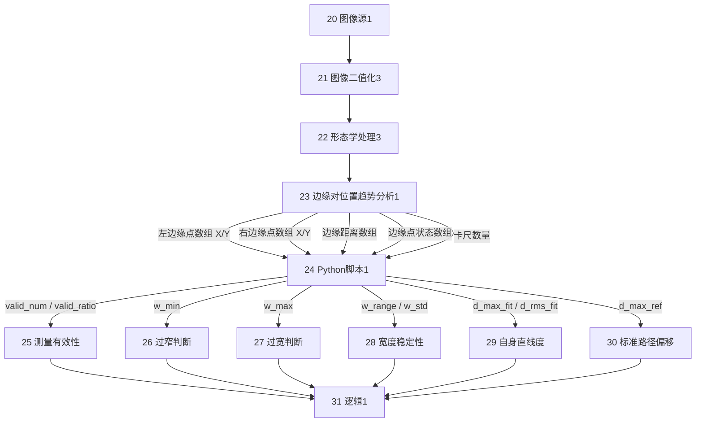

# VisionMaster 4.4 涂胶检测全流程配置手册

> **2026-11-21 范围更新**：当前合成训练集使用
> `visiontrain-glue-binary-v5`，只训练 `background/glue`。本文中涉及
> `defect` 分割模型的旧配置仅作为历史方案；当前模型输出胶条区域，断胶、
> 气泡、拉丝等缺陷需要在后续规则或独立模型中判断。

> 软件：VisionMaster 4.4.0
>
> 深度学习：VisionTrain 2.3.0
>
> 加密狗：`iMVS-VM-7200`（支持深度学习）
>
> 更新日期：2026-11-21
>
> 适用阶段：无相机条件下的本地图像/合成图像流程联调
>
> 关联文档：[VisionTrain 训练与部署 SOP](visiontrain-training-sop.md)、[单相机标定计划](calibration-plan.md)

本文的参数名、模块名和下拉选项统一采用 VisionMaster 4.4.0 简体中文界面文字。

`InImage`、`OutImage`、`BlobNum` 等是模块之间连接时显示的内部端口名或结果字段名，不是参数选项；文中会同时给出中文含义。

> 如果目标是判断“整条胶条走得直不直、全程有没有局部宽窄变化”，直接以
> [第 21 节](#21-推荐增强流程沿胶条方向逐截面测宽与直线度)为主。
> 第 3～20 节是已经联调通过的单截面基础流程：一个位置测一次宽度、
> 一个点检查一次偏移，不能代表整条胶条的全程最坏情况。

---

## 0. 本文解决什么问题

本文从创建方案开始，说明如何配置一条完整的 VisionMaster 涂胶检测流程：

```text
胶路缺陷分割
胶条连续性/断胶检测
胶宽检测
胶条直线度/偏移检查
结果条件判断
```

模块分工必须分清：

| 能力 | 使用模块 | 输出 |
|---|---|---|
| 缺陷像素分割 | `DL图像分割` | 缺陷区域 |
| 缺陷连通域计数 | `Blob标签分析` | 缺陷数量 |
| 胶条是否断开 | `Blob分析` | 胶条连通域数量（`BlobNum`） |
| 胶宽 | `间距检测` | 一组边缘之间的距离（`CaliperEdgePairWidth`） |
| 全程多截面胶宽 | `边缘对位置趋势分析` | 每段左右边缘点、每段宽度、最小/最大/平均宽度 |
| 胶条中心点趋势 | `边缘对位置趋势分析` | 每段边缘中点或由左右边缘点计算的中点 |
| 相对标准轨迹的偏移 | `边缘对模型缺陷检测` | 位置偏移、宽度、断裂等缺陷 |
| 胶边位置 | `直线查找` | 直线和边缘点 |
| 胶条中线 | `中线查找` | 两条边的中线 |
| 胶边拟合/残差 | `直线拟合` | 拟合线、拟合误差（`LineFitScore`）、拟合距离（`FitDist`） |
| 单点偏移 | `点线测量` | 点到线的垂直距离（`P2LDistPerpend`） |
| 合格/不合格（OK/NG） | `条件检测` | 条件结果和模块状态 |

### 0.1 当前阶段的边界

- 没有相机时，可以用本地图片目录完成流程联调。
- 合成数据只能用于冒烟、联调和预训练，不能作为真实验收指标。
- `间距检测`当前输出主要是像素宽度，不能直接当毫米宽度。
- 第 3～20 节的“点线测量”只检查一个点，不等同于整条胶条的全程最大直线度。
- 第 21 节使用“一个长 ROI + 多个卡尺截面”，可以得到整段胶条的逐截面宽度和中心点统计。
- 如果实际路径本来就应当是曲线，不能拿整条中心点去拟合一条直线；应使用标准轨迹模型或分段直线。
- 正式毫米量测必须完成相机固定、棋盘格标定和已知宽度试件验证。

### 0.2 中文界面参数对照

下面只列本文会操作的参数。界面里用中文名称查找；括号内是内部字段名或结果名，只用于连接端口和核对结果。

| 模块 | 中文界面参数 | 本文使用的下拉值或数值 |
|---|---|---|
| 图像二值化 | 二值化类型 | 自动（原理为最大类间方差法/Otsu）；全白时改用硬阈值二值化 |
| 图像二值化 | 低阈值、高阈值 | 硬阈值二值化时使用；亮目标与暗目标的设置不同 |
| 图像二值化 | ROI外处理 | 黑色 |
| 形态学处理 | 形态学类型 | 关操作；需要去除小噪点时改为开操作 |
| 形态学处理 | 形状 | 椭圆 |
| 形态学处理 | 模板宽度、模板高度 | 3、3 |
| 形态学处理 | 迭代次数 | 1 |
| Blob分析 | 阈值方式 | 已是二值图，不需要二值化 |
| Blob分析 | 连通类型 | 8连通 |
| Blob分析 | blob最大个数 | 100 |
| Blob分析 | 根据面积查找使能 | 开启 |
| Blob分析 | 面积下限、面积上限 | 200、999999999 |
| Blob分析 | 孔洞最小面积 | 0 |
| Blob分析 | 排序特征、排序方式 | 面积、降序 |
| 直线查找 | 边缘类型 | 最大值 |
| 直线查找 | 边缘极性 | 两种类型；确认方向后改为由黑到白或由白到黑 |
| 直线查找 | 边缘阈值、滤波核半宽 | 15、2 |
| 直线查找 | 卡尺数量 | 20 |
| 直线查找 | 剔除点数、剔除距离、投影宽度 | 0、5、5 |
| 直线查找 | 初始拟合类型、拟合方式 | 局部最优、Huber函数 |
| 直线拟合 | 直线拟合初始化类型 | 穷举局部最小二乘，取最佳 |
| 直线拟合 | 直线拟合拟合函数 | Huber函数 |
| 直线拟合 | 直线拟合最大迭代次数 | 20 |
| 间距检测 | 边缘0极性、边缘1极性 | 先选两种类型 |
| 间距检测 | 边缘类型 | 查找最强边缘对 |
| 间距检测 | 最大结果数 | 1 |
| 间距检测 | 输出排序类型 | 分数降序 |
| 间距检测 | 边缘查找方向 | 从左到右，或从上到下 |
| 点线测量 | 结果字段 | 垂直距离（`P2LDistPerpend`） |
| Blob分析 | 结果字段 | Blob个数（`BlobNum`） |
| 间距检测 | 结果字段 | 测量宽度（`CaliperEdgePairWidth`）、边缘对个数（`EdgePairNum`） |
| 直线拟合 | 结果字段 | 拟合误差（`LineFitScore`）、拟合距离（`FitDist`） |

“Huber函数”“Tukey函数”中的英文是人名，VisionMaster 中文界面本身就是这样显示。

“面积下限、面积上限、模板宽度、模板高度、滤波核半宽”等可能位于高级或专家参数中；当前页没看到时，展开高级参数后再找。

---

## 1. 推荐流程与模块编号

以下编号对应当前测试方案；模块重新编号后，以模块名称和连接关系为准。

| 编号 | 模块 | 用途 |
|---:|---|---|
| 0 | 图像源 | 读取本地胶条图像 |
| 1 | DL图像分割 | 输出缺陷概率图和类别数据 |
| 2 | Blob标签分析 | 统计缺陷类别连通域 |
| 3 | 形态学处理1 | 修正缺陷分割结果 |
| 4 | 条件检测1 | 判断是否存在缺陷 |
| 5 | 点线测量 | 计算一个点到中线的距离 |
| 6 | Blob分析1 | 判断胶条是否连续 |
| 7 | 直线查找1 | 查找胶条第一条边 |
| 8 | 直线查找2 | 查找胶条第二条边 |
| 9 | 中线查找 | 根据两条边生成胶条中线 |
| 10 | 直线拟合 | 根据边缘点拟合直线 |
| 11 | 间距检测2 | 测量胶条横向宽度 |
| 12 | 图像二值化1 | 分割出胶条区域 |
| 13 | 形态学处理2 | 清理胶条二值图 |
| 14 | 条件检测2 | 判断胶宽是否在允许范围 |
| 15 | 条件检测3 | 判断单点直线偏移是否合格 |
| 16 | 条件检测4（新增） | 判断胶条连通域数量是否为 1 |

推荐连接关系：

```mermaid
flowchart TD
    M0[0 图像源]

    M0 --> M1[1 DL图像分割]
    M1 -->|ScoreImage| M3[3 形态学处理1]
    M3 -->|OutImage| M2[2 Blob标签分析]
    M1 -->|ClassName / GrayValue| M2
    M2 -->|BlobNum| M4[4 条件检测1]

    M0 --> M12[12 图像二值化]

    M12 --> M6[6 Blob分析1]
    M6 -->|BlobNum| M16[16 条件检测4]

    M12 --> M13[13 形态学处理2]
    M13 --> M7[7 直线查找1]
    M13 --> M8[8 直线查找2]
    M13 --> M11[11 间距检测2]
    M13 --> M5[5 点线测量]

    M7 -->|Line 1| M9[9 中线查找]
    M8 -->|Line 2| M9
    M7 -->|EdgePoint| M10[10 直线拟合]

    M9 -->|中线| M5
    M10 -->|拟合线起点| M5

    M11 -->|CaliperEdgePairWidth[0]| M14[14 条件检测2]
    M5 -->|P2LDistPerpend| M15[15 条件检测3]
```

最终判断时，需要同时考虑：

```text
缺陷条件检测
胶条连续性条件检测
胶宽条件检测
直线度/偏移条件检测
```

---

## 2. 开始前准备

### 2.1 确认软件和加密狗

- [ ] `iMVS-VM-7200` 已插入并授权正常。
- [ ] VisionMaster 4.4.0 能正常打开。
- [ ] VisionTrain 2.3.0 能正常打开。
- [ ] VisionMaster 中有 `DL图像分割` 模块。
- [ ] 已导出并保存可用的 VM 4.4 深度学习模型。

### 2.2 准备图像目录

没有相机时，先使用本地图片：

```text
D:\WORK\glue-inspection-sensor\outputs\synthetic\visiontrain-glue-v1\images
```

要求：

- 图片格式使用 PNG 或 BMP。
- 图像分辨率保持一致。
- 图像中胶条方向、工作距离和背景条件尽量一致。
- 先选 5～10 张代表性图片调通，再批量运行 60 张。

### 2.3 备份当前方案

在 VisionMaster 中执行：

```text
文件 → 另存为
```

建议方案名：

```text
glue_v3_manual
```

VisionMaster 方案名不要超过 16 个字符。

---

## 3. 模块 0：图像源

### 3.1 配置图像源

1. 选中 `图像源1`。
2. 图像来源选择“本地图像”或“本地文件夹”。
3. 选择图像目录：

   ```text
   D:\WORK\glue-inspection-sensor\outputs\synthetic\visiontrain-glue-v1\images
   ```

4. 关闭图像缩放、裁剪和自动格式转换。
5. 确认图像列表能显示图片名称。
6. 运行一次 `图像源1`。

### 3.2 必须确认

- 图像预览正常。
- 图像不是黑图。
- 图像宽度和高度不为 0。
- `图像源1`模块状态为正常。

### 3.3 输出连接

```text
图像源1.Image → DL图像分割C1.InImage
图像源1.Image → 图像二值化1.InImage
```

图像尺寸和像素格式一般会自动建立：

```text
图像宽度 → 输入图像宽度（InImageWidth）
图像高度 → 输入图像高度（InImageHeight）
像素格式 → 输入图像像素格式（InImagePixelFormat）
```

如果目标模块提示“获取输入图像失败”，先检查这三组连接是否完整。

---

## 4. 模块 1～4：胶路缺陷分支

这一分支负责识别气泡、污染、胶丝等缺陷，不负责毫米级胶宽量测。

### 4.1 模块 1：DL图像分割

连接：

```text
图像源1.Image → DL图像分割C1.InImage
```

配置：

1. 选择已训练并导出的 VM 4.4 分割模型。
2. 确认模型类别与训练时一致。
3. 第一轮建议使用训练时的两个类别名：

   ```text
   background（背景）
   defect（缺陷）
   ```

   这两个是模型类别标签，应保持与 VisionTrain 训练时完全一致，不要为了界面中文化而改名。

4. 确认执行设备、CPU/GPU 和模型输入尺寸没有错误。
5. 运行模块，检查缺陷评分图（`ScoreImage`）是否能看到缺陷响应区域。

输出说明：

- 缺陷评分图（`ScoreImage`）：可用于显示和传统后处理的图像。
- 类别图（`ClassName`）：类别数据，不是普通图像。
- 类别灰度数据（`GrayValue`）：类别对应的灰度值数据。

不要把类别图（`ClassName`）连接到形态学处理或普通图像输入。

### 4.2 模块 3：缺陷形态学处理

连接：

```text
DL图像分割C1.ScoreImage → 形态学处理1.InImage
```

联调初值：

| 参数 | 建议值 |
|---|---|
| 形态学类型 | 关操作（即闭运算） |
| 形状 | 椭圆 |
| 模板宽度 | 3 |
| 模板高度 | 3 |
| 迭代次数 | 1 |

作用：

- 连接缺陷区域中的小断裂。
- 保持缺陷的大致尺寸。
- 不用于把胶条两侧连起来。

如果“关操作”把细小缺陷吞掉，改用“开操作”或关闭模块 3。

### 4.3 模块 2：Blob标签分析

连接：

```text
形态学处理1.OutImage → Blob标签分析1.InImage
DL图像分割C1.ClassName → Blob标签分析1.ClassName
DL图像分割C1.GrayValue → Blob标签分析1.GrayValue
```

配置：

1. 打开 Blob 标签分析参数。
2. 目标类别选择缺陷（`defect`）。
3. 不选择背景（`background`）。
4. 设置最小面积，用于过滤零散噪声。
5. 第一轮可设置 `50～100 px²`，再根据误检情况调整。
6. 运行后检查 Blob个数（`BlobNum`）。

`Blob标签分析`与普通 `Blob分析`的区别：

- Blob标签分析读取 DL 类别信息，专门统计某个类别的缺陷连通域。
- Blob分析读取普通二值图，统计图中所有满足面积条件的白块。

### 4.4 模块 4：缺陷条件检测1

连接：

```text
Blob标签分析1.BlobNum → 条件检测1.%int0%
```

初始规则：

```text
有效范围：0 到 0
```

解释：

- Blob个数（`BlobNum`）等于 `0`：没有检测到缺陷（`defect`）连通域。
- Blob个数（`BlobNum`）大于 `0`：存在缺陷连通域，触发不合格或转入复判。

最终合格/不合格方向必须结合实际界面确认。不要只看“有数值”，要看条件模块的最终状态。

---

## 5. 模块 12：胶条图像二值化

### 5.1 连接

```text
图像源1.Image → 图像二值化1.InImage
```

### 5.2 ROI

1. 选中 `图像二值化1`。
2. ROI 形状选择矩形。
3. 画一个覆盖胶条全部有效区域的矩形。
4. 双击或确认 ROI。
5. 不要让 ROI 宽度或高度为 0。

无相机、使用 1440×1080 合成图时，可以先用整幅图：

```text
左上角：0, 0
右下角：1440, 1080
```

### 5.3 参数

VisionMaster 4.4.0 的 `图像二值化` 模块中，下拉名称是 `自动`，其原理是
最大类间方差法（Otsu，也常称大津法）。它不需要人工填写阈值，但会针对每张
输入图重新计算一个阈值。

首次联调可以先试：

| 参数 | 建议值 |
|---|---|
| 二值化类型 | 自动 |
| ROI外处理 | 黑色 |

合成数据背景通常较暗、胶条较亮，因此使用 `自动`（Otsu）后应得到：

```text
胶条：白色
背景：黑色
```

如果出现整幅图全白，不要继续盲目调 `自动`，改用 `硬阈值二值化`。先观察
原始图的胶条和背景灰度，再把阈值放在两类灰度之间：

| 目标与背景关系 | 低阈值 | 高阈值 | 结果 |
|---|---:|---:|---|
| 胶条比背景亮 | 胶条与背景灰度之间的值 | 255 | 该灰度区间内的胶条变白 |
| 胶条比背景暗 | 0 | 胶条与背景灰度之间的值 | 该灰度区间内的胶条变白 |

`硬阈值二值化`的规则是：

```text
低阈值 < 高阈值：灰度值在两者范围内的像素变白
低阈值 > 高阈值：灰度值在两者范围外的像素变白
```

当前胶条检测应保持 `低阈值 < 高阈值`，不要用调换高低阈值的办法充当极性开关。

### 5.4 检查

运行后必须满足：

- 胶条主体为白色。
- 背景基本为黑色。
- 不应整幅图全白。
- 不应整幅图全黑。
- 不应把大面积工件背景认定为胶条。

后续 Blob、直线查找和间距检测都依赖这一步。

### 5.5 整幅图全白怎么排查

按下面顺序检查，通常在第 1～4 步就能找到原因：

1. **先看二值化模块的输入图。**

   打开 `图像二值化1.InImage` 的输入预览。如果输入本来就是大面积纯白，
   问题在上游图像源、图像本身或错误连接的图像，不在二值化阈值。

2. **确认 `ROI外处理` 设置为黑色。**

   如果选择“原图”，ROI 外仍会显示原始亮度，容易看起来像整幅图全白。
   把 ROI 缩小到只包住胶条和少量背景，并选择“黑色”，再看真实二值结果。

3. **不要让 `自动` 同时处理大片高亮背景。**

   `自动`会把每张图中较亮的一类设为白色。胶条暗、工件或背景亮时，它可能
   把整块亮背景变白；即使胶条亮，背景占比和反光变化也会使阈值在不同图片
   之间跳动，表现为“有时正常、有时全白”。

4. **改用固定阈值，并正确设置目标极性。**

   设胶条灰度约为 `G`，背景灰度约为 `B`：

   ```text
   胶条比背景亮：
   低阈值 = G 与 B 之间的值
   高阈值 = 255

   胶条比背景暗：
   低阈值 = 0
   高阈值 = G 与 B 之间的值
   ```

   调整时先只看一张正常图，让胶条成为白色、背景成为黑色；再用窄胶、
   宽胶和反光图验证。不要在未看灰度值的情况下猜一个 `128`。

5. **检查输入图是否过曝或对比度不足。**

   如果原始图中胶条和背景都接近 255，任何阈值都不可能把两者分开。
   没有相机时应检查本地合成图或已有图片的曝光、增益和对比度；有相机后再
   降低曝光、固定增益，并改善光源角度，避免镜面反光。

6. **检查二值化的来源端口。**

   普通图像处理必须接 `图像源1.Image`、`OutImage` 或其他图像型输出。
   不要把 `DL图像分割C1.ClassName` 类别数据接到二值化图像输入；类别数据
   不是普通 BGR/Mono 图像。需要后处理缺陷时，应使用 `ScoreImage`。

7. **最后再检查形态学处理。**

   如果二值化输出本身正常，但形态学处理后全白，优先检查是否使用了过大的
   核、过多的迭代次数，或把“关操作”的大结构元素连接成了整片区域。先用
   椭圆 `3×3`、迭代 `1` 次，必要时暂时关闭形态学模块，单独查看二值化结果。

整幅全白时，不要直接把反光、宽胶、窄胶都当成真实现象。先证明二值图把
“胶条算白、背景算黑”，再继续接 Blob、直线查找和间距检测。

---

## 6. 模块 6：Blob分析1，判断胶条连续性

这是用来判断是否断胶的模块，不负责测量精确胶宽。

### 6.1 为什么从模块 12 接入

推荐连接：

```text
图像二值化1.OutImage → Blob分析1.InImage
```

不优先从模块 13 接入。原因是模块 13 的“关操作”会执行闭运算，可能把很小的断口重新连起来，从而漏掉细断胶。

### 6.2 Blob 分析在判断什么

```text
Blob个数（BlobNum） = 0：没有找到胶条
Blob个数（BlobNum） = 1：找到一整条连通胶条
Blob个数（BlobNum） ≥ 2：胶条可能断开，或者存在大块噪声
```

### 6.3 ROI

1. 选中 `Blob分析1`。
2. ROI 形状选择矩形。
3. 画一个覆盖整条胶条的矩形。
4. 双击或确认 ROI。
5. 确保 ROI 是实际存在的图形，不能只有 ROI 类型而没有框。

### 6.4 运行参数

因为输入已经是 `图像二值化1` 输出的二值图，使用：

| 参数 | 建议值 |
|---|---|
| 阈值方式 | 已是二值图，不需要二值化 |
| 连通类型 | 8连通 |
| blob最大个数 | 100 |
| 孔洞最小面积 | 0 |
| 根据面积查找使能 | 开启 |
| 面积下限 | 200 |
| 面积上限 | 999999999 |
| 排序特征 | 面积 |
| 排序方式 | 降序 |
| Blob数量判断 | 先关闭 |
| 二值化图像 | 显示 |
| Blob图像 | 显示 |

面积下限为 `200 px²`，这是当前项目的联调初值，来源见
[P0 规范 A15](p0-spec.md#5-假设登记论文未给由本次复现自定的参数)。

如果最小有效胶段面积小于 200 px²，应降低该值。如果背景噪点多，可以提高该值。

### 6.5 如果看不到 Blob

先把“阈值方式”改成“单阈值”，用以下参数排查：

```text
低阈值 = 100
二值化极性 = 目标物体亮于背景
```

这种方式只用于排查。确认二值图正常后，连续性检测仍应优先使用“已是二值图，不需要二值化”。

### 6.6 自动判断连续性

两种方法任选一种。

方法 A：在 Blob 模块内部判断：

```text
Blob数量判断 = 开启
Blob个数下限 = 1
Blob个数上限 = 1
```

方法 B：连接外部条件检测，推荐用于最终流程：

```text
Blob分析1.BlobNum → 条件检测4.%int0%
有效范围：1 到 1
```

如果一张图中本来就应该有多条独立胶条，上限改为该图应有的胶条数量。

### 6.7 为什么会出现多个 Blob

| 原因 | 处理 |
|---|---|
| 真实断胶 | 保留为 NG |
| 细小噪点 | 提高面积下限或检查二值化 |
| 胶条末端被 ROI 切断 | 扩大 ROI |
| 胶条上有孔洞导致碎裂 | 检查二值化和形态学处理 |
| 反光导致强分割 | 先用真实反光样本验证 |
| ROI 中混入其他白色物体 | 缩小 ROI 或增加遮挡 ROI |

### 6.8 `Blob分析1`一直提示参数未配置完整

依次检查：

1. `InImage`是否有真实图像输入。
2. 上游`图像二值化1`是否已经成功运行。
3. ROI 是否真正画出了矩形。
4. ROI 宽高是否大于 0。
5. 阈值方式是否选择。
6. 面积下限是否小于面积上限。
7. blob最大个数是否在允许范围内。
8. 设置完成后是否点击了模块运行按钮。
9. 运行成功后是否保存了方案。

如果从旧方案继承的 Blob 模块始终无法恢复，直接在界面中删除后重新拖入一个 `Blob分析`，再按本节配置。通过界面删除和重建不会产生“流程不存在”错误。

---

## 7. 模块 13：胶条形态学处理

### 7.1 连接

```text
图像二值化1.OutImage → 形态学处理2.InImage
```

### 7.2 参数

| 参数 | 建议值 |
|---|---|
| 形态学类型 | 关操作（即闭运算） |
| 形状 | 椭圆 |
| 模板宽度 | 3 |
| 模板高度 | 3 |
| 迭代次数 | 1 |

### 7.3 停止条件

运行后检查：

- 胶条应为连续白色区域。
- 小孔洞应被填补。
- 胶条宽度不能明显增加。
- 小噪点应尽可能消失。

如果宽度明显增粗，把宽高降为 `2×2` 或关闭模块 13。

输出连接：

```text
形态学处理2.OutImage → 直线查找1.InImage
形态学处理2.OutImage → 直线查找2.InImage
形态学处理2.OutImage → 间距检测2.InImage
形态学处理2.OutImage → 点线测量1.InImage
```

---

## 8. 模块 7～8：查找胶条两条边

### 8.1 模块 7：直线查找1

连接：

```text
形态学处理2.OutImage → 直线查找1.InImage
```

ROI：

1. 进入基本参数。
2. ROI 类型选择线卡尺。
3. 沿胶条第一条边画一条长线。
4. ROI 方向应大致沿胶边。
5. 卡尺扫描方向应横穿胶边。
6. 双击或确认 ROI。

运行参数联调初值：

| 参数 | 建议值 |
|---|---|
| 边缘类型 | 最大值 |
| 边缘极性 | 两种类型；确认方向后固定 |
| 边缘阈值 | 15 |
| 滤波核半宽 | 2 |
| 卡尺数量 | 20 |
| 剔除点数 | 0 |
| 剔除距离 | 5 |
| 投影宽度 | 5 |
| 初始拟合类型 | 局部最优 |
| 拟合方式 | Huber函数 |
| 角度拟合约束 | 关闭 |

### 8.2 模块 8：直线查找2

连接和参数与模块 7 相同，但 ROI 画在胶条的另一条边。

### 8.3 固定边缘极性

第一次运行先用“两种类型”找点。确认正确后改为固定方向：

- 从暗到亮：由黑到白
- 从亮到暗：由白到黑

如果两个模块都使用“两种类型”，可能把另一条胶边的点混进结果。

### 8.4 合格标准

模块 7 和 8 分别运行后：

- 边缘点必须落在正确的胶边上。
- 不能一个 ROI 包含两条边。
- 不能有大量离群点。
- 边缘点个数（`EdgePointNum`）应足够多。

---

## 9. 模块 9：中线查找

### 9.1 连接

如果界面提供直线组合端口：

```text
直线查找1.Line → 中线查找1.Line 1
直线查找2.Line → 中线查找1.Line 2
```

如果必须分别连接端点：

```text
直线查找1.LineStartPoint → 中线查找1.Line1StartPoint
直线查找1.LineEndPoint   → 中线查找1.Line1EndPoint
直线查找2.LineStartPoint → 中线查找1.Line2StartPoint
直线查找2.LineEndPoint   → 中线查找1.Line2EndPoint
```

### 9.2 检查

运行后应输出：

```text
LineMidStartPointX
LineMidStartPointY
LineMidEndPointX
LineMidEndPointY
```

中线必须位于两条胶边之间。如果中线在胶条外部，检查模块 7、8 的 ROI 和边缘极性。

---

## 10. 模块 10：直线拟合

### 10.1 连接

优先使用点集连接：

```text
直线查找1.EdgePoint → 直线拟合1.Fit Point
```

如果界面要求分别连接 X/Y：

```text
直线查找1.EdgePointX → 直线拟合1.PointX
直线查找1.EdgePointY → 直线拟合1.PointY
```

### 10.2 参数

| 参数 | 建议值 |
|---|---|
| 输入模式 | 按点 |
| 直线拟合剔除点数 | 0 |
| 直线拟合剔除距离 | 5 |
| 直线拟合初始化类型 | 穷举局部最小二乘，取最佳 |
| 直线拟合拟合函数 | Huber函数 |
| 直线拟合最大迭代次数 | 20 |
| 角度拟合约束 | 先关闭 |

### 10.3 输出

重点检查：

```text
拟合点个数（FitPointNum）
拟合误差（LineFitScore）
拟合距离（FitDist）
直线起点X、直线起点Y
直线终点X、直线终点Y
```

拟合误差（`LineFitScore`）和拟合距离（`FitDist`）可以作为胶边直线度的工程参考，但阈值必须通过真实数据确定。

---

## 11. 模块 11：间距检测，测量胶宽

### 11.1 连接

```text
形态学处理2.OutImage → 间距检测2.InImage
```

### 11.2 ROI

1. ROI 形状选择矩形。
2. 把矩形放在需要测胶宽的位置。
3. 矩形必须横跨胶条的左右两条边。
4. 一个 ROI 内只保留一处有效胶条截面。
5. 不要把断口、分叉、反光或背景噪点放进 ROI。

搜索方向：

- 胶条大致竖直：从左到右
- 胶条大致水平：从上到下
- 胶条倾斜：旋转 ROI，使扫描方向垂直于胶条中心线

### 11.3 参数

| 参数 | 建议值 |
|---|---|
| 滤波核半宽 | 1 |
| 边缘阈值 | 5 |
| 边缘0极性 | 先用两种类型 |
| 边缘1极性 | 先用两种类型 |
| 边缘类型 | 查找最强边缘对 |
| 最大结果数 | 1 |
| 输出排序类型 | 分数降序 |
| 最低评分 | 0 |
| 边缘查找方向 | 根据胶条方向选择 |

白色胶条、黑色背景下，常见固定极性为：

```text
边缘0极性：由黑到白
边缘1极性：由白到黑
```

但是否正确取决于 ROI 起点和扫描方向，必须查看卡尺实际找点结果。

### 11.4 宽度限制

当前测试方案使用：

```text
边缘对间距使能 = 开启
边缘对间距下限 = 12
边缘对间距上限 = 100
```

这不是正式宽窄阈值，只用于确认模块能输出一组边。

调试时如果边缘对个数（`EdgePairNum`）为 `0`：

1. 关闭宽度限制。
2. 确认 ROI 横穿两条边。
3. 把边缘0极性、边缘1极性改为“两种类型”。
4. 降低边缘阈值。
5. 检查二值图胶条是否完整。

### 11.5 胶宽单位

测量宽度（`CaliperEdgePairWidth`）是像素距离。正式毫米宽度需要：

```text
相机内参/畸变参数
固定工作平面
mm/px 或单应映射
已知宽度试件验证
```

未完成标定前，只能使用像素宽度做流程联调。

---

## 12. 模块 5：点线测量

### 12.1 连接

点输入：

```text
直线拟合1.LineStartPoint → 点线测量1.Point
```

线输入：

```text
中线查找1.LineMidStartPoint → 点线测量1.LineStartPoint
中线查找1.LineMidEndPoint   → 点线测量1.LineEndPoint
```

图像只用于显示：

```text
形态学处理2.OutImage → 点线测量1.InImage
```

### 12.2 输出

连接和坐标配置完成后，重点读取：

```text
垂直距离（P2LDistPerpend）
```

它表示点到中线的垂直距离，单位为像素。

### 12.3 当前方法的局限

当前流程只使用拟合线的一个起点，因此只能检查该点的偏移，不能证明整条胶条的全程最大偏移合格。

如果要做更完整的直线度检查，需要：

- 沿胶条设置多个截面；
- 增加多个点线测量；
- 或使用拟合误差（`LineFitScore`）、拟合距离（`FitDist`）统计拟合残差；
- 最终再定义“最大偏差”和“均方根偏差”等验收口径。

---

## 13. 模块 14～16：条件检测

### 13.1 模块 14：胶宽判断

先确保模块 11 的“最大结果数”为 `1`，然后连接：

```text
间距检测2.CaliperEdgePairWidth[0] → 条件检测2 的数值输入
```

条件范围先用：

```text
1 到 9999 px
```

这个范围只用于确认连线正确。正式范围必须从正常、宽胶、窄胶数据中确定。

### 13.2 模块 15：单点直线偏移判断

连接：

```text
点线测量1.P2LDistPerpend → 条件检测3 的数值输入
```

条件范围先用：

```text
0 到 100 px
```

确认模块能通过后，再替换为项目允许的最大像素偏差。

### 13.3 模块 16：胶条连续性判断

连接：

```text
Blob分析1.BlobNum → 条件检测4.%int0%
```

条件范围：

```text
1 到 1
```

该条件只有在一整条胶条对应一个连通域时通过。

### 13.4 宽胶和窄胶分开报警

一个范围条件通常只能给出“范围内/范围外”，不能自动区分过宽和过窄。

如果需要三个结果：

```text
正常
过窄
过宽
```

需要增加两个条件模块：

```text
窄胶条件：测量宽度 < 边缘对间距下限
宽胶条件：测量宽度 > 边缘对间距上限
正常分支：边缘对间距下限 ≤ 测量宽度 ≤ 边缘对间距上限
```

当前两个条件模块如果已经分别用于胶宽和直线度，就需要新增条件模块，不能依赖同一个范围条件同时区分宽窄。

---

## 14. 第一次完整运行顺序

必须按顺序运行，不要一开始直接运行最终条件模块。

1. 运行 `图像源1`。
2. 运行 `DL图像分割C1`。
3. 运行 `形态学处理1`。
4. 运行 `Blob标签分析1`。
5. 运行 `条件检测1`。
6. 运行 `图像二值化1`。
7. 运行 `Blob分析1`，确认 Blob个数（`BlobNum`）等于 `1`。
8. 运行 `条件检测4`，确认连续性判断正确。
9. 运行 `形态学处理2`。
10. 运行 `直线查找1`。
11. 运行 `直线查找2`。
12. 运行 `中线查找1`。
13. 运行 `直线拟合1`。
14. 运行 `间距检测2`，确认边缘对个数（`EdgePairNum`）等于 `1`。
15. 运行 `点线测量1`，确认垂直距离（`P2LDistPerpend`）有有效值。
16. 运行 `条件检测2`。
17. 运行 `条件检测3`。
18. 抽查 5～10 张不同类型图像。
19. 再批量运行全部 60 张。
20. 保存方案和运行日志。

---

## 15. 每步应该看到的正确结果

| 模块 | 正确现象 | 常见错误 |
|---|---|---|
| 图像源 | 图片正常预览 | 路径错误、图片为空 |
| DL图像分割 | 缺陷区域有响应 | 模型选错、输入尺寸错误 |
| 形态学处理1 | 缺陷小孔被连接 | “关操作”的模板过大，吞掉缺陷 |
| Blob标签分析 | Blob个数（`BlobNum`）与缺陷数量相符 | 类别选错、面积过滤过大 |
| 图像二值化 | 胶条白色、背景黑色 | 比较方向反了 |
| Blob分析1 | 连续胶条时 Blob个数（`BlobNum`）为 `1` | ROI 缺失、噪声过多 |
| 形态学处理2 | 胶条连续且宽度稳定 | 核过大导致宽度变化 |
| 直线查找1 | 点落在第一条边 | ROI 不是线卡尺 |
| 直线查找2 | 点落在第二条边 | 两模块选到同一边 |
| 中线查找 | 中线位于两胶边之间 | 两条线输入接错 |
| 直线拟合 | 拟合线与正确胶边重合 | 拟合点不是模块 7 的点 |
| 间距检测2 | 边缘对个数（`EdgePairNum`）为 `1` | ROI 没有横穿两条边 |
| 点线测量 | 垂直距离（`P2LDistPerpend`）有数值 | 点或线没有接完整 |
| 条件检测 | 状态与输入值一致 | 范围和比较方向设置错误 |

模块状态为 `1` 通常表示模块执行成功，但它不自动证明参数在业务上正确，仍要查看中间图和输出值。

---

## 16. 常见错误排查

### 16.1 “模块参数未配置完整”

重点检查：

1. 输入图像是否连接。
2. ROI 是否真正绘出。
3. ROI 宽高是否大于 0。
4. 二值化类型或阈值方式是否选择。
5. 面积下限、面积上限是否有效。
6. 模块是否运行过一次。
7. 运行成功后是否保存。

Blob 分析模块当前的阈值已经存在，但仍可能因为 ROI 无效而报这个错误。

### 16.2 “获取输入图像失败”

常见原因：

- 上游模块没有运行。
- 把类别图（`ClassName`）当成了图像。
- 输出图像（`OutImage`）或缺陷评分图（`ScoreImage`）没有连接。
- 宽度/高度/像素格式没有建立。
- 上游模块执行失败，没有生成输出缓存。

处理顺序：

```text
先运行上游
→ 查看上游 OutImage
→ 再连接下游
→ 重运行下游
```

### 16.3 Blob个数为零

- 二值图比较方向反了。
- ROI 没有覆盖胶条。
- 输入不是二值图。
- 面积下限设置过大。
- 上游形态学处理把胶条删除了。

### 16.4 Blob个数很大

- 二值图噪声多。
- 面积下限太小。
- ROI 中包含了大量背景纹理。
- 真实图像上胶条碎裂。
- “关操作”不足以连接小孔洞。

### 16.5 边缘对个数为零

- ROI 没有横跨左右两条胶边。
- 扫描方向和胶条方向不匹配。
- 边缘0极性、边缘1极性设置错误。
- 边缘阈值过高。
- 二值图中的胶条不连续。

### 16.6 垂直距离无效

- 模块 9 的端点连接不完整。
- 模块 10 的拟合点不是模块 7 的边缘点。
- 上游直线查找没有找到边缘。
- 模块 5 没有输入图像或两个组合输入没有配齐。

### 16.7 “文件无法打开”或“流程不存在”

- 不要用脚本手工拼接正在被 VisionMaster 使用的 `.sol`。
- 不要手工删除 MoudleFrame 中的模块。
- 在 VisionMaster 界面内删除模块和重建流程。
- 先备份，再从可正常打开的模板重新搭建。

---

## 17. 联调参数总表

> 以下全部是流程联调初值，不是真实产线验收阈值。

| 模块 | 参数 | 联调初值 |
|---|---|---|
| 图像源 | 本地图片 | 合成图像目录 |
| DL图像分割 | 类别 | 背景（`background`）、缺陷（`defect`） |
| 缺陷形态学 | 形态学类型 | 关操作 |
| 缺陷形态学 | 形状与模板 | 椭圆 3×3，1 次 |
| Blob标签分析 | 目标类别 | 缺陷（`defect`） |
| Blob标签分析 | 最小面积 | 50～100 px² |
| 图像二值化 | 二值化类型 | 自动；全白时改硬阈值二值化 |
| 图像二值化 | 阈值 | 硬阈值时按亮/暗目标设置，见第 5.5 节 |
| Blob分析 | 阈值方式 | 已是二值图，不需要二值化 |
| Blob分析 | 连通类型 | 8连通 |
| Blob分析 | 面积下限 | 200 px² |
| Blob分析 | 面积上限 | 999999999 |
| Blob分析 | 连续性范围 | 1～1 |
| 胶条形态学 | 形态学类型 | 关操作 |
| 胶条形态学 | 形状与模板 | 椭圆 3×3，1 次 |
| 直线查找 | ROI | 线卡尺 |
| 直线查找 | 边缘类型 | 最大值 |
| 直线查找 | 边缘阈值 | 15 |
| 直线查找 | 卡尺数量 | 20 |
| 直线查找 | 拟合方式 | Huber函数 |
| 直线拟合 | 输入模式 | 按点 |
| 直线拟合 | 剔除距离 | 5 px |
| 直线拟合 | 最大迭代次数 | 20 |
| 间距检测 | ROI | 矩形 |
| 间距检测 | 滤波核半宽 | 1 |
| 间距检测 | 边缘阈值 | 5 |
| 间距检测 | 最大结果数 | 1 |
| 间距检测 | 搜索方向 | 按胶条方向选择 |
| 点线测量 | 距离输出 | 垂直距离（`P2LDistPerpend`） |
| 胶宽条件 | 联调范围 | 1～9999 px |
| 直线偏移条件 | 联调范围 | 0～100 px |
| 连续性条件 | Blob个数（`BlobNum`） | 1～1 |

---

## 18. 从像素阈值过渡到真实业务阈值

完成流程联调后，不能直接使用本文中的联调数字作为产线阈值。

### 18.1 胶条连续性

统计正常和断胶图像：

```text
正常样本 Blob个数（BlobNum）
断胶样本 Blob个数（BlobNum）
噪声导致的多 Blob 次数
最小有效胶段面积
```

根据统计结果确定面积下限和允许的 Blob个数（`BlobNum`）。

### 18.2 胶宽

先记录每张图的：

```text
正常胶条 测量宽度（CaliperEdgePairWidth）
过窄胶条 测量宽度（CaliperEdgePairWidth）
过宽胶条 测量宽度（CaliperEdgePairWidth）
```

再确定“边缘对间距下限”和“边缘对间距上限”。

合成数据集中的胶宽分布存在重叠，不能只凭配置阶段的 12～100 px 区分正常、窄胶和宽胶。

### 18.3 直线度

当前流程的垂直距离（`P2LDistPerpend`）只能作为单点偏移指标。

正式定义至少需要明确：

- 沿胶条取多少个截面；
- 使用最大绝对偏差还是均方根；
- 是否使用两条边的拟合残差；
- 允许偏差是多少像素/毫米；
- 断胶、宽窄和反光情况下如何跳过直线度判断。

---

## 19. 最小验收边界

在本轮流程联调中，可以确认：

- [ ] VisionMaster 能加载方案。
- [ ] 图像源能读取本地图片。
- [ ] DL图像分割能运行。
- [ ] 胶条二值图方向正确。
- [ ] Blob分析能输出 Blob个数（`BlobNum`）。
- [ ] 两条胶边能被直线查找找到。
- [ ] 中线能够生成。
- [ ] 间距检测能输出一组宽度。
- [ ] 点线测量能输出距离。
- [ ] 条件模块能响应输入值。

以下内容不能仅凭本轮合成数据宣称完成：

- 真实胶宽 MAE、标准差和最大误差。
- 真实产线的断胶召回率。
- 真实反光场景的检出率。
- 毫米级直线度精度。
- 三相机同步和机器人坐标精度。

这些项目必须使用真实图像、固定工作距离、人工真值和独立测试集验证。

---

## 20. 一句话记住各模块用途

```text
DL图像分割：找缺陷在哪里
Blob标签分析：数缺陷有几块
图像二值化：把胶条变白
Blob分析：看胶条还是一整块，还是断成多块
直线查找：找胶条两条边
中线查找：算胶条中间线
直线拟合：拟合胶边并给出残差
间距检测：量某处胶宽
点线测量：算某点偏离中线多少
条件检测：根据数值给出 OK/NG
```

---

## 21. 推荐增强流程：沿胶条方向逐截面测宽与直线度

这一节解决两个问题：

1. 不要只看一个位置，而要看整条胶条每一小段是否过窄、过宽；
2. 不要只看一个点，而要看整条胶条的中心线是否偏离或弯曲。

不需要真的把图像裁成几十张小图。VisionMaster 4.4.0 的
`边缘对位置趋势分析` 可以在一个长旋转矩形 ROI 内自动生成多个卡尺，
每个卡尺就是胶条的一个横截面。

### 21.1 先分清“自身直不直”和“位置对不对”

这两个判断不能混在一起：

| 指标 | 比较对象 | 回答的问题 |
|---|---|---|
| 自身直线度 | 当前中心点到“当前中心点拟合线”的距离 | 胶条自己有没有弯、扭、局部鼓包 |
| 相对标准路径偏移 | 当前中心点到“示教标准路径”的距离 | 胶条整体是否走偏、方向是否正确 |

如果只把当前中心点拟合成一条直线，即使这条线整体向左偏了 30 px，
拟合残差仍可能很小。因此：

- 只查“自身是否弯”：用当前中心点的拟合残差；
- 查“是否按标准路线走”：必须有示教标准线、标准轨迹或模型；
- 成品路径本来就是曲线：不要强行拟合一条全局直线。

### 21.2 两种实现路线

| 路线 | 模块 | 优点 | 限制 | 当前建议 |
|---|---|---|---|---|
| A. 多截面直接测量 | `边缘对位置趋势分析` + `Python脚本` | 不需要建立模型，能输出每段胶宽和中心点 | 自身直线度依赖单条拟合线；曲线路径要分段或增加标准轨迹 | 先做，适合无相机联调 |
| B. 标准轨迹模型 | `边缘对模型缺陷检测` | 可直接比较每段实际中心与示教轨迹，适合宽窄、偏移、断裂 | 必须先建立边缘对模型，且位置和光路要稳定 | 固定工位后做正式验证 |

本文先写路线 A 的完整配置，再给路线 B 的操作方法。

### 21.3 路线 A 的模块清单

下面的编号是为本节新增模块预留的建议编号，若软件自动编号不同，以模块名称和连线为准。

| 建议编号 | 模块 | 作用 |
|---:|---|---|
| 20 | 图像源1 | 读取本地图像或后续相机图像 |
| 21 | 图像二值化3 | 生成胶条二值图 |
| 22 | 形态学处理3 | 修补胶条小孔并去除孤立噪点 |
| 23 | 边缘对位置趋势分析1 | 长 ROI 内生成多个卡尺截面 |
| 24 | Python脚本1 | 汇总宽度、中心点和残差 |
| 25 | 条件检测5 | 判断有效截面数量是否足够 |
| 26 | 条件检测6 | 判断是否过窄 |
| 27 | 条件检测7 | 判断是否过宽 |
| 28 | 条件检测8 | 判断宽度极差是否过大 |
| 29 | 条件检测9 | 判断自身直线度 |
| 30 | 条件检测10 | 判断相对标准路径偏移 |
| 31 | 逻辑1 | 汇总所有检测条件 |

如果暂时不做标准路径，模块 30 可以先不添加，但模块 25 的“测量有效”条件必须保留。

推荐连接：



### 21.4 准备胶条图像

1. 复制已经能稳定得到胶条白色区域的二值化模块，改名为 `图像二值化3`。
2. 复制已经能稳定修补孔洞的形态学模块，改名为 `形态学处理3`。
3. 连接：

   ```text
   图像源1.OutImage → 图像二值化3.InImage
   图像二值化3.OutImage → 形态学处理3.InImage
   ```

4. 先用正常胶条确认二值图中胶条连续、两条边清楚。
5. 形态学模板优先用椭圆 `3×3`、迭代 `1` 次。

注意：

- 形态学模板越大，胶宽越容易被改变；
- 如果原图对比度已经足够，也可以直接把原图或灰度图接到 `边缘对位置趋势分析1`；
- 二值图只用于稳定找边，不要把“二值化后的宽度”当作未经标定的毫米真值。

### 21.5 添加并放置“边缘对位置趋势分析”

1. 在左侧工具箱的缺陷检测类别中找到 `边缘对位置趋势分析`。
2. 拖入流程，建议命名为 `边缘对位置趋势分析1`。
3. 双击模块。
4. 在基本参数中把图像输入设置为：

   ```text
   形态学处理3.OutImage → 边缘对位置趋势分析1.InImage
   ```

5. 选择旋转矩形 ROI。
6. 让旋转矩形的长边沿胶条走向放置。
7. 短边要横跨整条胶条，并在左右各留 5～20 px 余量。
8. ROI 起点和终点要覆盖需要检查的全部胶段。
9. 查看 ROI 上的边缘查找箭头，箭头必须近似垂直于胶条中心线。

示意：

```text
图像平面

                长边沿涂胶方向
        ┌──────────────────────────────┐
        │  →  →  →  →  →  →  →  →  →  │
        │  每个箭头代表一个卡尺截面      │
        │  →  →  →  →  →  →  →  →  →  │
        └──────────────────────────────┘
                 短边横跨胶宽
```

不要把长边横着放在胶条上，否则卡尺会沿胶宽方向排列，无法得到逐段宽度的趋势。

### 21.6 为什么不需要把图片裁成“小条”

把 ROI 沿胶条方向拉长，再设置 `卡尺数量`，模块会在 ROI 长度方向自动布置多个卡尺。
每个卡尺沿 `边缘查找方向` 穿过胶条，找到左右两个边缘点。

因此：

- 原始 60 张图仍保留 60 个文件；
- 一张图内部自动生成约 20 个截面；
- 每张图输出 20 个左右边缘点和最多 20 个宽度；
- 后续只看统计结果，不需要人工生成 60×20 张小图。

卡尺数量不是越多越好。数量太少会漏掉局部窄点，数量太多会使相邻卡尺重叠，
而且会增加噪声。联调时先取 `20`，看到完整趋势后再根据 ROI 长度调整。

### 21.7 中文界面参数配置

先按下面联调值配置，数量、阈值和像素范围都不是正式产线参数：

| 参数 | 联调初值 | 说明 |
|---|---:|---|
| 边缘类型 | 最强边缘对 | 二值图边缘清楚时先用它 |
| 边缘0极性 | 从黑到白 | 根据 ROI 箭头方向确认 |
| 边缘1极性 | 从白到黑 | 适用于黑背景、白胶条 |
| 滤波尺寸 | 1 | 边缘模糊时再增大 |
| 边缘阈值 | 15 | 没有边缘时降低，噪点多时提高 |
| 理想边缘宽度 | 按当前胶宽估计 | 只有选“最接近边缘对”时才生效 |
| 卡尺数量 | 20 | 表示一张图测 20 个截面 |
| 边缘查找方向 | 从左到右或从上到下 | 必须垂直于胶条走向 |
| 卡尺宽度 | 3～5 px | 用于在胶条方向做小幅平均 |
| 距离低阈值 | 1 | 只用于圈定“疑似边缘对”，不是成品下限 |
| 距离高阈值使能 | 关闭 | 使用人工上限，避免自适应把宽胶筛掉 |
| 距离高阈值 | 10000 | 先放宽，保证宽胶和窄胶都能进入统计 |
| 中心点使能 | 开启 | 用于显示和核对中心点 |

极性不要凭经验一次定死。第一次先改成 `任意极性`，运行后观察
边缘0、边缘1是否分别落在胶条两侧，再改成固定极性。

### 21.8 “距离低阈值/高阈值”不是成品宽窄判定

这是本节最容易配错的地方。

`距离低阈值`、`距离高阈值` 用来筛选哪些边缘对算目标边缘对。
如果直接把成品下限和上限填进去，窄胶或宽胶可能在统计前就被筛掉，
结果会表现为“没有边缘对”，而不是“宽度超限”。

推荐：

1. 测量模块内部的上下限设置得足够宽，先保证所有候选胶段都被测到；
2. 真实的宽窄判定放在后面的 `条件检测6`、`条件检测7`；
3. 正式阈值必须从图纸/工艺规范、卡尺真值和真实样本分布共同确定。

当 `距离低阈值 < 距离高阈值` 时，模块保留“低阈值到高阈值之间”的边缘对；
如果把两者设成低阈值大于等于高阈值，筛选逻辑会变成范围外，容易造成误判。

### 21.9 第一次运行需要确认什么

依次检查结果区：

| 结果 | 正确现象 |
|---|---|
| 卡尺数量（`EdgePairPosCaliperCount`） | 与设置的卡尺数量一致，例如 20 |
| 边缘对个数（`EdgePairNum`） | 正常胶段接近 20，不能长期只有 1～2 个 |
| 边缘对提取总数（`EdgePairPosDetectCount`） | 与有效边缘对数量相符 |
| 目标边缘对最小距离（`SelEdgePairPosMinDistance`） | 是当前所有有效截面中的最小宽度 |
| 目标边缘对最大距离（`SelEdgePairPosMaxDistance`） | 是当前所有有效截面中的最大宽度 |
| 目标边缘对平均距离（`SelEdgePairPosAverageDistance`） | 是当前有效截面宽度的平均值 |
| 边缘距离（`EdgeDist[]`） | 数组长度与有效截面数量一致 |
| 边缘点查找状态（`Edge_Point_Search_Status[]`） | 正常截面为 `1`，异常为其他值 |
| 左/右边缘点 X、Y 数组 | 不大量为零、空值或跳点 |

如果边缘对个数接近零：

1. 检查 ROI 长边是否沿胶条方向；
2. 检查箭头是否横穿两条边；
3. 把两个极性先改成“任意极性”；
4. 降低 `边缘阈值`；
5. 关闭宽高阈值筛选；
6. 回到二值图确认胶条是否连续；
7. 最后再检查 ROI 短边是否过窄，导致只覆盖一条边。

如果边缘对数量很多但宽度乱跳，通常是 ROI 内同时包含了背景边、反光边、断口或分叉。
先把 ROI 限制在单一胶路段内，再调整 `边缘类型` 和阈值。

### 21.10 使用 Python 脚本汇总全程指标

`边缘对位置趋势分析` 能直接给出每段宽度、最小/最大/平均宽度和边缘点数组，
但为了同时得到宽度标准差、最大直线偏差和均方根直线偏差，建议增加一个
`Python脚本` 模块。

#### 第一步：拖入模块

1. 从逻辑工具中拖入 `Python脚本`。
2. 改名为 `Python脚本1`。
3. 双击打开脚本编辑窗口。

#### 第二步：定义输入变量

在“输入/输出变量编辑区”中新增以下输入变量。带 `[]` 的必须是数组类型：

| 变量名 | 类型 | 订阅来源 |
|---|---|---|
| `e0x` | float[] | 边缘对位置趋势分析1 的左边缘点 X 数组 |
| `e0y` | float[] | 左边缘点 Y 数组 |
| `e1x` | float[] | 右边缘点 X 数组 |
| `e1y` | float[] | 右边缘点 Y 数组 |
| `width` | float[] | 边缘距离（`EdgeDist`）数组 |
| `status` | int[] | 边缘点查找状态（`Edge_Point_Search_Status`）数组 |
| `expected_num` | int | 卡尺数量（`EdgePairPosCaliperCount`） |
| `ref_x1` | float | 可选：标准路径起点 X |
| `ref_y1` | float | 可选：标准路径起点 Y |
| `ref_x2` | float | 可选：标准路径终点 X |
| `ref_y2` | float | 可选：标准路径终点 Y |

输入端口在界面中可能显示为组合点类型，例如 `CaliperEdge0PointX[]`、
`CaliperEdge0PointY[]`。按界面实际名称订阅，不要按本文文字手工生成变量。

如果没有标准路径，`ref_x1`、`ref_y1`、`ref_x2`、`ref_y2` 不连接，
脚本会把 `ref_valid` 置为 `0`，只计算自身直线度。

#### 第三步：定义输出变量

新增以下输出变量：

| 变量名 | 类型 | 含义 |
|---|---|---|
| `valid_num` | int | 状态正常且宽度有效的截面数 |
| `valid_ratio` | float | 有效截面数 / 计划卡尺数 |
| `w_min` | float | 全程最小宽度，像素 |
| `w_max` | float | 全程最大宽度，像素 |
| `w_avg` | float | 全程平均宽度，像素 |
| `w_range` | float | 最大宽度减最小宽度，像素 |
| `w_std` | float | 宽度总体标准差，像素 |
| `geom_valid` | int | 至少 3 个有效中心点时为 1 |
| `d_max_fit` | float | 中心点到自身拟合线的最大距离，像素 |
| `d_rms_fit` | float | 中心点到自身拟合线的均方根距离，像素 |
| `ref_valid` | int | 标准路径有效时为 1 |
| `d_max_ref` | float | 中心点到标准路径的最大距离，像素 |
| `d_rms_ref` | float | 中心点到标准路径的均方根距离，像素 |

这些输出只描述测量结果，不在脚本里写死“过窄/过宽/合格”的业务阈值。
业务判定交给后序 `条件检测`。

#### 第四步：连接输入

在 `Python脚本1` 的输入设置里，逐个把来源订阅到
`边缘对位置趋势分析1` 的结果数组：

```text
CaliperEdge0PointX[] → e0x
CaliperEdge0PointY[] → e0y
CaliperEdge1PointX[] → e1x
CaliperEdge1PointY[] → e1y
EdgeDist[]           → width
Edge_Point_Search_Status[] → status
EdgePairPosCaliperCount    → expected_num
```

如果界面允许显示“边缘中点X/Y”，也可以直接接中心点数组；但上面的写法不依赖
“边缘中点X/Y”是否在当前版本的结果列表中，稳定性更好。

#### 第五步：粘贴脚本

```python
# coding: utf-8
import math
from ioHelper import *


def _as_list(value):
    if value is None:
        return []
    if isinstance(value, (list, tuple)):
        return list(value)
    return [value]


def _finite(value):
    try:
        return math.isfinite(float(value))
    except (TypeError, ValueError):
        return False


def _point_line_distance(px, py, x1, y1, x2, y2):
    vx = x2 - x1
    vy = y2 - y1
    norm = math.hypot(vx, vy)
    if norm <= 1e-9:
        return None
    return abs(vy * (px - x1) - vx * (py - y1)) / norm


def Process(data) -> int:
    moduleVar = IoHelper(data, INIT_MODULE_VAR)
    try:
        e0x = _as_list(moduleVar.e0x)
        e0y = _as_list(moduleVar.e0y)
        e1x = _as_list(moduleVar.e1x)
        e1y = _as_list(moduleVar.e1y)
        widths_in = _as_list(moduleVar.width)
        status = _as_list(moduleVar.status)

        n = min(len(e0x), len(e0y), len(e1x), len(e1y), len(widths_in))
        if len(status) > 0:
            n = min(n, len(status))

        points = []
        widths = []

        for i in range(n):
            if len(status) > 0 and int(status[i]) != 1:
                continue
            if not all(_finite(v) for v in (e0x[i], e0y[i], e1x[i], e1y[i], widths_in[i])):
                continue

            w = float(widths_in[i])
            if w <= 0.0:
                continue

            cx = (float(e0x[i]) + float(e1x[i])) / 2.0
            cy = (float(e0y[i]) + float(e1y[i])) / 2.0
            points.append((cx, cy))
            widths.append(w)

        valid_num = len(widths)
        expected_num = int(moduleVar.expected_num)
        valid_ratio = valid_num / float(expected_num) if expected_num > 0 else 0.0

        moduleVar.valid_num = valid_num
        moduleVar.valid_ratio = valid_ratio

        if valid_num == 0:
            moduleVar.w_min = 0.0
            moduleVar.w_max = 0.0
            moduleVar.w_avg = 0.0
            moduleVar.w_range = 0.0
            moduleVar.w_std = 0.0
            moduleVar.geom_valid = 0
        else:
            w_min = min(widths)
            w_max = max(widths)
            w_avg = sum(widths) / valid_num
            moduleVar.w_min = w_min
            moduleVar.w_max = w_max
            moduleVar.w_avg = w_avg
            moduleVar.w_range = w_max - w_min
            moduleVar.w_std = math.sqrt(
                sum((w - w_avg) ** 2 for w in widths) / valid_num
            )
            moduleVar.geom_valid = 1 if valid_num >= 3 else 0

        d_max_fit = 0.0
        d_rms_fit = 0.0
        if valid_num >= 3:
            cx0 = sum(p[0] for p in points) / valid_num
            cy0 = sum(p[1] for p in points) / valid_num

            sxx = sum((p[0] - cx0) ** 2 for p in points)
            syy = sum((p[1] - cy0) ** 2 for p in points)
            sxy = sum((p[0] - cx0) * (p[1] - cy0) for p in points)

            if sxx + syy > 1e-9:
                theta = 0.5 * math.atan2(2.0 * sxy, sxx - syy)
                ux = math.cos(theta)
                uy = math.sin(theta)
                residual = [
                    abs(-uy * (p[0] - cx0) + ux * (p[1] - cy0))
                    for p in points
                ]
                d_max_fit = max(residual)
                d_rms_fit = math.sqrt(
                    sum(d * d for d in residual) / valid_num
                )
            else:
                moduleVar.geom_valid = 0

        moduleVar.d_max_fit = d_max_fit
        moduleVar.d_rms_fit = d_rms_fit

        ref_values = [
            moduleVar.ref_x1,
            moduleVar.ref_y1,
            moduleVar.ref_x2,
            moduleVar.ref_y2,
        ]
        ref_valid = all(_finite(v) for v in ref_values)
        d_max_ref = 0.0
        d_rms_ref = 0.0

        if ref_valid and valid_num > 0:
            x1, y1, x2, y2 = [float(v) for v in ref_values]
            ref_dist = [
                _point_line_distance(p[0], p[1], x1, y1, x2, y2)
                for p in points
            ]
            if any(d is None for d in ref_dist):
                ref_valid = False
            else:
                d_max_ref = max(ref_dist)
                d_rms_ref = math.sqrt(
                    sum(d * d for d in ref_dist) / valid_num
                )

        moduleVar.ref_valid = 1 if ref_valid else 0
        moduleVar.d_max_ref = d_max_ref
        moduleVar.d_rms_ref = d_rms_ref

        PrintMsg(
            "valid=%d/%d, width=[%.3f, %.3f], "
            "d_fit_max=%.3f, d_fit_rms=%.3f, ref_valid=%d"
            % (
                valid_num,
                expected_num,
                moduleVar.w_min,
                moduleVar.w_max,
                d_max_fit,
                d_rms_fit,
                moduleVar.ref_valid,
            )
        )
        return 0
    except BaseException as exc:
        moduleVar.valid_num = 0
        moduleVar.valid_ratio = 0.0
        moduleVar.geom_valid = 0
        moduleVar.ref_valid = 0
        PrintMsg("Python script error: %s" % exc)
        return 1
```

#### 第六步：预编译和运行

1. 单击“预编译”，确认没有语法错误。
2. 单击“执行”，确认结果区打印 `valid=...`。
3. 单击“确定”保存脚本。
4. 回到主流程，运行 `Python脚本1`。
5. 在结果区检查所有输出变量，不应出现空值或明显异常的大数。

Python脚本缩进必须使用 4 个空格，不能使用制表符。

### 21.11 指标怎么理解

#### 胶宽

设第 `i` 个有效截面的左右边缘点为：

```text
P0[i] = (x0[i], y0[i])
P1[i] = (x1[i], y1[i])
```

则：

```text
W[i]    = EdgeDist[i]
Wmin    = min(W[i])
Wmax    = max(W[i])
Wavg    = mean(W[i])
Wrange  = Wmax - Wmin
Wstd    = sqrt(mean((W[i] - Wavg)^2))
```

判定含义：

- `w_min < 下限`：全程至少有一处过窄；
- `w_max > 上限`：全程至少有一处过宽；
- `w_range` 过大：宽度在胶条长度方向变化明显；
- `w_std` 过大：整体宽度波动大；
- `w_avg` 合格但 `w_min` 不合格：局部窄胶仍然必须判 NG。

#### 中心点

每一段中心点：

```text
Cx[i] = (x0[i] + x1[i]) / 2
Cy[i] = (y0[i] + y1[i]) / 2
```

脚本用所有有效中心点做主成分直线拟合，再计算每个中心点的垂直残差：

```text
d_fit[i] = 中心点 C[i] 到当前中心点拟合线的距离
Dmax_fit = max(abs(d_fit[i]))
Drms_fit = sqrt(mean(d_fit[i]^2))
```

判定含义：

- `d_max_fit` 是最大局部弯曲或跳点；
- `d_rms_fit` 描述整条中心线的总体弯曲程度；
- 两个指标都要看，不能只用平均值。

### 21.12 标准路径和相对偏移

如果胶条应当沿一条已知直线运动，可以增加一条标准中心线：

1. 使用 `几何创建` 或现有示教线得到标准线起点 `P_ref_start` 和终点 `P_ref_end`；
2. 把起点 X/Y、终点 X/Y 接到脚本的 `ref_x1/ref_y1/ref_x2/ref_y2`；
3. 运行后检查 `ref_valid = 1`；
4. 用 `d_max_ref` 判断中心点相对标准线的最大偏移；
5. 用 `d_rms_ref` 判断整条路径的整体偏移趋势。

区别必须记清：

```text
d_max_fit：胶条自己是否弯
d_max_ref：胶条是否走到规定位置
```

如果标准路径是曲线，单条直线的 `d_max_ref` 没有意义，
应使用分段直线、折线模型或 `边缘对模型缺陷检测`。

### 21.13 条件检测怎么接

建议至少添加以下条件。范围值只能作为联调占位，不能直接写进生产。

| 条件模块 | 输入 | 联调判断 |
|---|---|---|
| 条件检测5：测量有效 | `valid_num`、`valid_ratio`、`geom_valid` | 有效截面不少于 3，且有效比例足够 |
| 条件检测6：过窄 | `w_min` | 最小值不小于工艺下限 |
| 条件检测7：过宽 | `w_max` | 最大值不大于工艺上限 |
| 条件检测8：宽度稳定 | `w_range`、`w_std` | 两个统计量不超过允许值 |
| 条件检测9：自身直线度 | `d_max_fit`、`d_rms_fit` | 最大偏差和均方根偏差都不超限 |
| 条件检测10：路径偏移 | `d_max_ref` | 最大值不超过允许偏移 |

如果当前 `条件检测` 一次只能配置一个比较，就复制多个模块，分别判断。
不要为了少放模块，把“过窄”和“过宽”合成同一个简单范围后又当成三种类别输出。

最终建议使用 `逻辑1` 做 AND：

```text
测量有效
AND 无过窄
AND 无过宽
AND 宽度稳定
AND 自身直线度合格
AND 路径偏移合格
AND 胶条连续
AND 缺陷分割未发现超限缺陷
= 最终 OK
```

任何一项无效或超限都应输出 NG/待复判，不能默认判为 OK。

### 21.14 宽胶、窄胶、弯曲和偏移样本怎么联调

先准备下面五组样本，再分别调参数：

| 样本组 | 目的 | 重点看什么 |
|---|---|---|
| 正常胶条 | 建立基线 | 宽度范围、中心点噪声、拟合残差 |
| 局部窄胶 | 检查漏检 | `w_min` 是否明显降低 |
| 局部宽胶 | 检查漏检 | `w_max` 是否明显升高 |
| 整条弯曲 | 检查直线度 | `d_max_fit`、`d_rms_fit` |
| 整条偏移 | 检查位置 | `d_max_ref` 是否增大，而 `d_max_fit` 仍可能很小 |

调试顺序：

1. 正常样本先确认每个截面都有左右两条边；
2. 窄胶样本确认窄处在 `EdgeDist[]` 中有明显低值；
3. 宽胶样本确认宽处在 `EdgeDist[]` 中有明显高值；
4. 弯曲样本确认中心点图出现弯曲，`d_max_fit` 增大；
5. 偏移样本确认中心点整体移动，`d_max_ref` 增大；
6. 最后再统计正常/缺陷分布，定义生产阈值。

如果正常样本和缺陷样本的指标明显重叠，不要硬把阈值调成刚好分开；
应回头检查边缘极性、ROI、二值化、形态学、反光和成像稳定性。

### 21.15 路线 B：使用“边缘对模型缺陷检测”

当工件位置固定、胶路可能是曲线，或者需要直接判断“偏离标准轨迹”时，
优先使用 `边缘对模型缺陷检测`。

注意：这里的“模型”是边缘对轨迹模型，不是 VisionTrain 的深度学习模型。

操作步骤：

1. 拖入 `边缘对模型缺陷检测`。
2. 连接图像输入：

   ```text
   图像源1.OutImage 或 形态学处理3.OutImage
   → 边缘对模型缺陷检测1.InImage
   ```

3. 在基本参数里设置 ROI 和检测范围。
4. 选择一张位置正确、胶条完整的标准好品图作为建模图。
5. 在 `起始范围` 的圆形图标处画出轨迹起点范围。
6. 单击 `生成轨迹`，检查生成的两条边缘轨迹是否包住胶条。
7. 在运行参数中设置：

   | 参数 | 联调初值 |
   |---|---|
   | 边缘查找类型 | 最接近边缘对或最强最接近边缘对 |
   | 卡尺宽度 | 3～5 px |
   | 卡尺高度 | 根据胶宽和余量联调 |
   | 理想宽度 | 当前正常胶宽的像素值 |
   | 边缘阈值 | 15 |
   | 边缘0/1极性 | 按图像方向确定，通常为由黑到白边/由白到黑边 |
   | 中心点使能 | 开启 |
   | 宽度缺陷使能 | 开启 |
   | 宽度合格比例 | 先设宽范围，例如 50%～150% |
   | 位置缺陷使能 | 开启 |
   | 位置偏移阈值 | 先设较大值，确认输出后再收紧 |
   | 断裂缺陷使能 | 开启 |
   | 阶梯缺陷使能 | 第一阶段先关闭 |
   | 气泡缺陷使能 | 第一阶段先关闭 |

8. 先运行一张好品，确认 `缺陷个数（FlawNum） = 0`、`边缘对个数（WidthPairNum）` 接近卡尺数量。
9. 再运行窄胶、宽胶、弯曲和偏移样本，检查缺陷类型。

`缺陷类型（DefectType）` 的中文含义：

| 值 | 含义 |
|---:|---|
| 1 | 边缘对宽度缺陷 |
| 2 | 边缘对位置偏移 |
| 3 | 边缘对阶梯缺陷 |
| 4 | 边缘对断裂缺陷 |
| 5 | 边缘对气泡缺陷 |

这个模块的优点是，它把每个卡尺的实际中心与标准轨迹中心比较，
不用自己再猜“整条胶条应该是什么直线”。对于弯曲路径，它比全局直线拟合更合理。

### 21.16 有效截面数量不足时不能默认 OK

至少设置两个“测量有效”条件：

```text
valid_num ≥ 3
valid_ratio ≥ 联调下限
```

其中 `valid_num ≥ 3` 只是能拟合直线的最低数学条件，
`valid_ratio` 的下限才是工程可靠性条件。特别是：

- 断胶、严重遮挡、边缘极性错误时，有效截面会骤减；
- 端部卡尺经常会因为 ROI 出了画面而无效；
- 有效截面少时，极值和标准差不能代表整条胶条；
- 任何测量失败都应进入复判/报警，不得静默判为合格。

### 21.17 常见问题排查

| 现象 | 可能原因 | 处理 |
|---|---|---|
| 边缘对个数为 0 | ROI 方向错、极性错、边缘阈值过高 | 改成两种极性，降低阈值，重新画 ROI |
| 边缘对个数远少于卡尺数量 | 胶条中断、ROI 出界、边缘点状态异常 | 看 `Edge_Point_Search_Status[]`，缩短 ROI 或修复二值图 |
| 宽度数组大量近似 0 | 边缘点数组未接对，或状态过滤不正确 | 检查 `e0x/e0y/e1x/e1y/width/status` 五个输入 |
| 宽度明显周期跳动 | 卡尺落在分叉、反光或背景边缘 | 缩小 ROI，固定极性，调整边缘类型 |
| 平均宽度正常但仍有缺陷 | 只看平均值，漏掉局部极值 | 必须检查 `w_min`、`w_max`、`w_range`、`w_std` |
| `d_max_fit` 很小但胶条整体偏移 | 只计算了自身拟合，没有标准路径 | 增加 `ref` 标准线或改用模型缺陷检测 |
| 弯曲路径被误判为直线不合格 | 用全局直线拟合了本来应该弯曲的路径 | 分段拟合，或改用边缘对模型缺陷检测 |
| 有效截面太少仍显示条件通过 | `valid_num/valid_ratio` 未接入最终逻辑 | 把测量有效性条件加入 AND，失败直接 NG/复判 |
| Python 脚本执行失败 | 变量名、类型、数组端口或缩进错误 | 先预编译，检查输入是否都是 `float[]/int[]` |

### 21.18 像素与毫米的边界

本节的 `w_min`、`w_max`、`d_max_fit` 和 `d_max_ref` 默认都是像素。
正式使用毫米前必须完成：

1. 相机固定；
2. 棋盘格标定；
3. 固定工作平面的 `mm/px` 或单应映射；
4. 已知宽度试件验证；
5. 中心、边缘和四角的误差检查。

合成图像上的正常、宽、窄、弯曲结果只能证明流程能运行，
不能证明真实产线精度。

### 21.19 全流程完成检查表

- [ ] 长旋转矩形 ROI 沿涂胶方向布置。
- [ ] 每个卡尺都横跨胶条两侧，左、右边缘点没有接反。
- [ ] 卡尺数量已记录，建议先为 20。
- [ ] `EdgePairNum` 与卡尺数量大体一致。
- [ ] `Edge_Point_Search_Status[]` 中有效点状态可以解释。
- [ ] `EdgeDist[]` 的窄/宽样本有对应变化。
- [ ] Python 脚本能输出 `w_min`、`w_max`、`w_range`、`w_std`。
- [ ] Python 脚本能输出 `d_max_fit`、`d_rms_fit`。
- [ ] 有标准路径时，`ref_valid = 1` 且 `d_max_ref` 有值。
- [ ] 有效截面不足时，最终结果为 NG 或待复判。
- [ ] 正常、窄、宽、弯曲、偏移样本均已联调。
- [ ] 所有业务阈值来自工艺规范/真实样本验证，不是本文联调占位值。
- [ ] 完成相机标定后才输出正式毫米指标。
