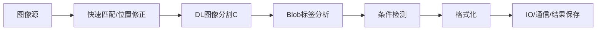

# VisionTrain 2.3 涂胶缺陷分割训练与 VisionMaster 部署 SOP

> **2026-11-21 范围更新**：当前 `visiontrain-glue-binary-v5` 只训练
> `background/glue` 两个类别。断胶、气泡、拉丝、污染和反光只作为样本场景，
> 不再创建 `defect` 标签。新版数据路径、导出与校验以
> [visiontrain-data-preparation.md](visiontrain-data-preparation.md) 和
> [visiontrain-manual-review.md](visiontrain-manual-review.md) 为准。
>
> 本文后续仍保留旧版缺陷分割流程，作为历史操作记录；其中要求手工创建
> `defect` 标签、使用 `visiontrain-glue-v1` 或输出“存在 defect 即 NG”的
> 步骤，不适用于当前二分类数据集。

> 文档状态：首版可执行流程
>
> 适用软件：VisionTrain 2.3.0、VisionMaster 4.4.0
>
> 适用硬件：`iMVS-VM-7200` 深度学习加密狗
>
> 更新日期：2026-11-20
>
> 关联任务：A-07、VisionTrain 合成数据流程验证

---

## 0. 本轮目标

使用当前 60 张合成涂胶图像完成一条可验证的深度学习闭环：

```text
合成图像
  -> VisionTrain 导入与标注
  -> 训练单类别缺陷分割模型
  -> 测试评估
  -> 生成 VM 4.4.0 模型
  -> VisionMaster 加载模型
  -> 单图流程验证
```

第一轮只训练一个类别：

```text
background
defect
```

原始合成缺陷类型：

```text
break
bubble
stringing
contamination
```

在第一轮全部合并为 `defect`。这样更适合当前每类仅约 5～11 个样本的数据规模。

### 本轮不做什么

- 不把模型框宽度直接当作胶条毫米宽度；
- 不把 `narrow`、`wide` 标注成像素缺陷；
- 不把合成数据测试结果写成真实产线指标；
- 不在测试结果不理想时更换测试集；
- 不在没有真实数据时宣称模型已经具备现场验收资格。

---

## 1. 总体流程

```mermaid
flowchart LR
    A[合成数据] --> B[VisionTrain 建方案]
    B --> C[导入图像]
    C --> D[建立 defect 标签]
    D --> E[标注或导入标注]
    E --> F[训练/验证划分]
    F --> G[训练 DL 图像分割]
    G --> H[测试评估]
    H --> I[导出 VM 4.4 模型]
    I --> J[VisionMaster 加载]
    J --> K[Blob/条件检测]
    K --> L[OK/NG 输出]
```



### 关键边界

```text
深度学习模型：识别缺陷像素区域
传统视觉量测：测量胶条宽度、长度和位置
相机标定：把像素尺寸换算为毫米
```

宽度检测的推荐链路：

```text
图像
  -> 定位/位置修正
  -> 传统边缘对或胶条轮廓分割
  -> 标定换算
  -> 宽度 mm
  -> 宽窄判定
```

---

## 2. 文件与路径

| 项目 | 路径 |
|---|---|
| VisionTrain | `D:\VM\VisionTrain2.3.0\Applications\Hik.VM.DeepLearningTool.exe` |
| VisionMaster | `D:\VM\VisionMaster4.4.0\Applications\VisionMaster.exe` |
| 合成数据集 | `D:\WORK\glue-inspection-sensor\outputs\synthetic\visiontrain-glue-v1` |
| 合成图像目录 | `D:\WORK\glue-inspection-sensor\outputs\synthetic\visiontrain-glue-v1\images` |
| manifest | `D:\WORK\glue-inspection-sensor\outputs\synthetic\visiontrain-glue-v1\manifest.csv` |
| 数据摘要 | `D:\WORK\glue-inspection-sensor\outputs\synthetic\visiontrain-glue-v1\dataset.json` |
| 建议 VisionTrain 方案目录 | `D:\VMProjects\glue_dl_v1` |
| 建议模型目录 | `D:\VMProjects\models` |
| 建议 VisionMaster 方案目录 | `D:\VMProjects\vm_glue_dl_smoke` |
| 建议实验记录目录 | `D:\VMProjects\run_001` |

创建目录：

```powershell
New-Item -ItemType Directory -Force "D:\VMProjects\glue_dl_v1"
New-Item -ItemType Directory -Force "D:\VMProjects\models"
New-Item -ItemType Directory -Force "D:\VMProjects\run_001"
```

> 路径中不要包含软件不支持的特殊字符：`@ : - ( )`。

---

## 3. 第一阶段：建立 VisionTrain 方案

### 3.1 启动前检查

- [ ] `iMVS-VM-7200` 加密狗已插入；
- [ ] 加密狗驱动已安装；
- [ ] VisionTrain 能正常启动；
- [ ] `DL图像分割` 模块可以打开；
- [ ] 没有“未授权”或“模型数量超限”提示。

启动 VisionTrain：

```powershell
& "D:\VM\VisionTrain2.3.0\Applications\Hik.VM.DeepLearningTool.exe"
```

### 3.2 新建方案

1. 单击 `新建方案`。
2. 方案名称填写：

   ```text
   glue_dl_v1
   ```

3. 本地保存路径填写：

   ```text
   D:\VMProjects\glue_dl_v1
   ```

4. 单击 `确定`。
5. 在模块连接面板单击 `+`。
6. 选择 `DL图像分割`。

### 3.3 先导入一张断胶图

1. 进入 `图像管理`。
2. 单击添加图像按钮。
3. 选择 `数据导入`。
4. 选择 `添加图片`。
5. 导入：

   ```text
   D:\WORK\glue-inspection-sensor\outputs\synthetic\visiontrain-glue-v1\images\syn_20261120_000003.png
   ```

6. 第一轮不要设置 ROI。
7. 单击 `数据导入`。
8. 检查预览图片是否正常显示。

> ROI 会裁剪全部导入图像。除非待检测目标一定完全位于 ROI 内，否则第一轮保持不裁剪。

---

## 4. 第二阶段：建立标签并完成一张样例标注

### 4.1 系统默认标签

`DL图像分割` 默认包含：

| 标签 | 用途 |
|---|---|
| `background` | 无缺陷图片，或整张图没有缺陷 |
| `hard_background` | 容易被误检为缺陷的正常背景，例如反光、阴影 |
| `ignore` | 不参与训练的无关区域 |

不要再创建同名的 `ignore` 标签。VisionTrain 不允许导入与默认标签同名的标签。

### 4.2 新增缺陷标签

1. 在 `标签管理` 区域单击新增按钮。
2. 标签名称填写：

   ```text
   defect
   ```

3. 颜色选择红色。
4. 透明度使用默认值。
5. 单击 `确认`。

### 4.3 标注断胶样例

1. 选中 `syn_20261120_000003.png`。
2. 在工具栏选择多边形或画笔工具。
3. 把图像中间的断口区域涂成红色。
4. 在标签列表中选择 `defect`。
5. 单击保存按钮，或切换到其他图片触发自动保存。
6. 检查标注区域是否贴合断口。

### 4.4 导出 VisionTrain 格式样例

VisionTrain 手册确认它支持导出包含标注信息的数据集，但没有明确说明可以直接识别任意 PNG 掩膜或 COCO/VOC 目录。

因此先导出一个最小样例：

1. 在图像管理或方案菜单中找到 `导出数据集`。
2. 导出到：

   ```text
   D:\VMProjects\visiontrain_export_sample
   ```

3. 确认导出目录中包含图像和标注 JSON、掩膜或其他标注文件。
4. 记录该目录的实际结构。

这个样例用于开发标注格式转换器。完成转换后，可以把全部 60 张现有掩膜自动导入 VisionTrain，不必逐张手画。

---

## 5. 第三阶段：完成全部图像标注

### 5.1 推荐路线

```text
已有 Python 掩膜
  -> 与 VisionTrain 导出样例比对
  -> 转换成 VisionTrain 原生数据集
  -> 导入全部图像和标注
```

转换器已经实现，完整数据已生成到：

```text
D:\VMProjects\visiontrain_glue_v1_full
```

首次导入先使用两张回读样例：

```text
D:\VMProjects\visiontrain_glue_v1_roundtrip
```

两张样例分别验证：

- `syn_20261120_000003.png`：断胶多边形显示为 `defect`；
- `syn_20261120_000004.png`：无缺陷图显示为已标注背景。

如果两项正确，再导入完整 60 张。转换细节和生成命令见
[visiontrain-data-preparation.md](visiontrain-data-preparation.md) §4。

### 5.2 人工兜底路线

如果不能立即进行格式转换，再手工完成 60 张。

1. 在 `图像管理` 中继续导入：

   ```text
   D:\WORK\glue-inspection-sensor\outputs\synthetic\visiontrain-glue-v1\images
   ```

2. 确认共导入 60 张图像。
3. 打开：

   ```text
   D:\WORK\glue-inspection-sensor\outputs\synthetic\visiontrain-glue-v1\manifest.csv
   ```

4. 用 Excel 按 `scenario` 或 `defect_types` 筛选。
5. 按下表完成标注。

| 场景 | 标注方法 |
|---|---|
| `ok` | 选中整图，单击 `background` |
| `narrow` | 选中整图，单击 `background` |
| `wide` | 选中整图，单击 `background` |
| `reflection` | 正常区域标 `background`，明显反光区域标 `hard_background` |
| `break` | 断口区域标 `defect` |
| `bubble` | 深色圆斑或凹坑标 `defect` |
| `stringing` | 细长拉丝标 `defect` |
| `contamination` | 不规则脏污区域标 `defect` |

### 5.3 标注纪律

- [ ] 无缺陷图都设置了 `background`；
- [ ] 每张缺陷图都标完了全部缺陷；
- [ ] 相邻缺陷没有被错误合并；
- [ ] 反光没有被标成 `defect`；
- [ ] 没有用大矩形粗略包住大片正常区域；
- [ ] `narrow` 和 `wide` 没有被当成像素缺陷；
- [ ] 所有图片状态均为“已标注”。

### 5.4 示例图像

| 用例 | 图像 ID | 标注重点 |
|---|---|---|
| 断胶 | `syn_20261120_000003` | 中间断口标 `defect` |
| 正常 | `syn_20261120_000004` | 整图标 `background` |
| 气泡 | `syn_20261120_000051` | 深色圆斑标 `defect` |

---

## 6. 第四阶段：划分训练集和测试集

### 6.1 当前合成数据冒烟方案

当前数据每张图对应独立合成场景，可临时使用 VisionTrain 自动划分：

1. 进入 `模型训练`。
2. 单击 `自动划分`。
3. 将训练集比例设为 80%。60 张时预计为训练集 48 张、测试集 12 张。
4. 单击 `确定`。

不要设置为 100%。那会把 60 张全部放入训练集，测试集为 0，训练后无法在
VisionTrain 内进行独立测试。划分后应确认测试集同时包含缺陷图和背景图。

本次划分只用于流程验证。正式报告不能基于反复调整过的测试集。

### 6.2 正式真实数据方案

真实相机连续采集时，必须按照 `object_id`、工件或批次分组划分。

```text
训练集：70%
验证集：15%
测试集：15%
```

同一工件的多帧只能进入一个集合。不得用逐帧随机划分代替按工件分组。

---

## 7. 第五阶段：配置训练参数

### 7.1 推荐参数

| 参数 | 第一轮建议值 | 说明 |
|---|---|---|
| 模型生成位置 | `D:\VMProjects\models` | 避免放在临时目录 |
| 模型名称 | `glue_defect_v1` | 包含用途和版本 |
| 目标平台 | `VM` | 部署到 VisionMaster |
| VM版本 | `440` | 对应 VisionMaster 4.4.0 |
| 推理平台 | `CPU` | 对应 `DL图像分割C` |
| 训练类型 | `单图像分割` | 泛化能力优先 |
| 模型能力 | `中` 或 `均衡` | 没有该选项则使用推荐值 |
| 分辨率 | `1024×768` | 与 1440×1080 同宽高比，两边均为 32 的倍数；兼顾细拉丝与 CPU 成本 |
| 迭代轮次 | `600` 起 | 手册建议有效标注少于 100 张时使用 600 以上，后续按 Loss 调整 |
| 缺陷类型 | `常规` | 不先启用小缺陷或边缘高精度 |
| 批大小 | 默认值 | 显存不足时再调整 |
| 自动超参 | 开启 | 若界面提供 |
| 类别均衡 | 开启 | 缺陷像素远少于背景 |
| 图像裁剪 | `不裁剪` | 当前图约 155 万像素 |
| 多分类输出优化 | 关闭 | 保留概率图 |
| 数据增强 | 默认策略 | 第一轮不手工加大增强 |

### 7.2 操作步骤

1. 进入 `模型训练` 页签。
2. 单击 `训练参数推荐`。
3. 按推荐参数表修改关键项。
4. 目标平台选择 `VM`。
5. VM 版本选择 `440`。
6. 推理平台选择 `CPU`。
7. 训练类型选择 `单图像分割`。
8. 模型名称填写 `glue_defect_v1`。
9. 单击 `开始训练`。
10. 单击 `模型训练详情` 查看训练参数和 Loss 曲线。

### 7.3 训练监控

- Loss 总体应下降并逐步趋于平稳；
- 若 Loss 长期不下降，先检查标签和图像显示；
- 若训练损失很低但测试效果差，检查过拟合、数据量或域差异；
- 训练过程中可单击 `模型测试` 检查当前版本；
- 效果符合预期后可单击 `模型另存为`；
- 训练完成后在 `模型管理` 查看任务和模型文件。

> 当前 60 张合成数据可能显示“样本较少”，VisionTrain 仍允许训练，但该模型只能用于流程验证或预训练。

---

## 8. 第六阶段：测试评估

### 8.1 操作步骤

1. 进入 `测试评估` 页签。
2. `模型选择` 选择 `当前模块`。
3. `版本选择` 选择 `glue_defect_v1`。
4. 置信度初始设为 `0.5`。
5. IoU 初始设为 `0.5`。
6. 推理模式选择 `CPU模式`。
7. 测试范围选择 `测试集`。
8. 单击 `模型测试`。

### 8.2 必看指标

| 指标 | 用途 |
|---|---|
| 精确率 | 判断误检是否过多 |
| 召回率 | 判断漏检是否过多 |
| 混淆矩阵 | 查看哪些类别容易被混淆 |
| 推理标签统计 | 比较人工标注和推理区域数量 |
| 单图平均耗时 | 评估部署效率 |

### 8.3 推荐检查用例

- [ ] 正常图不产生 `defect`；
- [ ] 断胶图能识别断口；
- [ ] 气泡图能识别深色圆斑；
- [ ] 拉丝细线能够检出；
- [ ] 反光图不会大面积误检；
- [ ] 过窄和过宽图仍判为 `background`，不产生伪缺陷。

### 8.4 参数调整原则

- 小缺陷漏检较多：数据补足后尝试 `小缺陷` 模式；
- 边缘粗糙、面积不准：数据补足后尝试 `边缘高精度`；
- 反光误检：增加 `hard_background` 样本；
- 某类目标漏检：补齐该类别样本，不要只在测试集上调阈值；
- 正常图误检：检查光照、背景和困难负样本。

---

## 9. 第七阶段：保存并导出模型

### 9.1 确认目标平台

部署到 VisionMaster 4.4.0 时：

```text
目标平台：VM
VM版本：440
推理平台：CPU
```

对应 VisionMaster 模块：

```text
DL图像分割C
```

如果训练时选择 GPU：

```text
推理平台：GPU
VisionMaster 模块：DL图像分割G
```

### 9.2 定位模型文件

1. 进入 `模型管理`。
2. 找到 `glue_defect_v1`。
3. 单击 `详情`，检查目标平台和 VM 版本。
4. 单击 `模型文件` 列的文件夹。
5. 确认模型文件已生成。

> 如果目标平台选择 VM 后只出现 `.model` 而无 VisionMaster 可用模型，先检查目标平台和 VM 版本，不要通过修改文件后缀解决。

### 9.3 模型命名建议

```text
glue_defect_v1_synthetic_20261120_cpu
```

模型信息中至少保留：

- 数据来源：`synthetic`
- 数据集版本：`visiontrain-glue-synthetic-v1`
- 数据集种子：`20261120`
- 目标平台：`VM 4.4.0`
- 标签：`background / defect`

---

## 10. 第八阶段：在 VisionMaster 中部署

### 10.1 推荐流程



### 10.2 操作步骤

1. 启动 VisionMaster：

   ```powershell
   & "D:\VM\VisionMaster4.4.0\Applications\VisionMaster.exe"
   ```

2. 打开参考方案：

   ```text
   D:\VM\VisionMaster4.4.0\Applications\Samples\项目案例展示\BY胶路缺陷检测\
   ```

3. 使用“另存为”保存为新方案：

   ```text
   D:\VMProjects\vm_glue_dl_smoke
   ```

4. 添加 `DL图像分割C` 模块。
5. 把图像源连接到 DL 模块。
6. 打开模块运行参数。
7. 在 `模型文件路径` 中选择 VisionTrain 导出的模型。
8. 初始置信度使用 `0.5`。
9. 添加 `Blob标签分析`。
10. 将 DL 分割结果连接到 Blob 分析。
11. 设置 Blob 显示类别、位置和面积。
12. 添加 `条件检测`。
13. 第一轮规则设为：

    ```text
    存在 defect 区域 -> NG
    不存在 defect 区域 -> OK
    ```

14. 添加 `格式化` 模块，输出：

    ```text
    图像ID、模型版本、缺陷类别、缺陷面积、
    OK/NG、处理耗时
    ```

15. 保存方案。

### 10.3 单图验证

| 图像 | 预期 |
|---|---|
| `syn_20261120_000003.png` | 检出断口 `defect`，输出 NG |
| `syn_20261120_000004.png` | 无缺陷，输出 OK |
| `syn_20261120_000051.png` | 检出气泡 `defect`，输出 NG |

### 10.4 宽度测量的正确位置

DL 模型不负责输出毫米宽度。最终流程应为：

```text
图像
  -> 位置修正
  -> 胶条边缘/轮廓提取
  -> 边缘对测量
  -> 标定换算
  -> 宽度 mm
  -> 宽窄判定
```

---

## 11. 第九阶段：保存实验记录

在 `D:\VMProjects\run_001` 中保存：

```text
run_001/
├─ model/
├─ visiontrain_project/
├─ visionmaster_solution/
├─ dataset.json
├─ manifest.csv
├─ training_screenshot.png
├─ evaluation_screenshot.png
├─ vm_result.png
└─ run_info.txt
```

### run_info.txt 模板

```text
实验名称：
数据来源：synthetic
数据集版本：visiontrain-glue-synthetic-v1
随机种子：20261120
模型名称：
模型版本：
目标平台：
VM版本：
标签：
训练图片数：
测试图片数：
迭代轮次：
置信度：
IoU：
精确率：
召回率：
单图平均耗时：
VisionMaster验证结果：
备注：仅合成数据，不能作为真实产线指标
```

---

## 12. 完成定义

### 数据闭环

- [ ] VisionTrain 能正常导入图像；
- [ ] `defect` 标签创建成功；
- [ ] 断口样例标注完成；
- [ ] VisionTrain 数据集导出成功；
- [ ] 无标注错位或类别错误。

### 训练闭环

- [ ] 训练状态达到可训练；
- [ ] Loss 曲线已保存；
- [ ] 模型训练完成；
- [ ] 模型目标平台为 VM 4.4.0；
- [ ] CPU/GPU 选择与 VisionMaster 模块一致。

### 测试闭环

- [ ] 正常图参与测试；
- [ ] 断胶图参与测试；
- [ ] 气泡图参与测试；
- [ ] 反光图参与测试；
- [ ] 已记录精确率、召回率和混淆矩阵；
- [ ] 没有把合成结果写成真实指标。

### 部署闭环

- [ ] VisionMaster 成功加载模型；
- [ ] 正常图输出 OK；
- [ ] 断胶图输出 NG；
- [ ] 结果包含模型版本；
- [ ] 方案和结果已归档。

---

## 13. 常见问题

| 现象 | 优先检查 |
|---|---|
| VisionTrain 没有 DL 模块 | 加密狗、驱动、授权工具 |
| 图片导入后没有标注 | 当前格式不是 VisionTrain 原生格式，先导出样例并转换 |
| 数据集一直显示“样本较少” | 可训练，但只能作为流程验证模型 |
| 训练 Loss 不下降 | 标签错位、漏标、学习率或类别设置 |
| 正常图误检 | 增加 `hard_background`，改善光照和曝光 |
| 小缺陷漏检 | 增加样本，确认目标大于约 3×3 像素 |
| 只有 `.model` 没有 VM 模型 | 检查目标平台和 VM 版本 |
| VisionMaster 加载模型失败 | 训练与部署的目标平台、版本或 CPU/GPU 不一致 |
| 宽度不准 | 优先检查标定、畸变、工作距离和边缘测量 |
| 合成数据效果很好、真实图很差 | 正常域差异，必须使用真实图片微调和验收 |

---

## 14. 下一步

先完成最小格式验证：

1. 在 VisionTrain 中导入一张断胶图；
2. 手工标一个 `defect`；
3. 导出 VisionTrain 数据集；
4. 检查导出目录结构；
5. 将已有 60 张图的掩膜转换为 VisionTrain 原生格式；
6. 再开始完整训练。

相关文档：

- [VisionTrain 数据准备](visiontrain-data-preparation.md)
- [P0 指标与数据规范](p0-spec.md)
- [接口契约](interfaces.md)
- [单相机标定与尺寸验证计划](calibration-plan.md)
