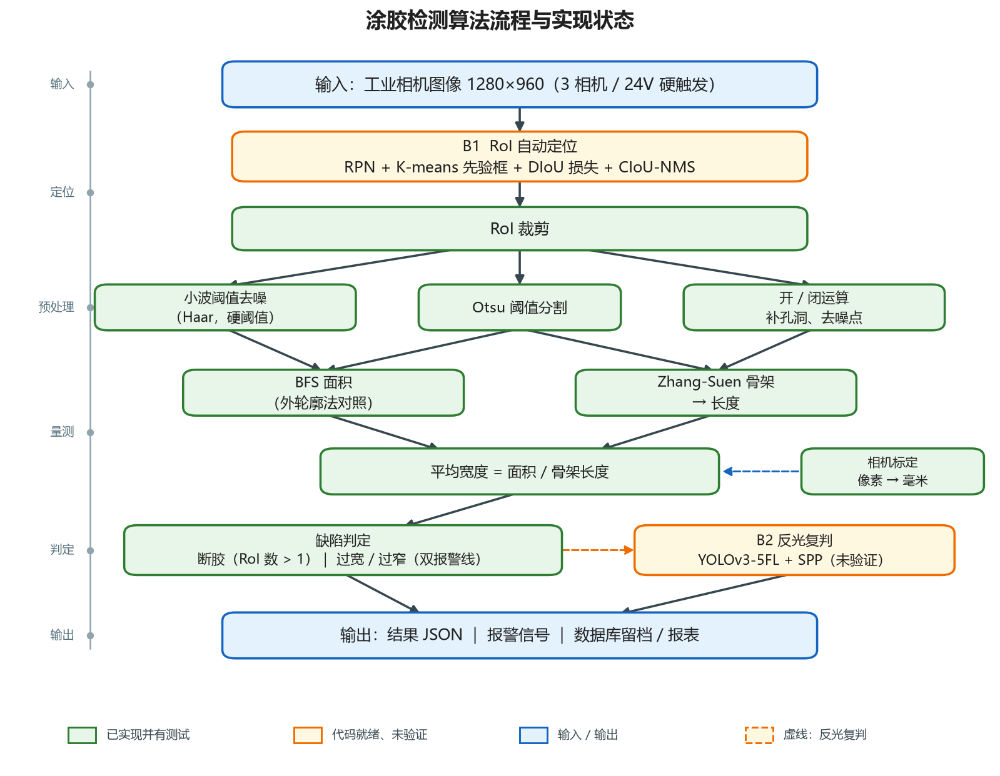
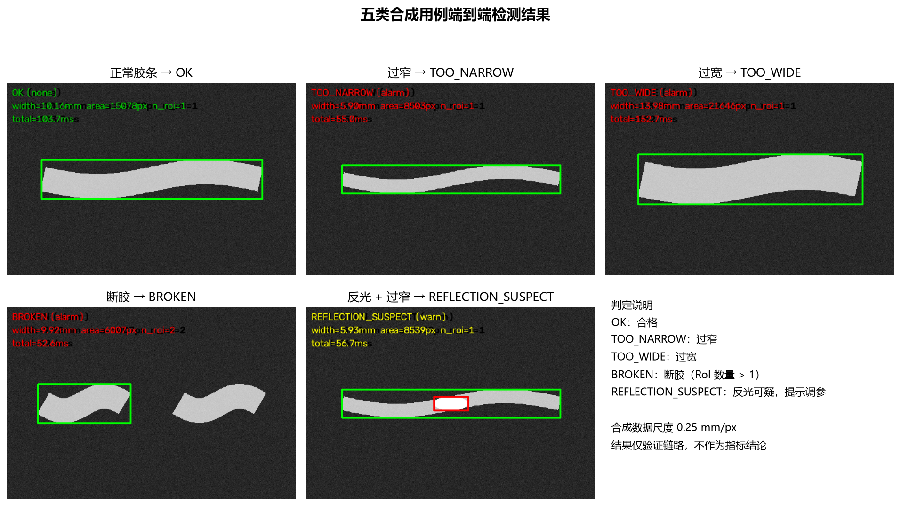
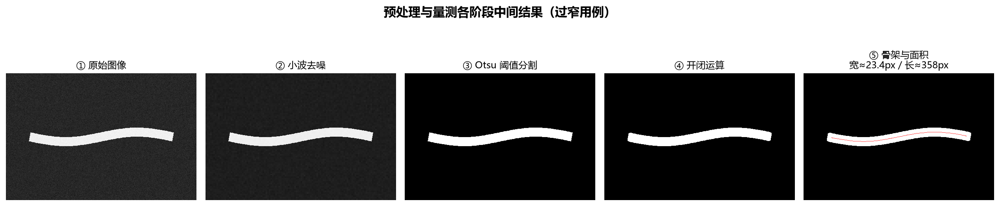

# 涂胶检测算法阶段汇报与标定工作计划

> 项目：基于机器视觉的车身涂胶在线检测传感器
> 汇报日期：2026-11-15
> 当前分支：`main`（集成分支）
> 当前硬件：HIKROBOT `MV-CB016-10UM-S`、6 mm M12 镜头，MVS 已安装
> 详细标定方案：[calibration-plan.md](calibration-plan.md)

---

## 一、阶段结论

目前已经完成论文传统视觉量测链路的基本复现，形成了从图像预处理、胶条分割、几何量测、缺陷判定到结构化结果输出的可运行框架。现有算法代码通过 65 项单元测试，并能在合成数据上完成正常、过窄、过宽、断胶和反光五类用例的端到端验证。

当前阶段的主要成果是：

- 完成了论文算法结构拆解和指标口径定义；
- 完成了小波去噪、阈值分割、形态学处理、面积和骨架量测；
- 完成了相机标定、像素到毫米换算和重投影误差计算模块；
- 完成了断胶、过宽、过窄和反光复判规则；
- 完成了单帧检测流水线、JSON 输出、批量评测和报告生成脚本；
- 建立了配置、假设登记、降级记录和测试规范。

当前尚未完成的关键工作是：

- 还没有使用真实相机图像完成正式宽度误差测试；
- 当前 RoI 定位仍使用传统图像分割占位实现，论文中的 RPN 尚未完成集体验收；
- YOLOv3-5FL 反光检测仍处于代码骨架阶段，测试尚未全部通过；
- 单帧运行速度仍需在真实图像和部署环境中进一步验证；
- 标定结果目前只支持平均像素尺度，去畸变和局部映射尚未接入检测流水线。

因此，当前项目已经从“文档方案阶段”进入“可运行算法原型阶段”，下一步应优先完成真实相机标定和尺寸验证，而不是继续无数据地扩展深度模型。

### 1.1 在总体开发计划中的位置

按照产品开发路线，当前项目正从 **P0 需求与方案准备阶段**进入 **P1 论文装置复现阶段**：

- P0 的算法结构拆解、指标口径、接口规范、实验 BOM 和首轮采购已经完成；
- P1 的第一项硬件条件已经具备，即 `MV-CB016-10UM-S` 相机、6 mm M12 镜头和 MVS 采集环境；
- P1 尚未完成的核心内容是单相机成像基线、相机标定、真实胶条图像采集和人工卡尺真值验证；
- 三相机同步、红光频闪、RK3588、自研载板和产品软件仍属于后续阶段。

因此，当前阶段的判断标准不是“模型代码有没有写完”，而是“能否用真实相机稳定拍到胶条，并把像素宽度可靠地换算成毫米”。

### 1.2 下一个里程碑与并行工作

当前下一个里程碑是完成 **P1 单相机成像与尺寸基线**：

```text
3D 打印固定支架
  -> 棋盘格标定
  -> 固定曝光、焦距和光圈
  -> 采集真实图像
  -> 已知宽度试件验证
  -> 形成第一版真实宽度误差报告
```

与此同时，还需要完成一项 P0 收尾工作：获取实际工件、胶型和表面状态，明确断胶、过宽、过窄、多胶、位置偏差等缺陷的最小尺寸、判定方法和报警边界。标定可以在没有正式胶条样本时先开始，但正式数据采集和缺陷算法验收必须建立在明确的缺陷定义之上。

近期工作顺序如下：

1. 并行推进 P0 收尾和 P1 标定准备，收集实际工件与胶型资料，同时制作标定靶和固定支架；
2. 完成单相机视野、聚焦、曝光、增益和光圈的参数冻结；
3. 完成内参标定和已知宽度物理验证；
4. 完成 20 张以上真实图像试标，确定数据采集和标注规范；
5. 单相机成像、标定和尺寸重复性通过后，再扩展红光照明、第二/第三台相机和真实缺陷样本；
6. 在固定训练集和测试集建立之前，不把 RPN、YOLO 或三相机开发作为当前主任务。

当前阶段的主线是 **“先让测量可信，再让模型智能”**。如果单相机的成像、标定和尺度验证没有通过，则优先修正镜头、支架、工作距离、照明和量测方法，不进入深度模型训练或 RK3588 部署。

---

## 二、已经完成的算法工作

### 2.1 算法流程

当前检测流程如下：

```text
输入图像
  -> RoI 定位与裁剪
  -> 小波去噪
  -> Otsu/全局/双峰阈值分割
  -> 开运算与闭运算
  -> BFS 连通域面积
  -> Zhang-Suen 骨架提取
  -> 骨架长度和平均宽度
  -> 标定换算为毫米
  -> 反光检测与缺陷判定
  -> JSON 结果和可视化叠加图
```



### 2.2 已完成模块

| 模块 | 论文位置 | 当前实现 | 状态 |
|---|---|---|---|
| 小波去噪 | 第 4.1 节 | Haar 小波、硬阈值、可配置分解层数 | 已完成 |
| 中值滤波对比 | 第 4.1 节 | 可切换中值滤波，用于去噪效果对照 | 已完成 |
| 阈值分割 | 第 4.2.1 节 | Otsu、全局阈值、双峰法 | 已完成 |
| 开闭运算 | 第 4.2.2 节 | 可配置核尺寸和开闭顺序 | 已完成 |
| 相机标定 | 第 4.3 节 | 棋盘格内参、畸变、重投影误差、平均尺度 | 代码完成，待真实图验证 |
| 胶条面积 | 第 4.4.1 节 | BFS 面积和外轮廓面积两种方法 | 已完成 |
| 骨架与长度 | 第 4.4.2 节 | Zhang-Suen 细化、骨架最长路径 | 已完成 |
| 平均宽度 | 第 4.4.3 节 | `面积 / 骨架长度`，支持像素到毫米换算 | 已完成 |
| 缺陷判定 | 第 5.3.3 节 | 断胶、过宽、过窄、预警和反光复判 | 已完成 |
| 单帧流水线 | 第 5.2.3 节 | 串行编排、分段计时、降级记录和 JSON 输出 | 已完成 |
| 评测指标 | P0 规范 | IoU、样本召回、MAE、标准差、最大误差、p50/p95 | 已完成 |
| 合成数据 | 算法自检 | 正常、断胶、过窄、过宽、反光五类 | 已完成 |

### 2.3 算法设计特点

#### （1）传统量测与缺陷判定分离

宽度由标定后的几何量测得到，不依赖神经网络直接回归。这样可以保留物理单位、计算过程和误差来源，便于后续标定、复核和产品化。

#### （2）所有业务参数配置化

阈值、报警线、形态学参数和模型开关均集中在 `configs/default.yaml`，避免在代码中散落业务阈值。

#### （3）论文事实与复现假设分开

论文没有给出的参数，例如小波层数、形态学核尺寸、骨架长度算法和报警线，均在文档中登记为复现假设，并在配置中明确标记。

#### （4）缺失能力显式降级

没有标定文件、RPN 权重或反光模型时，系统仍可运行，但会把降级原因写入结果，不会把未标定结果伪装成毫米量测结果。

### 2.4 当前代码结构

```text
algo/
├─ config.py       配置加载
├─ preprocess.py   去噪、分割、形态学处理
├─ calib.py        相机标定和像素尺度换算
├─ measure.py      面积、骨架、长度和宽度计算
├─ decide.py       缺陷判定和反光复判
├─ pipeline.py     单帧检测流水线
├─ metrics.py      指标统计
├─ synth.py        合成测试数据
├─ visualize.py    检测结果叠加
└─ models.py       RoI 和反光检测接口及占位实现

scripts/
├─ calibrate_board.py
├─ demo_synthetic.py
├─ eval_measure.py
└─ run_measure_report.py

tests/
├─ test_measure.py
├─ test_calib.py
├─ test_pipeline.py
└─ 其余预处理、几何和指标测试
```

### 2.5 当前验证结果

#### （1）单元测试

运行命令：

```powershell
py -3 -m unittest discover -s tests -v
```

结果为 65 项测试全部通过，覆盖：

- 小波去噪和阈值分割；
- 形态学处理；
- 连通域和骨架量测；
- 标定尺度计算；
- IoU、GIoU、DIoU 和 CIoU；
- NMS 与 CIoU-NMS；
- 缺陷判定和反光复判；
- 宽度和耗时指标；
- 单帧流水线和 JSON 序列化。

#### （2）五类合成用例



合成测试结果：

| 用例 | 计算结果 | 判定 |
|---|---:|---|
| 正常胶条 | 约 10.16 mm | `OK` |
| 过窄胶条 | 约 5.90 mm | `TOO_NARROW` |
| 过宽胶条 | 约 13.98 mm | `TOO_WIDE` |
| 断胶 | 2 个互不相连 RoI | `BROKEN` |
| 反光叠加过窄 | 约 5.93 mm | `REFLECTION_SUSPECT` |

上述结果仅用于验证链路和判定逻辑，不能作为真实测量精度结论。

#### （3）预处理中间过程



该图展示了去噪、分割、形态学修正和骨架提取过程，可用于检查各阶段是否符合预期。

### 2.6 深度学习部分当前状态

论文中的 RoI 定位和反光检测依赖训练数据，目前不能计入已经验收的算法成果。

| 模型 | 论文位置 | 当前状态 | 结论 |
|---|---|---|---|
| RPN RoI 定位 | 第 3.1 节 | `wip/b1-b2` 已建立网络、框编解码、损失和推理骨架 | 基础模块部分验证通过，正式训练流程尚未跑通 |
| YOLOv3-5FL + SPP | 第 3.3 节 | 已建立五层特征和 SPP 代码骨架 | 模型输出维度、目标分配和框解码仍有问题，尚未通过测试 |

当前主分支仍使用阈值分割加连通域外接框作为 RoI 占位实现。该实现能够支撑传统链路联调，但不代表论文 RPN 方法已经复现完成。

下一阶段模型工作的前置条件不是继续堆代码，而是获得真实胶条图像、RoI 标注和反光区域标注。

### 2.7 当前待解决的问题

1. 没有真实相机的标定图、胶条图像和卡尺真值，因此无法给出正式 MAE、标准差和最大误差；
2. 当前 RoI 只能处理目标与背景具有明显灰度差异的简单场景，复杂背景和反光场景需要进一步验证；
3. 论文的断胶判据依赖 RoI 数量，若分割产生碎片或光斑，可能造成错误断胶；
4. 当前流水线只使用平均 `mm_per_px`，尚未在量测前应用去畸变和局部映射；
5. 合成数据上的单帧耗时约 56～158 ms，需要在真实分辨率和部署平台上重新统计；
6. 反光检测模型尚不能用于正式实验。

---

## 三、下一步：单相机标定计划

### 3.1 为什么先做标定

当前算法已经能够输出“像素宽度”，但要判断算法是否满足 1 mm 检测精度，必须先建立可信的像素到毫米映射，并验证：

- 相机和镜头是否覆盖约 100 x 80 mm 的目标区域；
- 固定工作距离下中心和边缘是否清晰；
- 标定后的宽度是否具有足够的重复性和绝对准确性；
- 当前传统量测链路是否存在系统性尺度偏差。

因此，下一步不应先扩展三相机或继续训练模型，而应完成单相机固定工位标定。

### 3.2 本轮目标

1. 完成 `MV-CB016-10UM-S + 6 mm M12 镜头` 的单相机内参标定；
2. 获得相机内参、畸变系数、重投影误差和平均像素尺度；
3. 使用已知宽度试件验证实际测量误差；
4. 形成可复用的标定 JSON、参数记录和第一版测量报告；
5. 根据真实误差决定是否需要增加去畸变和局部映射。

本轮不包含三相机相对位姿、机器人坐标和最终红光频闪条件下的产品验收。

### 3.3 标定靶设计

使用黑白棋盘格，不使用普通方格线纸。

| 项目 | 建议参数 |
|---|---|
| 内角点 | 13 x 9 |
| 黑白方块 | 14 x 10 |
| 方格标称尺寸 | 7 mm |
| 棋盘有效区域 | 约 98 x 70 mm |
| 打印尺寸 | A4 横向，300 dpi 以上 |
| 基板 | 2～3 mm 亚克力、铝板或其他刚性平板 |
| 表面 | 哑光，无翘曲和明显反光 |

打印后必须测量连续 10 个方格的实际跨度，用实测值计算方格边长。标定脚本输入应为实测值，不能直接使用 7.0 mm。

现有 13 x 9、4 mm 靶标可以作为论文参数对照，但覆盖面积较小，正式全视野标定建议使用上面的 7 mm 靶标。

### 3.4 3D 打印支架

3D 打印件用于保证重复定位，但高度必须可调。

建议设计：

- 相机支架和靶标平台一体化；
- 初始高度约 135 mm；
- 高度可调范围约 125～150 mm；
- 使用 M4 长圆孔、垫片或隔套微调；
- 相机光轴垂直靶面；
- 靶标平台带定位挡边；
- 底座预留相机线缆应力释放；
- 使用黑色哑光材料。

按当前相机和 6 mm 镜头估算：

| 物距 | 理论视野 |
|---:|---:|
| 130 mm | 约 102.7 x 77.0 mm |
| 135 mm | 约 106.8 x 80.1 mm |
| 145 mm | 约 115.1 x 86.3 mm |

该结果只用于确定支架的粗调范围，正式 `mm_per_px` 必须通过标定得到。

### 3.5 标定流程

#### 第一步：固定光学参数

- 分辨率设置为 1440 x 1080；
- 像素格式设置为 Mono8；
- 关闭自动曝光和自动增益；
- 增益初值设置为 0 dB；
- 调整焦距，使中心和四角同时清晰；
- 比较 F2.8 与 F4，选择边缘清晰度较好的光圈；
- 锁紧焦距和光圈；
- 保存原始 PNG 或 BMP，不使用 JPEG。

#### 第二步：调整工作距离和视野

- 将棋盘格放在实际被测物同一平面；
- 调整支架高度，使目标区域完整进入画面；
- 检查画面中心和四角的清晰度；
- 检查相机光轴是否垂直靶面；
- 记录相机到靶面的实际距离。

#### 第三步：采集标定图

建议采集 30 张：

- 中心正对靶面 3 张；
- 四角位置 4 张；
- 上下左右边缘 4 张；
- 左右倾斜约 10～15° 4 张；
- 上下倾斜约 10～15° 4 张；
- 平面内旋转并组合位置 11 张。

至少保留 25 张有效图像。图像必须无裁边、无明显模糊、无过曝和反光。

#### 第四步：运行标定

假设靶标内角点为 13 x 9，实测方格尺寸为 6.989 mm：

```powershell
py -3 scripts/calibrate_board.py `
  --images data/raw/calib/20261116_cb016 `
  --cols 13 `
  --rows 9 `
  --square-mm 6.989 `
  --out data/calib/20261116_cb016.json
```

检查以下结果：

- 真正参与标定的有效图片数；
- 总体重投影误差 RMS；
- 每张视图的单独重投影误差；
- 内参 `K` 和畸变参数 `dist`；
- 平均 `mm_per_px` 是否与理论视野量级一致。

工程初筛可优先关注总体 RMS 是否处于 0.3～0.5 px 范围。该范围是当前阶段的工程参考，不是论文原始指标。

#### 第五步：独立验证

标定图本身的重投影误差不能证明实际尺寸准确，必须补充：

- 留出 5～10 张未参与标定的棋盘格图；
- 使用 5、8、10、12、15 mm 等已知宽度试件；
- 分别在中心和边缘位置测量；
- 每个位置重复采集 3 次；
- 使用游标卡尺记录人工真值；
- 统计中心、边缘和四角误差。

初期验收目标：

| 指标 | 目标 |
|---|---:|
| 固定位置重复性 | ≤ 0.2 mm |
| 同一试件不同位置尺度偏差 | 约 ±0.2 mm |
| 宽度 MAE | ≤ 0.4 mm |
| 最大宽度误差 | ≤ 1.0 mm |

### 3.6 标定后的算法修正

当前 `GlueInspector` 只使用平均 `mm_per_px`，尚未真正应用标定得到的畸变参数和单应矩阵。

标定完成后，建议按以下顺序补充代码：

1. 根据 `K` 和 `dist` 对图像或 ROI 去畸变；
2. 使用固定工作平面单应矩阵，或按位置查询局部映射表；
3. 在输出中加入标定文件路径、标定版本和工作距离；
4. 增加留出验证和已知宽度误差报告；
5. 比较中心与边缘的尺度误差；
6. 确认全视野精度后，再进入正式 P1 报告。

在完成上述工作前，可以采集数据并做初始测量，但边缘宽度结果不能作为正式的算法精度结论。

---

## 四、近期工作安排

### 第 1 天：靶标和固定件

- 打印 13 x 9 内角点、7 mm 方格棋盘格；
- 粘接到刚性平板；
- 测量实际方格尺寸；
- 完成 3D 打印相机支架；
- 检查相机轴线、靶面平行度和高度调节范围。

交付物：标定靶、固定支架和靶标尺寸记录。

### 第 2 天：成像基线

- 安装相机和镜头；
- 调整工作距离；
- 完成调焦和光圈选择；
- 固定曝光、增益、焦距和光圈；
- 检查视野和四角清晰度。

交付物：单相机成像参数记录和初始视野图。

### 第 3 天：标定采图

- 采集 30 张不同位姿的棋盘格图像；
- 检查角点识别和图像质量；
- 重新采集模糊、反光或裁边图片；
- 运行内参标定。

交付物：标定原图、`calib.json` 和重投影误差表。

### 第 4 天：独立尺寸验证

- 使用已知宽度试件；
- 测量中心、边缘和四角；
- 每个位置重复采集 3 次；
- 记录人工卡尺真值；
- 计算 MAE、标准差和最大误差。

交付物：真实宽度测量 CSV 和误差统计。

### 第 5 天：修正和冻结

- 根据边缘误差决定是否调整镜头、支架或光源；
- 补充去畸变或映射代码；
- 重新验证；
- 冻结第一版相机标定和采集参数。

交付物：单相机标定验收记录和第一版 P1 真实测量报告。

---

## 五、阶段评审门槛

### 门槛 G1：单相机成像

- 1440 x 1080 连续采集稳定；
- 目标区域完整进入视野；
- 中心和四角清晰；
- 无明显暗角、拖影和过曝；
- 连续采集 10 分钟无掉线。

### 门槛 G2：几何标定

- 至少 25 张有效标定图；
- 棋盘格角点能够稳定检测；
- 重投影误差和逐视图误差已记录；
- 标定结果与实际视野量级一致。

### 门槛 G3：真实尺寸

- 已知宽度试件完成独立验证；
- 宽度重复性达到约 0.2 mm；
- MAE 和最大误差接近当前项目目标；
- 中心与边缘误差差异已分析。

### 门槛 G4：进入后续算法阶段

- 形成稳定的真实数据集；
- 完成 20 张以上试标；
- 固定训练集、验证集和测试集划分；
- 再决定是否继续投入 RPN、YOLO 和三相机开发。

---

## 六、近期采购和工作重点

优先补充：

1. 13 x 9 内角点、7 mm 方格的高质量棋盘格，或刚性标定板；
2. 可调支架、滑轨和固定夹具；
3. 655 nm 红光光源、恒流控制器和 24 V 电源；
4. 合适量程和分辨率的游标卡尺；
5. 如相机未附赠，补充 USB 3.0 锁紧数据线。

暂缓：

- 第二、第三台相机；
- USB 3.0 多相机 Hub；
- 三相机同步触发板；
- LED 灯板 PCB；
- RK3588 核心板和自研载板。

只有单相机成像、标定和真实宽度验证通过后，才进入三相机和边缘计算阶段。

---

## 七、总结

当前算法工程已经从方案整理推进到可运行的传统视觉量测原型，核心链路、测试、结构化输出和实验脚本均已建立。现有成果足以支持进一步采集真实数据，但还不能证明论文中的 0.23 mm 宽度误差已经复现。

下一阶段的关键路径是：

```text
单相机标定
  -> 真实宽度验证
  -> 固定数据采集规范
  -> 传统算法参数优化
  -> 真实数据上的 RoI 和反光模型
  -> 三相机与边缘部署
```

因此，当前最合理的下一步是立即制作标定靶和固定支架，完成单相机标定及已知宽度试件验证。标定结果将直接决定后续图像采集、算法阈值和模型输入是否具有可靠的物理尺度。
