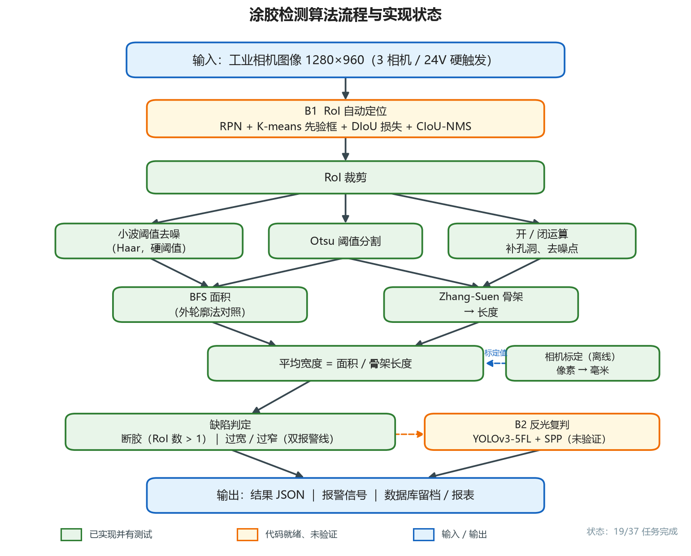
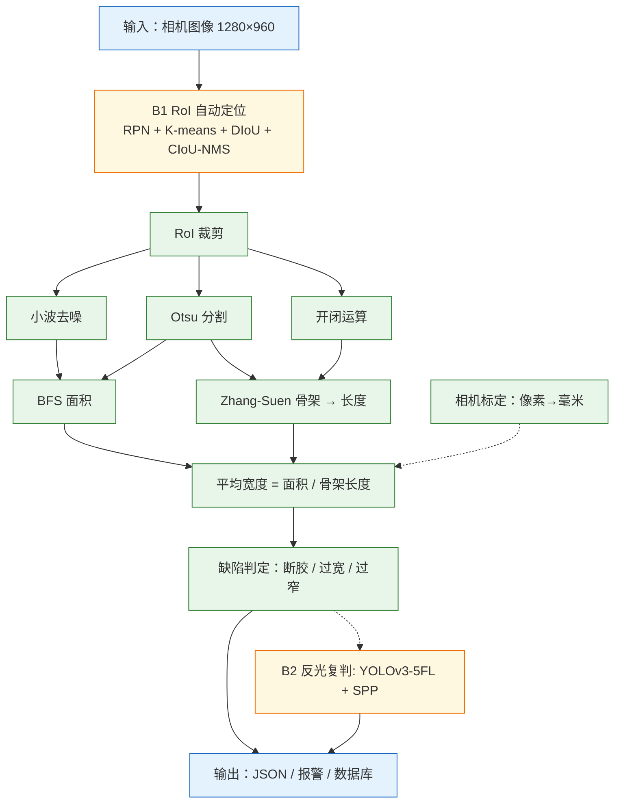

# 算法复现进度

> 更新时间：2026-11-15
> 当前分支：`feat/algorithm-reproduction`（领先 main 7 个提交，未推送）
> 一句话：**能出毫米数的那条链路已经跑通并有测试；两路深度学习代码写完但没跑过；所有"论文指标"还等着真实数据。**

---

## 一、总体进度

```
P0 规范与口径    ██████████ 100%   指标定义、数据规范、接口契约、假设登记
P1 量测链路      █████████░  90%   全部实现 + 60 项测试；缺真实数据验证
P2 判定与集成    ████████░░  80%   判定/流水线/叠加图完成；缺延迟统计
P3 RoI 定位 B1   ███░░░░░░░  30%   代码在 wip 分支，未运行
P4 反光检测 B2   ███░░░░░░░  30%   同上
P5 对标与报告    ░░░░░░░░░░   0%   依赖 P3/P4 与真实数据
```

任务清单：**19 / 37 项完成**（详见 [tasks.md](tasks.md)）。

---

## 二、算法流程与状态



- 🟩 绿色：已实现并有单元测试
- 🟧 橙色：代码就绪、尚未验证（在 `wip/b1-b2` 分支）
- 🟦 蓝色：输入 / 输出

对应的 Mermaid 版本（GitHub 上可直接渲染）：



---

## 三、模块完成情况

| 模块 | 论文位置 | 状态 | 说明 |
| --- | --- | --- | --- |
| 小波去噪 / 中值滤波 | 4.1 | ✅ | Haar 2 层 + 硬阈值，含中值对比 |
| 阈值分割（Otsu / 双峰 / 全局） | 4.2.1 | ✅ | 三种方法都可切换 |
| 开闭运算 | 4.2.2 | ✅ | 四种顺序组合 |
| 相机标定 | 4.3 | ✅ | 棋盘格、内参、重投影误差、像素→毫米 |
| 面积（BFS / 外轮廓） | 4.4.1 | ✅ | 两种方法可对照 |
| 骨架与长度 | 4.4.2 | ✅ | Zhang-Suen；长度用图直径法（比边计数稳） |
| 宽度换算 | 4.4.3 | ✅ | 面积÷长度，再乘标定系数 |
| 缺陷判定 | 5.3.3 | ✅ | 断胶、双报警线、反光复判 |
| 单帧流水线 | 5.2.3 | ✅ | 含降级记录与分段计时 |
| 评测指标 | — | ✅ | IoU / 召回 / 误差 / p50-p95 |
| **B1 RoI 定位（RPN）** | 3.1 | 🟧 | `wip/b1-b2` 分支，torch 未装，测试未跑 |
| **B2 反光检测（YOLO-5FL+SPP）** | 3.3 | 🟧 | 同上 |
| 消融实验（表 3-1/3-2/3-4） | 3.1/3.3 | ⬜ | 脚本骨架在，需模型跑通 + 数据 |
| 真实数据指标（0.23mm 那条线） | 4.4/表 5-4 | ⬜ | 卡在采集与卡尺真值 |

---

## 四、文件结构

```
glue-inspection-sensor-reproduction/
├─ README.md                  项目总览
├─ AGENTS.md                  AI/人协作规范（红线、DoD）
├─ requirements.txt           核心依赖（torch 为可选项）
├─ algo/                      算法实现（13 个模块）
│   ├─ types / config         数据结构与配置
│   ├─ geometry               IoU 家族、NMS、K-means 先验框
│   ├─ preprocess             小波去噪、阈值分割、形态学
│   ├─ measure                BFS 面积、骨架、宽度
│   ├─ calib                  标定与毫米换算
│   ├─ decide                 断胶 / 宽窄 / 反光复判
│   ├─ pipeline               单帧流水线
│   ├─ models                 RoI 定位与反光检测的接口 + 占位实现
│   ├─ metrics                评测指标
│   ├─ synth                  五类合成样本
│   └─ visualize              叠加图
├─ configs/default.yaml       全部阈值（带 [假设] 标注）
├─ data/                      数据目录规范（图像不入库）
├─ docs/
│   ├─ algo/
│   │   ├─ plan.md            复现范围与技术路线
│   │   ├─ p0-spec.md         指标口径 M1–M10、假设登记 A1–A10
│   │   ├─ interfaces.md      接口契约
│   │   ├─ tasks.md           37 项任务清单
│   │   ├─ progress.md        本文件
│   │   ├─ reports/           P1 量测报告
│   │   └─ figures/           流程图
│   ├─ reproduction-bom.md    硬件 BOM
│   ├─ product-development-roadmap.md
│   └─ hikrobot-usb-camera-comparison.md
├─ scripts/                   6 个入口（demo/标定/评测/报告/流程图）
├─ tests/                     6 个测试模块、60 项用例
└─ references/                参考资料说明（PDF 不入库）
```

---

## 五、现在能跑什么

```powershell
# 全部单元测试（不需要 torch、不需要数据）
py -3 -m unittest discover -s tests

# 合成样本端到端演示（五类用例）
py -3 scripts/demo_synthetic.py --out outputs/demo

# 棋盘格标定
py -3 scripts/calibrate_board.py --images calib/ --cols 9 --rows 6 --square-mm 5 --out calib.json

# 生成 P1 宽度报告（有真实数据后）
py -3 scripts/run_measure_report.py --images data/raw/setA --labels data/labels/width.csv --calib calib.json

# 重新生成本文的流程图
py -3 scripts/make_flow_diagram.py
```

合成数据上的实测结果（只验证链路，不算指标）：正常 10.16mm→OK、过窄 5.90→TOO_NARROW、过宽 13.98→TOO_WIDE、断胶→BROKEN、反光+过窄→REFLECTION_SUSPECT。

---

## 六、卡点与下一步

| 卡点 | 影响 | 解法 |
| --- | --- | --- |
| **没有真实图像与卡尺真值** | 0.23mm 等指标全部「待测」 | 按 `data/README.md` 采集，先试标 20 张 |
| **torch 环境未装成** | B1/B2 代码无法验证 | 装 CPU 版 torch，跑 `tests/test_net.py` |
| **量测链路偏慢** | 合成图 p95 已 136ms，30fps 有距离 | BFS 换 OpenCV 连通域、骨架加速 |

建议顺序：**先补数据闭环（P1 验收）→ 再恢复 B1/B2 → 最后做性能与对标报告**。
