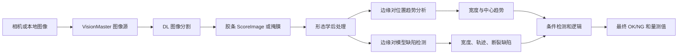

# VisionMaster 4.4 胶条分割模型部署流程

> 状态：首轮模型和方案已归档并完成人工运行；等待逐类统计和真实数据验收
> 软件：VisionMaster 4.4、VisionTrain 2.3
> 模型用途：分割 `background/glue`，不直接判断断胶、宽窄或弯曲
> 当前主线：模型分割 -> 二值化/形态学 -> 旋转扫描矩形 -> 边缘中点曲线 -> 质量判定
> 合成数据边界：当前训练数据为 `synthetic`，只能用于流程验证和预训练

> 2026-11-21 优先级更新：量产部署优先采用
> [VisionMaster 纯 VM 主线](visionmaster-pure-vm-mainline.md)。本文继续作为
> VM 模型加载、掩膜输出、坐标验证和 Python 对照的基础流程。
>
> 当前可运行版本见
> [M06 首轮部署包](../../deployment/visionmaster/glue_m06_inspection_v1/README.md)，
> 模型为 VM 440 CPU 分割模型。

## 1. 先在概念上分清 VisionTrain 和 VisionMaster

| 软件 | 负责什么 | 本项目操作 |
|---|---|---|
| VisionTrain | 训练和测试模型 | 导入 500 张数据，训练 `background/glue` 单图像分割模型 |
| VisionMaster | 加载训练好的模型并接入视觉流程 | 图像源、模型推理、掩膜后处理、结果展示和后续量测 |

VisionMaster 不在线训练模型。训练必须先在 VisionTrain 完成，确认目标平台为
`VM 440` 后再导出。

## 2. 推荐的分阶段路线

量产运行优先采用纯 VM 路线：

```text
阶段 A：VM 能加载模型并输出正确胶条掩膜
阶段 B：VM 用长旋转 ROI 验证多卡尺边缘和宽度
阶段 C：VM 用边缘对轨迹模型完成弯曲胶路量测
阶段 D：VM 条件检测和逻辑模块输出最终 OK/NG
```

纯 VM 目标架构：



具体模块配置、轨迹建模和缺陷映射见
[VisionMaster 纯 VM 主线](visionmaster-pure-vm-mainline.md)。

仓库中的
[旋转扫描矩形实现](../../algo/scanline.py) 继续保留，作为离线对照和复杂
胶路后备方案。

## 3. 当前完成边界

当前已经完成：数据库列划分、合成数据、分割模型接口、二值后处理、
旋转扫描矩形、边缘点和曲线量测；VisionMaster 首轮方案已运行，人工观察到
断胶、过宽、过窄和气泡响应。

当前尚未完成：

- M06 100 张图的逐类命中、漏报和误报统计；
- 独立气泡测试集和正式气泡判定边界；
- VisionMaster 输出掩膜到 Python/C++ 主线的部署适配器；
- 真实相机上的断胶、宽度和弯曲验收指标。

因此本流程中任何“正确结果”都指流程行为正确，不代表真实产线精度合格。

## 4. 部署前准备

### 4.1 VisionTrain 侧

- [ ] 模型训练完成；
- [ ] 模型类别为 `background`、`glue`；
- [ ] 测试集指标已实际记录，没有填入推测值；
- [ ] 目标平台为 `VM`；
- [ ] VM 版本为 `440`；
- [ ] 推理平台与部署电脑一致；
- [ ] 模型文件及配套运行文件完整；
- [ ] 已保存训练参数、Loss 曲线和模型版本。

建议模型名称：

```text
glue_bg_seg_syn500_v5_vm440_gpu_v001
```

本轮实际归档并用于首轮方案的是 CPU 版本：

```text
glue_bg_seg_syn500_v5_vm440_cpu_v001
```

不要因为后续规划了 GPU 版本，就把当前 VM 440 CPU 方案误写成 GPU 方案。

若最终部署电脑没有匹配的 NVIDIA GPU，应改为 CPU 模型，或者确认 GPU
运行时能够在部署电脑正常工作。GPU 训练模型不能直接当 CPU 模型加载。

### 4.2 VisionMaster 侧

- [ ] VisionMaster 4.4 能正常启动；
- [ ] 深度学习授权和加密狗正常；
- [ ] 能添加 `DL图像分割` 模块；
- [ ] 若使用 GPU，VisionMaster 能识别 CUDA/GPU；
- [ ] 已准备正常、断胶、过窄、过宽、宽窄不一致、弯曲和纯背景图片；
- [ ] 图片是 1440×1080 Mono8，且没有训练时未使用的裁边。

合成图片目录：

```text
D:\WORK\glue-inspection-sensor\outputs\synthetic\visiontrain-glue-binary-v5-500\images
```

第一轮优先使用训练时没有参与梯度更新的测试集图片。不要只用训练图判断模型。

### 4.3 建议目录

```text
模型文件：
D:\VMProjects\models\glue_seg\syn500_v5\vm440_gpu

VisionMaster 方案：
D:\VMProjects\vm_glue_seg\syn500_v5

验证记录：
D:\VMProjects\runs\vm_glue_seg_syn500_v5
```

方案名建议不超过 16 个字符：

```text
glue_seg_v5_vm
```

不要使用 `.model` 重命名为 `.bin`、`.onnx` 等不可靠方式修补模型文件。

## 5. 在 VisionTrain 中确认模型包

1. 打开 VisionTrain 2.3。
2. 进入模型管理。
3. 找到最终模型；
4. 检查目标平台、VM 版本、CPU/GPU 和执行设备。
5. 打开模型文件所在目录。
6. 记录完整目录和文件清单。

VisionTrain 可能生成与模型推理平台有关的多个配套文件，例如：

```text
.mvbonnx
_Nvidia.bin
_Board.bin
```

实际文件名和数量以本机 VisionTrain 导出结果为准。必须成组保留，不能只复制
其中一个文件就开始排查“模型加载失败”。

VisionMaster 专用 `.bin` 不是通用 ONNX Runtime 可以直接加载的模型。若自研
程序要直接使用，必须通过 VisionMaster SDK，或者另外进行独立模型转换和验证。

## 6. 建立 VisionMaster 最小验证方案

### 6.1 新建方案

1. 启动 VisionMaster 4.4。
2. 选择“新建方案”。
3. 方案名称填写 `glue_seg_v5_vm`。
4. 保存到 `D:\VMProjects\vm_glue_seg\syn500_v5`。
5. 保存一次空白方案，确认路径和权限正常。

### 6.2 添加图像源

1. 添加“图像源”模块。
2. 第一轮图像来源选择“本地图像”或“本地文件夹”。
3. 选择测试图片目录。
4. 关闭自动缩放、自动裁剪和未经验证的格式转换。
5. 运行图像源模块。
6. 确认预览图尺寸为 1440×1080，图像不是黑图，模块状态为成功。

第一轮不设置 ROI，原因如下：

- VisionTrain 使用完整图像训练；
- 训练和 VM 使用不同 ROI 会造成目标尺度、位置和边缘坐标变化；
- 必须先排除“模型没问题但部署裁错了”的干扰。

### 6.3 添加深度学习模块

1. 在模块库中搜索 `DL图像分割`。
2. 如果界面同时提供 CPU 和 GPU 模块，例如 `DL图像分割C`、
   `DL图像分割G`，选择与模型导出平台一致的模块。
3. 如果只有一个模块，在模块参数中选择 CPU 或 GPU 执行设备。
4. 把图像源输出连接到 DL 模块的输入图像端口。
5. 加载 VisionTrain 导出的模型文件。

必须检查：

| 参数 | 要求 |
|---|---|
| 模型类别 | `background`、`glue` |
| 输入尺寸 | 与训练/导出配置一致 |
| 执行设备 | 与导出的 CPU/GPU 模型一致 |
| 输入像素格式 | 与训练图像一致 |
| 图像宽高 | 1440×1080，或明确记录实际值 |
| 缩放和 ROI | 第一轮关闭 |

## 7. 第一次模型推理

按以下顺序操作：

1. 运行图像源。
2. 运行 DL 图像分割模块。
3. 查看模块状态。
4. 查看 `ScoreImage`、类别图或掩膜输出。
5. 查看 `glue` 和 `background` 的类别分数。
6. 保存截图。

### 7.1 正常胶条的预期现象

- 胶条区域显示为 `glue`；
- 背景显示为 `background`；
- 输出掩膜是连续条带；
- 模型边缘大致贴合可见胶条；
- 没有把整张背景识别成胶。

### 7.2 断胶图的预期现象

- 左右两段胶都显示为 `glue`；
- 中间断口明显保持背景；
- 掩膜在断口处断开；
- 模型没有为了形成连续条带而补洞。

### 7.3 其他场景

| 场景 | 预期 |
|---|---|
| 纯背景 | 掩膜基本全黑 |
| 过窄 | 窄胶仍被完整分割，不能因宽度小直接消失 |
| 过宽 | 宽胶仍被完整分割 |
| 宽窄不一致 | 沿程变化区域都属于胶条 |
| 弯曲 | 胶条掩膜沿曲线连续，不能被拉直 |

如果模型输出与上述行为不符，不要进入后续量测，先检查模型、ROI、缩放和阈值。

## 8. 生成可量测的二值掩膜

DL 模块的输出可能是概率图像、评分图像或类别图。先确认输出语义，再做二值化。

### 8.1 如果 ScoreImage 是概率图

增加图像二值化或阈值处理模块：

```text
DL图像分割.ScoreImage
  -> 图像二值化
  -> 胶条二值掩膜
```

初始阈值使用 `0.5`，但必须记录实际值。阈值只能在验证图像上调整，不能用测试集
反复试到看起来最好。

### 8.2 如果模块已经输出二值类别图

不要再对类别标签做普通 Otsu 阈值。直接把 `glue` 类别图或对应的二值输出送到
后处理模块。

不要把类别索引图误当作普通灰度概率图。类别索引通常不是“越亮越像胶条”，
直接二值化可能得到完全错误的结果。

## 9. 形态学后处理

当前 Python 主线默认使用 `5×5` 开运算后接闭运算：

```text
掩膜
  -> 开运算：去除小噪点
  -> 闭运算：补很小的孔
```

VisionMaster 中可对应增加一个或两个形态学处理模块：

| 参数 | 初始值 |
|---|---|
| 形状 | 椭圆或矩形，以实际效果为准 |
| 模板宽度 | 5 |
| 模板高度 | 5 |
| 迭代次数 | 1 |
| 处理顺序 | 先开后闭 |

注意事项：

- 核太大会抹平窄胶；
- 闭运算太强可能把真实断口填上；
- 不允许为了让掩膜“好看”而使用会系统性补断口的参数；
- VM 的核大小必须和 Python 主线后处理记录一致，否则两边结果不同。

## 10. VM 最小闭环的推荐结果

第一阶段 VM 只负责完成：

```text
图像输入
  -> DL 胶条分割
  -> 胶条掩膜
  -> 显示和输出原图坐标下的掩膜
```

可选增加一个普通 `Blob分析` 做诊断：

```text
二值胶条掩膜
  -> Blob分析
  -> Blob个数
```

预期：

- 正常、过窄、过宽、弯曲场景通常为一个主要连通域；
- 断胶场景通常出现多个主要连通域；
- 纯背景为零个主要连通域。

Blob 数量只能作为分割冒烟检查，不能直接代替正式断胶判定，因为：

- 分割噪点也会增加 Blob；
- 小孔可能形成伪连通域；
- 多相机或多胶路场景不满足“正常只能一个 Blob”；
- 最终断胶要在扫描序列中按连续无效窗口判定。

## 11. 保留的 Python 离线对照链路

纯 VM 是量产运行主线。本节只用于离线对照、算法回归和复杂胶路后备，
不作为当前优先生成产路径。

### 11.1 对照方式

通过 VisionMaster SDK 或进程间通信取得：

- 当前原图；
- DL 输出的胶条概率图或二值掩膜；
- 原图宽高、ROI 和图像时间戳；
- 模型版本和执行设备。

部署适配器负责把 VM 输出转换成：

```python
SegmentationOutput(
    mask=vm_glue_mask,
    source="visionmaster:glue_bg_seg_syn500_v5_vm440_gpu_v001",
    threshold=0.5,
    fallback=False,
    score_map=vm_score_image,
)
```

再调用：

```python
inspector = GlueInspector(cfg, segmenter=vm_segmenter, calib=calib)
result = inspector.run(image)
```

部署适配器尚未实现，对应任务为 `M-13`。

### 11.2 必须验证坐标

如果 VisionMaster 使用了 ROI 或缩放，适配器必须把掩膜映射回原图坐标：

```text
VM ROI 坐标
-> 原图坐标
-> 扫描矩形坐标
-> 输出宽度和中心线坐标
```

否则会出现模型分割正确，但扫描矩形和边缘点整体偏移的问题。

### 11.3 不得静默降级

以下情况必须在结果中明确记录：

- 模型加载失败；
- VM SDK 没有返回有效掩膜；
- 输入图与掩膜尺寸不一致；
- 未完成相机标定；
- 只能使用开发阈值 fallback。

不能让程序在没有模型时自动切换到 Otsu 等旧算法，却继续输出正常结论。

## 12. 纯 VisionMaster 主方案

纯 VM 主方案使用 VM 模块完成量测和判定，完整配置见
[VisionMaster 纯 VM 主线](visionmaster-pure-vm-mainline.md)。主要实现方向：

- 使用 VM 的卡尺、边缘对、间距或趋势分析模块；
- 直线或轻微弯曲先用长旋转 ROI 的多卡尺；
- 固定但弯曲的胶路使用 `边缘对模型缺陷检测` 和示教轨迹；
- 使用 VisionMaster 脚本模块或自定义算法模块；
- 使用条件检测和逻辑模块输出最终 OK/NG。

需要注意：当前算法不是普通固定方向边缘检测。它包含骨架、主方向排序、
断口桥接、局部切线旋转和逐窗边缘搜索。只用单个固定矩形或单次间距检测
不能等价复现整条胶条的旋转扫描量测。

纯 VM 版本先冻结模块映射和输出定义，再用同一输入与 Python 主线做语义对比：

- 掩膜区域是否一致；
- 测量区域是否覆盖同一胶路段；
- 正常样本是否都能得到完整边缘对；
- 窄、宽、弯曲和断口是否产生对应变化；
- 阈值一致时最终判定是否一致。

允许 VM 示教轨迹和 Python 骨架产生不同的卡尺中心；差异必须能够解释。
在语义和判定对齐之前，不宣称两个实现等价。

## 13. 单图验证顺序

每张图按下面顺序检查，不能只看最终 OK/NG：

1. 图像源尺寸是否正确；
2. DL 模块是否加载正确模型；
3. `glue/background` 类别是否正确；
4. 胶条 ScoreImage 是否符合预期；
5. 二值化方向是否反了；
6. 形态学处理是否改变断口和宽度；
7. 输出掩膜是否仍在原图坐标；
8. 将掩膜交给主线后，扫描矩形是否沿实际胶条旋转；
9. 左右边缘点是否落在胶条两侧；
10. 中点曲线是否跟随实际胶条；
11. 断胶窗口位置是否和原图断口一致；
12. 最终判定是否是算法计算值，而不是手工填写。

## 14. 代表性验证图片

第一轮至少使用以下测试场景。具体图片应从冻结测试集选择，不能只挑训练图。

| 场景 | 检查重点 |
|---|---|
| 正常胶条 | 掩膜连续、边缘稳定、曲线跟随 |
| 断胶 | 断口不被模型或形态学补平 |
| 过窄 | 窄胶不消失，扫描宽度可测 |
| 过宽 | 宽胶完整，矩形宽度足够覆盖 |
| 宽窄不一致 | 沿程各扫描窗宽度有实际变化 |
| 弯曲 | 矩形随局部方向旋转，中心线不拉直 |
| 纯背景 | 不应产生大块胶条掩膜 |

## 15. 相机接入

本地图片闭环通过后再接相机。

1. 使用 MVS 或 VisionMaster 相机模块连接相机。
2. 固定分辨率、曝光、增益、焦距和光圈。
3. 保持训练和部署的图像尺寸、通道数和方向一致。
4. 第一轮仍然不加 ROI。
5. 若确实需要 ROI，必须重新确认模型在该 ROI 上的输入尺度和坐标映射。
6. 连续采集正常胶条，检查掩膜是否稳定。
7. 再采集断胶、宽窄和弯曲样本。

相机角度变化、工作距离变化、镜头变化或曝光方式变化后，必须重新评估模型
效果。不能直接把实验室图像模型当作现场固定条件模型。

## 16. 性能记录

至少记录：

| 项目 | 记录内容 |
|---|---|
| DL 模块 | CPU/GPU、模型版本、输入尺寸 |
| 单次推理耗时 | 平均值、p50、p95 |
| 后处理耗时 | 二值化和形态学 |
| 外部算法耗时 | 扫描矩形、边缘点、判定 |
| 端到端耗时 | 图像输入到最终判定 |

不能只记录 DL 推理耗时并把它称为端到端节拍。

## 17. 结果输出建议

最终结果至少包含：

```text
image_id
model_name
model_version
execution_device
segmentation_threshold
verdict
width_mm 或未标定状态
min_width_mm / max_width_mm
curve_deviation_mm
break_windows
scan_window_count
processing_time_ms
degradations
```

没有相机标定时：

- 允许输出像素宽度；
- 毫米宽度和质量阈值不得伪造；
- 必须记录 `uncalibrated`；
- 最终报告不得把像素结果写成毫米精度。

## 18. 常见问题

| 现象 | 按顺序检查 |
|---|---|
| 模型加载失败 | 目标平台、VM 版本、CPU/GPU、配套文件是否完整 |
| 输出全黑 | 模型选错、类别映射错误、阈值反了、输入格式不对 |
| 输出全白 | 阈值过低、类别图被当概率图、模型错误 |
| 断口被补平 | 模型效果、闭运算核过大、阈值后处理 |
| 胶条边缘整体偏移 | ROI、缩放、坐标映射或图像方向变化 |
| 正常胶条被分成多个 Blob | 掩膜噪点、面积过滤过小、模型边缘断裂 |
| 断胶图只有一个 Blob | 模型填洞、形态学闭运算过强、阈值过低 |
| GPU 训练模型在 VM 不能用 | 部署模块和导出平台不一致、GPU 驱动或运行时缺失 |
| 与 Python 结果不一致 | 阈值、形态学、ROI、缩放、坐标映射不同 |
| 处理太慢 | 先分开统计模型、后处理和扫描量测耗时 |

## 19. 部署完成定义

### 19.1 VM 最小模型闭环

- [ ] VM 能加载最终模型；
- [ ] 模型类别显示为 `background/glue`；
- [ ] 正常图输出连续胶条掩膜；
- [ ] 断胶图断口不被系统性补平；
- [ ] 纯背景图不产生大面积胶条响应；
- [ ] 弯曲、过窄、过宽图仍能输出胶条掩膜；
- [ ] 输入和输出坐标一致；
- [ ] 模型版本和运行设备已记录。

### 19.2 接入自研主线

- [ ] 部署适配器输出 `SegmentationOutput`；
- [ ] 掩膜尺寸和原图一致；
- [ ] 扫描矩形能沿胶条旋转；
- [ ] 左右边缘点正确；
- [ ] 中点曲线按断口分段；
- [ ] 断胶、宽窄和弯曲判定来自真实计算结果；
- [ ] 缺少模型或标定时记录降级，不静默回退。

### 19.3 真实数据验收

- [ ] 相机参数已冻结；
- [ ] 单相机标定完成；
- [ ] 已知宽度试件完成毫米验证；
- [ ] 真实冻结测试集已建立；
- [ ] 断胶、宽窄不一致和弯曲召回率已实测；
- [ ] 正常样本误报率已实测；
- [ ] 推理和端到端 p50/p95 已实测；
- [ ] 报告没有把合成数据结果写成真实产线指标。

## 20. 下一步

模型训练完成后，先完成本文第 5～10 节，只验证：

```text
VisionTrain 模型
  -> VisionMaster 加载
  -> 单图胶条掩膜正确
```

不要同时开始改扫描算法和接相机。VM 能稳定输出掩膜后，再实现 `M-13` 部署
适配器，把原图和掩膜送入现有 `GlueInspector`。

相关文档：

- [VisionTrain 训练 SOP](visiontrain-training-sop.md)
- [旋转扫描矩形量测](scanline-measurement.md)
- [接口契约](interfaces.md)
- [单相机标定计划](calibration-plan.md)
