# VisionMaster 4.4 纯 VM 拖拽端到端流程

> 目标：在一个 VisionMaster 流程中完成图像输入、胶条分割、掩膜后处理、
> 沿胶路多卡尺量测、断胶/宽窄/宽度稳定性/轨迹偏移判定，以及最终 OK/NG 输出。
>
> 软件基线：本机安装目录为 `D:\VM\VisionMaster4.4.0`，本机中文帮助手册版本为
> VisionMaster 4.4.3 Lite。
>
> 事实来源：本文的模块名、输入输出和参数以本机
> `Applications\Module(sp)\x64` 下的模块 XML 与
> `Applications\Help\CH` 下的 4.4.3 Lite 帮助为准。
>
> 当前边界：本文是 VM 拖拽配置流程，不等于真实产线验收。任何真实精度、
> 检出率、误报率和节拍都必须实测后填写。

## 1. 最终主线

从空方案开始，按下面的顺序拖入模块。流程编辑区的连接线控制执行顺序，
模块内的“图像输入/订阅”控制数据来自哪个前序输出：

```mermaid
flowchart LR
    M01[01 图像源] --> M02[02 DL图像分割]
    M02 --> M03[03 图像二值化]
    M03 --> M04[04 形态学处理-开]
    M04 --> M05[05 形态学处理-闭]
    M05 --> M06[06 边缘对模型缺陷检测]
    M06 --> M07[07 Blob分析]
    M07 --> M08[08 变量计算]
    M08 --> M09[09 条件检测-测量有效]
    M09 --> M10[10 条件检测-质量合格]
    M10 --> M11[11 逻辑-最终与]
    M11 --> M12[12 格式化]
    M12 --> M13[13 发送数据]
```



实际需要保存和展示结果时，还要增加两个“输出图像”模块：原图使用
`original_YYYYMMddHHmmssfff`，卡尺检测图使用
`caliper_YYYYMMddHHmmssfff`；M13 或通信模块向独立前端发送
`YYYYMMddHHmmssfff|OK/NG`。完整格式和查看器启动方式见
[VM 结果查看器](../../deployment/vm-viewer/README.md)。

执行顺序是一条主线，但部分模块的数据要跨级订阅：

```text
M06 的输入图像 = M05 输出图像
M07 的输入图像 = M05 输出图像，不是 M06 的输出
M08 的输入宽度 = M06 的最大宽度、最小宽度、平均宽度
M09 的输入状态 = M02 模块状态 + M06 测量数量 + M07 Blob 数量
M10 的输入状态 = M06 缺陷个数 + M08 宽度极差 + M06 最小/最大宽度
M12 订阅 M06、M07、M08、M11 的结果
```

不要按模块编号随意自动订阅。拖动后每个模块都要检查输入图像或输入数据是否
指向本文下表指定的输出。

## 2. 你原来的“扫描矩形”在纯 VM 中怎么落地

你原来的构思是：

```text
分割胶条
  -> 沿实际胶条骨架生成若干旋转矩形
  -> 每个矩形找左右边缘两个绿色点
  -> 两个绿色点的中点连成实际中心线
  -> 没找到两点判断胶
  -> 由宽度和中心线判宽窄、波动和弯曲
```

VisionMaster 4.4 原生最接近的实现不是每次根据掩膜骨架临时重建全部矩形，
而是：

```text
在一张标准好品上示教一条胶路轨迹
  -> 沿轨迹自动布置多个卡尺
  -> 每个卡尺沿该位置的局部法向寻找左右两个边缘
  -> 模块内部比较实际边缘对与示教边缘对
  -> 输出宽度、位置、断裂等缺陷
```

使用的模块是 `边缘对模型缺陷检测`
（`IMVSEdgePairFlawInspModu`）。它适合固定工位、位置基本一致但胶路本身
可能弯曲的产品。对固定胶路，这能达到你要的“扫描框跟着胶条走”的效果。

必须明确两个边界：

1. 它不是从每帧实际骨架重新计算所有矩形方向。卡尺方向来自示教轨迹。
   如果工件每件位置变化很大，应先加模板匹配和位置修正。
2. 模块能输出并显示每个卡尺的两侧边缘点、边缘中点和卡尺框，但 4.4 原生
   结果显示不会自动把所有绿色中点连成一条平滑折线。实际中线由
   `EdgeMiddlePointX[] / EdgeMiddlePointY[]` 点序列表达，弯曲和偏移判断由
   模块内部的示教轨迹比较完成。必须把绿点画成连线时，可另加图形收集或
   VM 内置脚本做显示，但判定不应依赖这条“画出来的线”。

## 3. 主线上需要哪些模块

| 编号 | GUI 名称 | 内部模块 | 作用 | 基线是否必需 |
|---|---|---|---|---|
| M01 | 图像源 | `ImageSourceModule` | 本地图或相机图像 | 必需 |
| M02 | DL图像分割 | `IMVSCnnFlawModu`（GPU）或 `IMVSCnnFlawModuC`（CPU） | 输出 `glue` 概率图 | 必需 |
| M03 | 图像二值化 | `IMVSBinaryModu` | 概率图转胶条掩膜 | 必需 |
| M04 | 形态学处理 | `IMVSImageMorphModu` | 开运算去小噪点 | 必需 |
| M05 | 形态学处理 | `IMVSImageMorphModu` | 闭运算补小孔 | 必需 |
| M06 | 边缘对模型缺陷检测 | `IMVSEdgePairFlawInspModu` | 沿胶路卡尺、左右边缘、中点、宽度和轨迹缺陷 | 必需 |
| M07 | Blob分析 | `IMVSBlobFindModu` | 胶条存在性和连通域辅助判断 | 必需 |
| M08 | 变量计算 | `CalculatorModule` | 计算宽度极差和宽度极差比 | 必需 |
| M09 | 条件检测 | `IfModule` | 检查模型、掩膜和测量是否有效 | 必需 |
| M10 | 条件检测 | `IfModule` | 检查宽度、宽度稳定性和缺陷 | 必需 |
| M11 | 逻辑 | `AndModule` | 两个条件均合格才最终 OK | 必需 |
| M12 | 格式化 | `FormatModule` | 组装最终结果字符串 | 必需 |
| M13 | 发送数据 | `SendDatasModule` | 变量、队列、TCP、PLC 或视觉控制器输出 | 试运行可暂缓 |

基线主线上**不要**再添加：

- `Blob标签分析`：本项目只有一个 `glue` 前景类别，不需要类别标签分析；
- 直线查找、线拟合、中点直线、P2L 测量：会把弯曲胶路错误地拉直；
- 单次固定边缘宽度模块：不能沿整条曲线布置卡尺；
- 气泡检测：首轮方案已观察到气泡响应；是否作为正式判定项，要用独立冻结
  气泡集确认检出率、误报和缺陷类型映射后再定。

## 4. 从空方案开始的拖拽顺序

### 4.1 新建方案

1. 打开 VisionMaster 4.4。
2. 选择“新建方案”。
3. 建议新方案名：`glue_pure_vm_v1`。
4. 建议保存到：`D:\VMProjects\vm_glue\glue_pure_vm_v1`。
5. 不要直接在被多处尝试改乱的旧方案上继续叠加模块。旧方案可以保留作对照，
   新主线另建一个干净方案。

### 4.2 拖入模块并建立执行连接

按 M01 到 M13 的顺序从模块箱拖入流程编辑区。水平对齐时 VM 可能自动连接；
没有自动连接时，手动把上一模块的输出端连到下一模块的输入端。

最终执行连接应为：

```text
M01 -> M02 -> M03 -> M04 -> M05 -> M06 -> M07 -> M08
    -> M09 -> M10 -> M11 -> M12 -> M13
```

这里 M07 放在 M06 后面执行，但它的输入图像仍要手动订阅 M05 的输出图像。
这样既能保证 Blob 和边缘对量测使用同一张干净掩膜，又能保持流程顺序清楚。

### 4.3 数据订阅总表

| 模块 | 输入项 | 订阅来源 |
|---|---|---|
| M02 | 输入图像 | M01 的图像/图像数据 |
| M03 | 输入图像 | M02 中实际对应 `glue` 的那一路概率图，见 5.2 |
| M04 | 输入图像 | M03 的输出图像 |
| M05 | 输入图像 | M04 的输出图像 |
| M06 | 输入图像 | M05 的输出图像 |
| M07 | 输入图像 | M05 的输出图像 |
| M08 | 变量 0 表达式 | M06 的最大宽度 - M06 的最小宽度 |
| M08 | 变量 1 表达式 | M08 变量 0 / max(M06 平均宽度, 1) |
| M09 | 模型状态 | M02 的模块状态 |
| M09 | Blob 数量 | M07 的 Blob 个数 |
| M09 | 卡尺测量数量 | M06 的边缘对个数 |
| M10 | 缺陷数量 | M06 的缺陷个数 |
| M10 | 最小宽度 | M06 的最小宽度 |
| M10 | 最大宽度 | M06 的最大宽度 |
| M10 | 宽度极差比 | M08 的变量 1 |
| M11 | 逻辑输入 1 | M09 的模块状态或结果（INT） |
| M11 | 逻辑输入 2 | M10 的模块状态或结果（INT） |
| M12 | 最终结果 | M11 的运算结果（STRING） |
| M12 | 量测数据 | M06、M07、M08 的指定结果 |
| M13 | 输出数据 | M12 的格式化结果 |

VM 的模块输入通常可“自动订阅”前序同名输出。自动订阅选错时，双击模块，
在输入图像或条件数据右侧手动改订阅源。

## 5. 每个模块怎么配置

### 5.1 M01 图像源

第一轮用本地图像，不接相机：

| 参数 | 配置 |
|---|---|
| 图像源 | 本地图像 |
| 像素格式 | Mono8 |
| 方案存图 | 调试期可开启，正式方案通常关闭 |
| 自动切换 | 测试正常、断胶、窄、宽等图片时可开启 |
| ROI、缩放、裁剪 | 全部关闭 |
| 输入分辨率 | 与训练一致；首台相机基线为 1440×1080 |

建议先用仓库中的合成测试图：

```text
D:\WORK\glue-inspection-sensor\outputs\synthetic\visiontrain-glue-binary-v5-500\images
```

这批图只用于流程冒烟，不是真实产线验收数据。

### 5.2 M02 DL图像分割

首先选择与模型导出目标一致的模块：

- GPU 模型：`DL图像分割GPU`，内部类型 `IMVSCnnFlawModu`；
- CPU 模型：`DL图像分割CPU`，内部类型 `IMVSCnnFlawModuC`。

GPU 模型不能直接塞给 CPU 模块，反之亦然。

基础配置：

| 参数 | 第一轮配置 |
|---|---|
| 模型文件路径 | 训练并导出的有效 `.bin` |
| 方案存模型 | 开启，避免移动方案后丢模型 |
| 执行设备 | 与导出目标一致 |
| 获取模型 ROI | 关闭 |
| 按ROI裁图 | 关闭 |
| 小目标模式 | 关闭，除非胶条面积确实小于图像 0.5% |
| ROI | 第一轮不设置 |

`DL图像分割` 的模块结果包括：

- `类别图`；
- `类别名称[]`、`灰度值[]`；
- `缺陷概率图`（`ScoreImage`）；
- `缺陷1概率图` 到 `缺陷8概率图`
  （`Flaw1ScoreImage` 到 `Flaw8ScoreImage`）。

本地 XML 文档明确说明：`Flaw1ScoreImageData` 到
`Flaw8ScoreImageData` 分别是输出类别中第 1 到第 8 个类别对应的概率图。
因此不要不看类别顺序就固定写“第 1 路一定是胶”。

第一轮必须做一次类别映射：

1. 运行正常胶条图；
2. 查看 `类别名称[]` 和 `灰度值[]`；
3. 分别预览 `缺陷1概率图`、`缺陷2概率图`；
4. 哪一路只在胶条区域发亮，就把这一路记录为 `GLUE_SCORE`；
5. 后续 M03 只订阅 `GLUE_SCORE`，不要直接使用无法确认语义的汇总
   `ScoreImage`。

如果两路分别是 `background` 和 `glue`，只能按实际预览和类别顺序确认哪一路
对应 `glue`。不同训练项目的类别顺序可能不同，不能把索引写死在文档或程序里。

### 5.3 M03 图像二值化

输入使用 5.2 确认的 `GLUE_SCORE`。

| 参数 | 初始配置 |
|---|---|
| 二值化类型 | 硬阈值二值化 |
| 低阈值 | `128`，即 8 bit 概率图的约 0.5 |
| 高阈值 | `255` |
| ROI 外处理 | 黑色 |

结果图中：

```text
白色 = glue
黑色 = background
```

如果概率图在正常图上大部分变白，先检查是否订阅成了 `background` 概率图；
如果胶条大部分变黑，先检查是否订阅错类别或阈值是否反了。

如果模型输出已经是严格 0/255 胶条二值图，不要重复做硬阈值；否则会把已经
正确的掩膜再次改变。本基线默认 DL 输出概率图，所以保留 M03。

### 5.4 M04 形态学处理：开

| 参数 | 初始配置 |
|---|---|
| 形态学类型 | 开 |
| 形态学形状 | 椭圆或矩形，先按实际图比较 |
| 核宽度 | 5 |
| 核高度 | 5 |
| 迭代次数 | 1 |

开运算用于去掉分割噪点。如果窄胶在开运算后直接消失，把核从 5 降到 3，
或者继续改进训练数据和二值化阈值。

### 5.5 M05 形态学处理：闭

| 参数 | 初始配置 |
|---|---|
| 形态学类型 | 闭 |
| 形态学形状 | 与 M04 保持一致 |
| 核宽度 | 5 |
| 核高度 | 5 |
| 迭代次数 | 1 |

闭运算只用于补很小的分割孔洞。闭运算核太大时会把真实断胶口填平，因此每张
断胶图都必须检查断口是否仍然存在。项目要求“每个卡尺没有左右两点即断胶”时，
不能使用会系统性补断口的后处理。

### 5.6 M06 边缘对模型缺陷检测

这是纯 VM 主线的核心量测模块。输入图像订阅 M05 的输出图像。

#### 第一步：选标准好品

选择一张：

- 相机位置和实际生产一致；
- 胶条完整；
- 没有断胶、明显宽窄异常和异常弯曲；
- 分割掩膜边缘稳定；
- 工件位置代表正常生产状态。

标准好品只用于建立轨迹模型，不作为最终精度指标。

#### 第二步：生成轨迹

1. 打开 M06 的“边缘模型”页。
2. 在轨迹起点附近绘制“起始范围”。
3. 点击“生成轨迹”。
4. 检查是否生成一条沿胶路的标准轨迹。
5. 检查沿轨迹生成的卡尺是否逐段包住胶条。
6. 弯曲段应能看到卡尺角度随局部切线变化。
7. 轨迹不包住胶条时先修正轨迹，不要先调缺陷阈值。

该轨迹就是后续每帧布置卡尺的“标准曲线”。

#### 第三步：搜索框尺寸

设正常胶条在 M05 掩膜上的实测宽度为 `W_px`：

| 参数 | 配置 |
|---|---|
| 卡尺高度 `CaliperHeight` | `>= 3 × W_px` |
| 卡尺宽度 `CaliperWidth` | 3 到 5 px 起步 |
| 理想宽度 `EdgePairIdealWidth` | 正常胶条的实测像素宽度 `W_px` |

卡尺高度是横跨胶条方向的搜索范围。把它设成至少 3 倍正常胶宽，等价于你要求
的“蓝色矩形至少比胶条宽三倍”。卡尺宽度是沿胶路方向的薄片厚度，不能过大，
否则会平滑掉局部断口和局部窄点。

如果界面方向定义与文字理解相反，以预览中“短边沿轨迹、长边横跨胶条”为准，
把宽高对应到正确的两个参数。

#### 第四步：边缘参数

| 参数 | 初始配置 | 说明 |
|---|---|---|
| 边缘查找类型 | 最接近边缘对；不稳时试最强最接近边缘对 | 二进制掩膜优先稳定而不是追求最强梯度 |
| 边缘阈值 | 20 到 30 起步 | 本机默认 25 |
| 边缘 0 极性 | 从黑到白 | `glue` 白、背景黑时使用 |
| 边缘 1 极性 | 从白到黑 | 若预览左右点反了，交换两条极性 |
| 中心点使能 | 开启 | 输出两侧边缘点之间的中点 |
| 灰度辅助检测 | 第一轮关闭 | 输入为二值掩膜，不依赖原胶灰度 |

#### 第五步：缺陷使能

| 缺陷项 | 配置 | 对应业务 |
|---|---|---|
| 宽度缺陷 | 开启 | 过窄、过宽、局部宽度异常 |
| 位置缺陷 | 开启 | 胶条偏离示教曲线，可覆盖异常弯曲或轨迹偏移 |
| 断裂缺陷 | 开启 | 卡尺找不到完整左右边缘并达到长度阈值 |
| 阶梯缺陷 | 关闭 | 当前项目不需要 |
| 气泡缺陷 | 首轮方案中已观察到响应 | 需用独立气泡数据确认阈值和误报 |

断裂缺陷长度阈值建议先从 1 个卡尺开始，因为你要求“某个矩形没有识别到胶条
边缘两点就判断胶”。真实图像联调时再确认分割抖动是否会造成单卡尺误报。

宽度合格比例、位置偏移阈值和断裂长度阈值不要直接抄成验收值。首次只设置到
能观察到正常/异常差异，随后用冻结的真实测试集确定正式阈值。

#### 第六步：结果显示

至少开启：

- `Edge Caliper Result`：卡尺框；
- `Edge0Point`、`Edge1Point`：左右边缘点；
- `EdgeMiddlePoint`：左右边缘点中点，建议设为绿色；
- `Edge Defect Result`：缺陷框；
- `Result List`：`DefectType`、`FlawLen`、缺陷框等列表。

正常胶条运行后应看到：

```text
标准曲线
  ├─ 卡尺框随曲线局部方向变化
  ├─ 每个卡尺有两颗边缘点
  ├─ 两点之间有一颗中点
  └─ 正常区域不出现红色缺陷框
```

断胶段应表现为卡尺找不到完整边缘对，并在断口附近形成断裂缺陷。

### 5.7 M07 Blob分析

输入图像必须手动订阅 M05 的输出图像。

| 参数 | 初始配置 |
|---|---|
| 阈值方式 | 不进行二值化 |
| 连通性 | 8 连通 |
| 面积使能 | 开启 |
| 最小面积 | 从 `200 px` 起步，按真实噪点面积调整 |
| 查找个数 | 至少 20，避免断胶后被截断 |
| 输出轮廓类型 | 第一轮可关闭；后续需要骨架时再选有序轮廓 |

本项目假设一条完整胶路：

| 图像 | `BlobNum` 预期 |
|---|---:|
| 正常单条胶 | 1 |
| 断胶 | 2 或更多 |
| 纯背景 | 0 |

Blob 数量是连续性辅助证据，不代替 M06 的卡尺断裂检测。若正常图因为分割毛刺
变成 2 个 Blob，应先修分割、开运算和最小面积，不要直接把“允许 2 个 Blob”
当作正常。

### 5.8 M08 变量计算

添加两个变量：

| 变量 | 表达式 | 含义 |
|---|---|---|
| 宽度极差 `width_range` | `<M06.MaxWidth> - <M06.MinWidth>` | 沿程最大最小宽度差 |
| 宽度极差比 `width_range_ratio` | `<宽度极差> / max(<M06.AvgWidth>, 1)` | 不依赖标定的相对波动 |

配置：

- 输出类型选 `float`；
- 初始化开启，每帧重新计算；
- 点击“校验公式”，确认表达式合法。

`width_range_ratio` 便于在未完成毫米标定时先验证宽度稳定性。正式毫米报警仍
必须使用相机标定后的物理宽度。

### 5.9 M09 条件检测：测量有效

建议“判断方式”选择“全部”，即所有条件同时满足才 OK。

| 条件 | 有效范围起点 | 终点 |
|---|---:|---:|
| M02 模块状态 | 1 | 1 |
| M07 Blob 个数 | 1 | 1 |
| M06 边缘对个数 | 1 | 足够大的数，例如 99999 |

它的含义是：

```text
模型推理成功
AND 掩膜中存在一条主要胶条
AND 至少找到一组有效边缘对
= 测量有效
```

这不是最终质量结论，只确认后续数据有资格参与质量判断。

### 5.10 M10 条件检测：质量合格

同样使用“判断方式=全部”：

| 条件 | 有效范围 |
|---|---|
| M06 缺陷个数 | `[0, 0]` |
| M06 最小宽度 | `[W_min, 999999]` |
| M06 最大宽度 | `[0, W_max]` |
| M08 宽度极差比 | `[0, R_max]` |

其中：

- `W_min`、`W_max`：工艺允许的最小和最大胶宽；
- `R_max`：允许的沿程宽度极差比；
- 未标定时只能填像素调试值，并在结果中标记 `uncalibrated`；
- 完成后必须换成校准后的毫米阈值或按比例确认的工程阈值。

因为 M06 的位置缺陷已开启，异常弯曲线条会体现到 `FlawNum > 0`，此条件同时
覆盖轨迹偏移和异常弯曲。

### 5.11 M11 逻辑

| 参数 | 配置 |
|---|---|
| 运算类型 | `AND` |
| 运算数据 1 | M09 模块状态或结果（INT） |
| 运算数据 2 | M10 模块状态或结果（INT） |

输出：

```text
M09=1 AND M10=1 -> OK
任一项为 0      -> NG
```

### 5.12 M12 格式化

至少加入以下字段：

```text
VERDICT          <- M11 运算结果（STRING）
FLAW_NUM         <- M06 缺陷个数
DEFECT_TYPE      <- M06 缺陷类型数组
DEFECT_LEN       <- M06 缺陷长度数组
PAIR_NUM         <- M06 边缘对个数
WIDTH_MIN        <- M06 最小宽度
WIDTH_MAX        <- M06 最大宽度
WIDTH_AVG        <- M06 平均宽度
WIDTH_RANGE      <- M08 width_range
WIDTH_RANGE_RATIO<- M08 width_range_ratio
BLOB_NUM         <- M07 Blob个数
```

数组输出使用“插入数组”：

- 数组下标：`*`；
- 数组内分隔符：`;`；
- 数组间分隔符：`()`；
- 主字段分隔符：英文逗号。

示例：

```text
VERDICT=NG,FLAW_NUM=1,DEFECT_TYPE=(4),DEFECT_LEN=(3.0),PAIR_NUM=42,...
```

`DefectType` 数组值按本机 4.4 手册：

| 值 | 类型 |
|---:|---|
| 1 | 边缘对宽度缺陷 |
| 2 | 边缘对位置偏移 |
| 3 | 边缘对阶梯缺陷 |
| 4 | 边缘对断裂缺陷 |
| 5 | 边缘对气泡缺陷 |

首轮方案已观察到气泡类型 5 的响应；正式方案会出现的类型仍以实际模块配置和
冻结数据结果为准，不能只根据当前一次运行写死。

### 5.13 M13 发送数据

调试阶段可以只把 M12 输出到一个局部变量或数据队列，观察每帧字符串。

正式输出可选：

- 变量管理；
- 数据队列；
- TCP/UDP/串口；
- PLC；
- 视觉控制器 IO。

只看 OK/NG 灯时，可把 M11 的 `运算结果（STRING）` 订阅为视觉控制器 IO 输出
条件。需要同时记录量测值时，发送 M12 的完整格式化字符串。

## 6. 总体预览应该是什么样

### 6.1 流程编辑区

```text
[图像源] -> [DL图像分割] -> [二值化] -> [开运算] -> [闭运算]
                                                    |
                                                    v
                                      [边缘对模型缺陷检测]
                                                    |
                                                    v
                                                [Blob分析]
                                                    |
                                                    v
                                                [变量计算]
                                                    |
                                        [测量有效] -> [质量合格]
                                                    |
                                                 [逻辑AND]
                                                    |
                                                [格式化]
                                                    |
                                                [发送数据]
```

### 6.2 图像预览

M03 预览：

```text
白胶条 / 黑背景
```

M04、M05 预览：

```text
去除小噪点、保持断口的干净二值掩膜
```

M06 预览：

```text
         蓝框(卡尺)
      ●───────●
         绿点(中点)
```

其中每对两侧边缘点应落在胶条左右边界，绿色中点应位于两点之间。正常点序列
与示教轨迹贴近；异常弯曲或位置偏移区域应产生位置缺陷。

### 6.3 最终结果预览

正常：

```text
绿色 OK
FLAW_NUM=0
DefectType=()
BlobNum=1
宽度在工艺范围内
```

断胶：

```text
红色 NG
DefectType包含4
断口附近卡尺缺失完整边缘对
BlobNum可能变为2或更多
```

宽度异常：

```text
红色 NG
DefectType包含1
MinWidth或MaxWidth超限
或 width_range_ratio 超限
```

轨迹偏移或异常弯曲：

```text
红色 NG
DefectType包含2
实际边缘对中心相对示教轨迹的位置偏差超限
```

纯背景：

```text
红色 NG
BlobNum=0
M09测量有效条件失败
```

## 7. 分阶段调试顺序

不要一次拖完 13 个模块后只看最后 OK/NG。按下面顺序逐段通过。

### 阶段 A：只验证分割

模块：

```text
M01 -> M02
```

通过：

- 类别名称正确；
- 找到 `GLUE_SCORE`；
- 正常胶条发亮，背景不亮；
- 断口没有被模型填平；
- 纯背景基本全黑。

### 阶段 B：验证掩膜后处理

模块：

```text
M03 -> M04 -> M05
```

通过：

- 白胶条连续；
- 断胶口仍为黑；
- 窄胶没有消失；
- 弯曲胶条没有断成很多碎片。

### 阶段 C：验证卡尺和边缘点

模块：

```text
M06
```

通过：

- 标准轨迹沿胶路；
- 每个卡尺横跨胶条；
- 左右边缘点正确；
- 中点位于胶条中心附近；
- 正常图无缺陷。

### 阶段 D：验证缺陷和辅助证据

模块：

```text
M07 -> M08
```

通过：

- 正常图 BlobNum=1；
- 断胶图 BlobNum 增加；
- 纯背景 BlobNum=0；
- width_range 和 width_range_ratio 是真实计算结果。

### 阶段 E：验证最终判定

模块：

```text
M09 -> M10 -> M11 -> M12 -> M13
```

通过：

- 正常图 OK；
- 断胶 NG；
- 过窄 NG；
- 过宽 NG；
- 宽窄不一致 NG；
- 异常弯曲或轨迹偏移 NG；
- 纯背景 NG；
- 没有一个分支默认写死 OK。

## 8. 冒烟测试图片

从合成数据中先选以下代表图验证流程。它们只用于流程冒烟：

| 场景 | 示例文件 |
|---|---|
| 断胶 | `syn_20261121_000000.png` |
| 纯背景 | `syn_20261121_000001.png` |
| 正常胶条 | `syn_20261121_000002.png` |
| 过窄 | `syn_20261121_000004.png` |
| 过宽 | `syn_20261121_000005.png` |
| 弯曲 | `syn_20261121_000024.png` |
| 宽窄不一致 | `syn_20261121_000034.png` |

弯曲场景要分清：

- 如果用同一张弯曲好品建立标准轨迹，而测试图沿这条曲线正常涂胶，应判 OK；
- 如果测试图偏离标准曲线，或弯曲超出允许轨迹偏差，应产生位置缺陷并判 NG。

不要拿一个与标准轨迹完全相同的曲线图强行要求它报“弯曲”。系统判的是相对
标准轨迹的异常，而不是“只要不是直线就算弯曲”。

## 9. 阈值含义和初始边界

下表只说明参数来源和调试方向，不是验收指标：

| 参数 | 来源 | 当前处理 |
|---|---|---|
| 二值化阈值 | 工程假设 0.5，即 8 bit 的 128 | 用验证图确认 |
| 形态学核 | 工程假设 5×5 | 窄胶消失时降到 3 |
| 卡尺高度 | 用户要求至少 3 倍胶宽 | 按 M05 掩膜实测宽度设置 |
| 卡尺宽度 | 本机模块默认 5 | 先 3 到 5 px |
| 理想宽度 | 标准好品实测 | 不能用标称值代替图像实测 |
| 断胶长度 | 用户要求单矩形缺失即断 | 先设 1 个卡尺，再评估抖动 |
| 最小/最大胶宽 | 工艺规范 | 当前未知，必须实测 |
| 宽度极差比 | 由配置中的 1.2 mm/10 mm 推算约 0.12 | 仅调试点，不是正式验收值 |
| 位置偏移阈值 | M06 内部参数 | 用真实轨迹偏差样本确定 |

没有相机标定时，不能把 `MaxWidth`、`MinWidth` 直接写成毫米，也不能宣称已经
达到毫米级尺寸验收。未标定结果必须标记 `uncalibrated`。

## 10. 常见故障排查

| 现象 | 优先检查 |
|---|---|
| 掩膜全白 | 订阅成 `background` 概率图、阈值过低、极性错误 |
| 掩膜全黑 | 订阅错类别、阈值过高、模型输入格式不一致 |
| 正常图 BlobNum 很多 | 开运算过小、面积阈值过小、模型噪点多 |
| 断胶被填平 | 闭运算核过大、DL 阈值过低、模型训练把断口标成胶 |
| 窄胶消失 | 开运算核过大、最小面积过滤过大 |
| 卡尺找不到边缘 | 卡尺高度不足、极性反了、输入不是干净掩膜 |
| 每个卡尺都报宽度缺陷 | 理想宽度不对、边缘点配错、卡尺方向不对 |
| 正常图频繁报类型 5 | 先检查模型把背景/噪声误分为胶，再检查气泡缺陷阈值 |
| 断胶不报 | 断裂缺陷没开、长度阈值太大、卡尺跨过断口仍找到伪边缘 |
| 弯曲不报 | 位置缺陷没开、位置阈值过大、轨迹建模错误 |
| 纯背景仍 OK | 没有把 BlobNum 和测量有效条件接入最终逻辑 |
| 绿点可见但没有连线 | 4.4 原生显示限制，实际中点用点数组输出，判定不依赖连线 |
| 结果和 Python 不一致 | 模型、阈值、形态学、卡尺位置或阈值口径不同 |

## 11. 工件位置变化时怎么加

如果实际生产中工件会整体平移或小角度旋转：

1. 在 M01 后增加模板匹配；
2. 增加位置修正；
3. 把位置修正信息同时订阅给 M02 和 M06；
4. 先确认修正后的图像坐标与建模坐标一致；
5. 再重新验证标准轨迹和边缘点。

位置修正必须在 DL 和边缘对模型之间使用同一套坐标基准，否则会出现“模型分割
正确，但卡尺整体偏掉”的问题。

## 12. 接相机后的变化

本地图片闭环通过后，只替换 M01：

```text
图像源：本地图像 -> 相机
```

相机参数必须冻结：

- 分辨率；
- Mono8；
- 曝光；
- 增益；
- 焦距和光圈；
- 工作距离；
- 光源状态。

相机、镜头、工作距离或光源改变后，必须重新评估模型、轨迹和宽度阈值。

## 13. 完成检查清单

- [ ] 新建了干净方案，没有混入旧直线量测分支；
- [ ] M02 加载的是正确 CPU/GPU 模型；
- [ ] 已确认 `ClassName[]` 中 `glue` 对应的概率图；
- [ ] M03 输出方向正确，白为胶、黑为背景；
- [ ] M04/M05 不抹掉窄胶，也不填平断口；
- [ ] M06 标准轨迹沿真实胶路弯曲；
- [ ] 每个卡尺高度至少为正常胶宽的 3 倍；
- [ ] 左右边缘极性正确；
- [ ] 中心点使能已开启；
- [ ] 宽度、位置、断裂缺陷已开启；
- [ ] 气泡缺陷已按首轮方案配置，并有独立气泡样本的误报复核；
- [ ] M07 正常图 BlobNum=1；
- [ ] M08 真实计算宽度极差和极差比；
- [ ] M09 能在空掩膜和测量失败时输出 NG；
- [ ] M10 能在宽窄、波动和轨迹偏移时输出 NG；
- [ ] M11 使用逻辑与，任何一项失败都不会最终 OK；
- [ ] M12 输出真实量测值和缺陷类型；
- [ ] M13 能向变量、队列或通信设备发送结果；
- [ ] 原图和卡尺图按统一时间格式输出到查看器目录；
- [ ] TCP 结果时间与同轮输出图片时间能够匹配；
- [ ] 未标定时明确记录 `uncalibrated`；
- [ ] 合成图结果没有写成真实产线指标。

## 14. 与 Python 主线的关系

纯 VM 是当前运行主线。Python `algo.scanline` 继续保留用于：

- 离线同图对照；
- 算法回归；
- 需要真正从每帧骨架重建动态矩形时的复杂胶路后备；
- 可视化实际中心曲线。

VM 和 Python 对比时必须使用同一张图、同一个模型、同一分割阈值和同一形态学
处理。第一轮允许卡尺位置差异，因为 VM 使用示教轨迹而 Python 使用骨架；差异
必须能够解释，不能用一个判 OK、另一个判 NG 却直接宣称两者等价。

## 15. 相关文档

- [VisionMaster 纯 VM 主线](visionmaster-pure-vm-mainline.md)
- [VisionMaster 模型部署流程](visionmaster-deployment-sop.md)
- [VisionTrain 训练与部署 SOP](visiontrain-training-sop.md)
- [旋转扫描矩形量测](scanline-measurement.md)
- [单相机标定计划](calibration-plan.md)
- [P0 指标与数据规范](p0-spec.md)
- [VM 结果查看器](../../deployment/vm-viewer/README.md)
