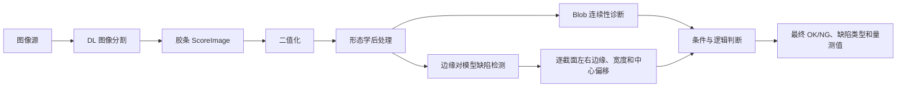

# VisionMaster 4.4 纯 VM 胶条检测主线

> 优先级：P0，优先于外部 Python 部署适配器
> 软件：VisionMaster 4.4、VisionTrain 2.3
> 运行边界：模型推理、掩膜后处理、边缘对量测和结果判定全部在 VisionMaster 内完成
> Python 定位：作为离线对照基准，不作为量产主线依赖
> 当前状态：首轮方案已运行；等待 M06 逐类统计、气泡专项统计和真实数据验收

需要从空方案开始逐项拖拽、连接和配置时，直接按
[VisionMaster 拖拽端到端 SOP](visionmaster-dragdrop-end-to-end.md) 执行。

当前可运行方案、VM 440 CPU 模型和 M06 配套数据归档在
[M06 首轮部署包](../../deployment/visionmaster/glue_m06_inspection_v1/README.md)。
人工首轮运行可识别断胶、过宽、过窄和气泡，但尚无冻结指标。

## 1. “纯 VM”具体指什么

本方案中的“纯 VM”定义为：

```text
图像输入
  -> VisionMaster 深度学习分割
  -> VisionMaster 图像后处理
  -> VisionMaster 边缘对/Blob/条件检测
  -> VisionMaster 输出 OK/NG 和量测值
```

运行时不启动外部 Python 进程，不依赖自研 C++/C# 检测程序。

VisionTrain 仍然负责离线训练模型。训练完成后把模型导入 VisionMaster，
这不影响“运行时纯 VM”。

VisionMaster 内置的 `Python脚本` 模块如果可用，可以作为 VM 方案内部的
统计组件使用；它不是外部 Python 服务。

## 2. 纯 VM 的目标输出

纯 VM 方案最终需要至少输出：

```text
胶条掩膜
每个横截面的左右边缘点
每个横截面的宽度
逐截面中心点或中心偏移
断胶状态
过窄状态
过宽状态
宽窄不一致状态
弯曲或轨迹偏移状态
最终 OK/NG
```

模型本身仍然只做 `background/glue` 像素分割，不直接输出缺陷类别。

## 3. 为什么不能只用一个固定矩形

你的最终目标是让扫描矩形随胶条方向变化。纯 VM 有两个可落地层次：

| 方案 | VM 模块 | 适用情况 | 限制 |
|---|---|---|---|
| V1：长旋转 ROI 多卡尺 | `边缘对位置趋势分析` | 胶路基本直线、轻微弯曲 | 一个旋转矩形只有一个整体角度 |
| V2：边缘对轨迹模型 | `边缘对模型缺陷检测` | 固定工位、固定但可能弯曲的胶路 | 需要示教标准轨迹 |

V2 更接近“扫描矩形随胶条走”。它在示教轨迹上布置多个卡尺，每个卡尺沿轨迹局部
法向寻找左右边缘，因此比只用一个固定角度矩形更适合弯曲胶路。

如果胶路是完全任意、每条工件都不同且没有示教轨迹，普通 VM 模块不能保证自动
沿任意骨架生成动态矩形。这种情况需要 VM 自定义模块、脚本模块或外部算法。
不能把“一个长旋转矩形”冒充成完整的动态曲线跟随。

## 4. 推荐纯 VM 架构



### 4.1 主量测模块

优先使用：

```text
边缘对模型缺陷检测
```

它能直接在示教胶路轨迹上完成：

- 左右边缘对查找；
- 局部宽度；
- 中心位置；
- 宽度缺陷；
- 位置偏移缺陷；
- 断裂缺陷。

### 4.2 直线简化模块

胶路接近直线时，可先用：

```text
边缘对位置趋势分析
```

在一个长旋转矩形内部生成多个卡尺。它适合先快速验证模型掩膜和边缘质量，
但不能代替完整曲线轨迹模型。

## 5. 第一阶段：只验证 DL 分割

先不要接边缘对模块。按照
[VisionMaster 部署流程](visionmaster-deployment-sop.md) 完成：

1. 图像源读取 1440×1080 图像；
2. 添加 `DL图像分割`；
3. 加载 VM 440 模型；
4. 确认类别为 `background/glue`；
5. 确认 CPU/GPU 与模型导出平台一致；
6. 第一轮关闭 ROI、缩放和裁剪；
7. 查看胶条 ScoreImage 或类别图。

通过条件：

- 正常胶条连续；
- 断口保持空白；
- 纯背景不出现大面积胶条；
- 窄胶、宽胶、弯曲胶条仍能完整分割；
- 原图与输出掩膜尺寸一致。

模型这一步不通过，后面的边缘对和缺陷判断都没有意义。

## 6. 第二阶段：生成纯 VM 胶条掩膜

### 6.1 判断 DL 输出类型

先检查 DL 模块输出的是：

- `glue` 概率/评分图；
- 类别索引图；
- 已经二值化的类别图。

概率图才可按 `0.5` 初始阈值二值化。类别索引图不能直接使用 Otsu。

### 6.2 图像后处理

推荐链路：

```text
DL 胶条评分图
  -> 图像二值化
  -> 形态学处理
  -> 胶条二值掩膜
```

Python 主线当前默认参数：

```text
二值化阈值：0.5
形态学核：5×5
处理顺序：先开后闭
```

VM 初始值也应使用同一组参数。后续可以通过合成测试图核对两边掩膜差异，
但真实参数必须由真实图像确认。

必须防止：

- 闭运算填平真实断口；
- 大核抹掉窄胶；
- 阈值过低导致背景被识别成胶；
- 阈值过高导致弯曲段断开。

## 7. V1：先用长旋转 ROI 验证多卡尺

### 7.1 适用前提

适合：

- 胶路近似直线；
- 轻微倾斜；
- 弯曲幅度很小；
- 只想先验证宽度趋势和边缘点。

不适合：

- 明显弧线；
- S 形胶路；
- 大角度转弯；
- 每个工件胶路位置变化很大。

### 7.2 添加模块

在逻辑或缺陷检测模块库中查找：

```text
边缘对位置趋势分析
```

将形态学后的胶条二值掩膜连接到模块图像输入。

### 7.3 放置旋转矩形

1. ROI 选择旋转矩形。
2. 长边沿胶条整体方向。
3. 短边横跨整条胶条，并在左右各留余量。
4. 每个卡尺箭头近似垂直于胶条。
5. ROI 起点和终点覆盖完整检测区域。

示意：

```text
长边沿胶路
┌────────────────────────────────────┐
│  |    |    |    |    |    |    |   │
│  v    v    v    v    v    v    v   │
│  每个卡尺沿法向穿过胶条            │
└────────────────────────────────────┘
```

### 7.4 初始参数

| 参数 | 联调初值 | 说明 |
|---|---:|---|
| 卡尺数量 | 20 | 根据胶路长度调整 |
| 卡尺宽度 | 3～5 px | 不要大幅平滑局部窄点 |
| 边缘阈值 | 15 起 | 以实际图像调整 |
| 边缘极性 | 先任意，再固定 | 二值胶条通常黑到白、白到黑 |
| 距离上下限 | 先放宽 | 不能在测量前把窄胶或宽胶筛掉 |
| 中心点输出 | 开启 | 用于检查实际中心轨迹 |

表中的数值只是联调起点，不是工艺验收阈值。

### 7.5 检查结果

至少查看：

- 卡尺数量；
- 有效边缘对数量；
- 每段宽度数组；
- 左右边缘点 X/Y 数组；
- 每段中心点；
- 边缘搜索状态数组。

V1 通过条件：

- 正常胶条大多数卡尺都有完整边缘对；
- 窄胶的宽度数组存在低值；
- 宽胶的宽度数组存在高值；
- 弯曲胶条的中心点确实沿曲线变化。

V1 通过仍不代表曲线跟随已经完成，只代表边缘对和宽度测量链路可用。

## 8. V2：纯 VM 主方案，建立边缘对轨迹模型

### 8.1 模型含义

这里有两个不同的“模型”：

| 模型 | 训练/建立方式 | 作用 |
|---|---|---|
| 深度学习分割模型 | VisionTrain | 找胶条像素 |
| 边缘对轨迹模型 | VisionMaster 示教 | 规定沿哪条胶路布置卡尺 |

不要把两者混为一谈。

### 8.2 添加模块

添加：

```text
边缘对模型缺陷检测
```

输入图像优先使用形态学后的胶条二值掩膜，使边缘定义与当前算法主线一致。
如果后续证明原图边缘更稳定，可以同时保留原图输入做对照，但不能在未记录的
情况下切换输入源。

### 8.3 选择标准好品

选择一张满足以下条件的正常胶条图：

- 工件位置和实际生产一致；
- 胶条完整；
- 断口、宽窄异常和明显弯曲都不存在；
- 掩膜边缘稳定；
- 相机参数与量产设置一致。

标准好品只用于建立轨迹，不用于计算最终精度指标。

### 8.4 生成轨迹

1. 在轨迹起点附近绘制起始范围。
2. 单击生成轨迹。
3. 检查是否生成左右两条边缘轨迹。
4. 确认两条轨迹包住胶条。
5. 确认轨迹沿实际涂胶路径，而不是一条横穿胶条的直线。
6. 对弯曲段重点检查局部法向卡尺。

轨迹不合理时，先调整起始范围和标准好品，不要先调缺陷阈值。

### 8.5 初始运行参数

| 参数 | 初始策略 |
|---|---|
| 边缘查找类型 | 最接近边缘对或最强最接近边缘对 |
| 卡尺宽度 | 3～5 px |
| 卡尺高度 | 覆盖胶宽并留安全余量 |
| 理想宽度 | 用正常胶条实际测量值 |
| 边缘极性 | 根据二值掩膜方向固定 |
| 中心点使能 | 开启 |
| 宽度缺陷使能 | 开启 |
| 位置缺陷使能 | 开启 |
| 断裂缺陷使能 | 开启 |
| 阶梯缺陷使能 | 第一阶段关闭 |
| 气泡缺陷使能 | 首轮方案中已观察到响应；需用独立气泡冻结集确认 |

宽度合格比例、位置偏移和断裂阈值在联调初期应足够宽，只用于确认输出。
正式值必须来自工艺规范和真实样本分布，不能从合成图直接照搬。

## 9. 缺陷如何映射

VisionMaster 旧版实测资料记录过以下缺陷类型：

| 值 | 类型 |
|---:|---|
| 1 | 边缘对宽度缺陷 |
| 2 | 边缘对位置偏移 |
| 3 | 边缘对阶梯缺陷 |
| 4 | 边缘对断裂缺陷 |
| 5 | 边缘对气泡缺陷 |

当前 4.4 环境的实际枚举名和值必须在模块结果区重新确认，不能只按数字硬编码。

### 9.1 断胶

同时观察两条证据：

1. `边缘对模型缺陷检测` 的断裂缺陷；
2. `Blob分析` 的胶条连通域数量。

正常单条胶路通常应为一个主要连通域；断口通常会出现两个或多个主要连通域。

但 Blob 数量不能单独作为最终规则，因为：

- 分割噪点会产生伪 Blob；
- 闭运算可能把断口填平；
- 实际工件可能本来就有多条胶路；
- 弯曲和交叉处可能形成复杂连通关系。

### 9.2 过窄和过宽

优先从边缘对模型的局部宽度结果判断，而不是只看平均宽度。

```text
任一局部宽度 < 下限 -> 过窄
任一局部宽度 > 上限 -> 过宽
```

平均宽度正常但局部最小宽度超限，仍应判不合格。

### 9.3 宽窄不一致

使用同一胶路上的宽度序列计算：

```text
width_range = max(width) - min(width)
width_std = std(width)
```

如果 VM 原生结果没有标准差：

- 优先使用 VM 内置统计/脚本模块；
- 或把边缘点数组送入 VM 内置 `Python脚本`；
- 不在每个条件模块里重复手算。

### 9.4 弯曲和轨迹偏移

优先使用边缘对轨迹模型的“位置偏移缺陷”。

需要区分：

| 指标 | 含义 |
|---|---|
| 自身直线拟合残差 | 胶条自身是否弯 |
| 相对示教轨迹偏移 | 胶条是否偏离规定涂胶路线 |

对本来就应该弯曲的固定胶路，应使用示教轨迹，不能把整条曲线强制拟合成直线。

## 10. VM 内置统计脚本

如果 `边缘对模型缺陷检测` 或 `边缘对位置趋势分析` 不能直接输出：

- 最小宽度；
- 最大宽度；
- 宽度极差；
- 宽度标准差；
- 有效截面比例；
- 相对示教轨迹最大偏移；

可增加 VM 内置 `Python脚本` 模块。

输入变量优先订阅实际结果端口：

```text
左边缘点 X/Y 数组
右边缘点 X/Y 数组
宽度数组
边缘搜索状态数组
计划卡尺数量
位置偏移数组
断裂状态
```

脚本只计算统计量，不写死工艺阈值。判定交给后序 `条件检测` 和 `逻辑` 模块。

必须遵守：

- 无有效边缘时不得返回 OK；
- 有效截面太少时结果标记为复判/NG；
- 空数组、NaN 和 0 宽度必须过滤；
- 脚本输出字段名固定并记录版本；
- 脚本源码纳入仓库或方案导出记录。

## 11. 条件检测和最终逻辑

建议至少建立以下条件：

| 条件 | 输入 | 结果 |
|---|---|---|
| 模型有效 | 模型加载、输入尺寸、类别正常 | 失败则 NG |
| 掩膜有效 | 前景比例、主要 Blob | 空掩膜不得 OK |
| 测量有效 | 有效卡尺数、有效比例 | 过低则复判/NG |
| 无断胶 | 断裂缺陷和 Blob 证据 | 任一有效断裂则 NG |
| 无过窄 | 局部最小宽度 | 低于下限则 NG |
| 无过宽 | 局部最大宽度 | 高于上限则 NG |
| 宽度稳定 | 宽度极差、标准差 | 超限则 NG |
| 轨迹合格 | 位置偏移缺陷或标准轨迹偏差 | 超限则 NG |

最终逻辑：

```text
模型有效
AND 掩膜有效
AND 测量有效
AND 无断胶
AND 无过窄
AND 无过宽
AND 宽度稳定
AND 轨迹合格
= OK
```

任何一项无效都必须进入 NG 或待复判，不能默认 OK。

## 12. 像素和毫米

当前 VM 初始闭环可以输出像素值，但正式合格线需要毫米尺度。

必须完成：

1. 相机固定；
2. 棋盘格标定；
3. 工作平面映射；
4. 已知宽度试件验证；
5. 中心、边缘和四角误差检查。

如果 VM 标定模块能直接给出物理尺度，则把校准后的宽度用于阈值。

如果没有标定：

- 输出字段标记 `uncalibrated`；
- 阈值只能使用像素调试值；
- 不得把像素宽度写入正式毫米指标；
- 不得声称完成真实尺寸验收。

## 13. 测试场景

纯 VM 方案必须逐类验证：

| 场景 | 重点结果 |
|---|---|
| 正常胶条 | 所有主要卡尺有效，无缺陷 |
| 断胶 | 断裂缺陷命中，有效卡尺在断口处减少 |
| 局部过窄 | 局部最小宽度下降 |
| 局部过宽 | 局部最大宽度上升 |
| 宽窄不一致 | 宽度极差/标准差上升 |
| 弯曲 | 示教曲线路径上的卡尺仍保持法向 |
| 整体偏移 | 位置偏移缺陷命中 |
| 气泡 | 气泡缺陷或对应局部异常有响应，边界和误报需独立统计 |
| 纯背景 | 模型空掩膜，测量无效并 NG/复判 |

上述行为必须在冻结测试集上检查。合成测试只能证明流程能跑通。

## 14. 与 Python 主线的对照

纯 VM 成为运行主线后，Python 主线仍保留两个用途：

1. 作为离线结果对照；
2. 在 VM 曲线轨迹方案无法覆盖复杂胶路时，作为后备算法。

对照时要求同一张图、同一模型、同一阈值、同一形态学核：

| 对照项 | 允许差异来源 |
|---|---|
| 胶条掩膜 | VM 阈值和形态学实现差异 |
| 卡尺位置 | VM 示教轨迹与 Python 骨架不同 |
| 左右边缘点 | 输入源、边缘算法和参数不同 |
| 宽度 | 检查是否需要重采样或坐标修正 |
| 断胶位置 | 边缘对断裂与扫描窗缺失的定义差异 |
| 最终判定 | 业务阈值必须完全一致 |

第一轮不要求每个卡尺坐标完全一致，但必须解释差异。相同输入下如果一个判 OK、
另一个判 NG，应先查阈值和坐标，再判断算法优劣。

## 15. 开发顺序

### 阶段 0：模型单图闭环

- [ ] VisionMaster 加载 VM 440 模型；
- [ ] 输出 `background/glue`；
- [ ] 正常、断胶、纯背景测试通过；
- [ ] 原图和输出坐标一致。

### 阶段 1：掩膜后处理

- [ ] 概率图二值化方向正确；
- [ ] 5×5 先开后闭；
- [ ] 断口没有被补平；
- [ ] 窄胶没有消失。

### 阶段 2：V1 长 ROI 多卡尺

- [ ] 一个旋转矩形内生成多个卡尺；
- [ ] 正常胶条大多数卡尺有效；
- [ ] 窄胶和宽胶的宽度数组有对应变化；
- [ ] 弯曲图可以观察到中心点趋势。

### 阶段 3：V2 边缘对轨迹模型

- [ ] 标准好品轨迹包住胶条；
- [ ] 弯曲段卡尺保持局部法向；
- [ ] 正常图无缺陷；
- [ ] 断胶、局部宽窄和轨迹偏移有响应。

### 阶段 4：条件与输出

- [ ] 有效测量条件已接入；
- [ ] 无断胶条件已接入；
- [ ] 过窄、过宽条件分别接入；
- [ ] 宽度稳定条件接入；
- [ ] 轨迹偏移条件接入；
- [ ] 最终结果只有真实计算值，没有固定占位值。

### 阶段 5：真实相机和标定

- [ ] 相机参数冻结；
- [ ] 完成标定；
- [ ] 完成毫米验证；
- [ ] 建立真实冻结测试集；
- [ ] 记录 p50/p95 耗时；
- [ ] 完成误报和漏报统计。

## 16. 当前阻塞项

1. M06 100 张合成验证图尚未形成逐类命中、漏报和误报统计；
2. 当前 100 张数据集没有独立气泡类别，气泡判定仍需专项测试集；
3. 真实几何尺度尚未完成相机标定；
4. 工艺上下限尚未给出真实值；
5. 真实产线节拍、误报率和漏报率尚未实测。

这份流程不使用推测指标。模型测试结果、VM 运行结果和真实缺陷统计必须在执行后
填写。

## 17. 相关文档

- [VisionTrain 训练 SOP](visiontrain-training-sop.md)
- [VisionMaster 通用部署流程](visionmaster-deployment-sop.md)
- [旋转扫描矩形量测](scanline-measurement.md)
- [接口契约](interfaces.md)
- [单相机标定计划](calibration-plan.md)
