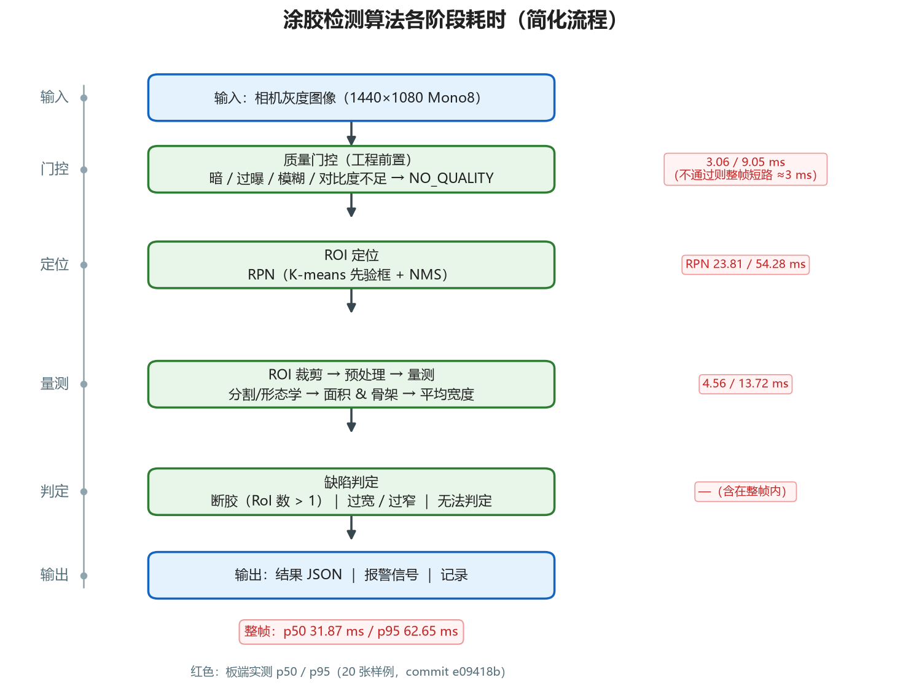
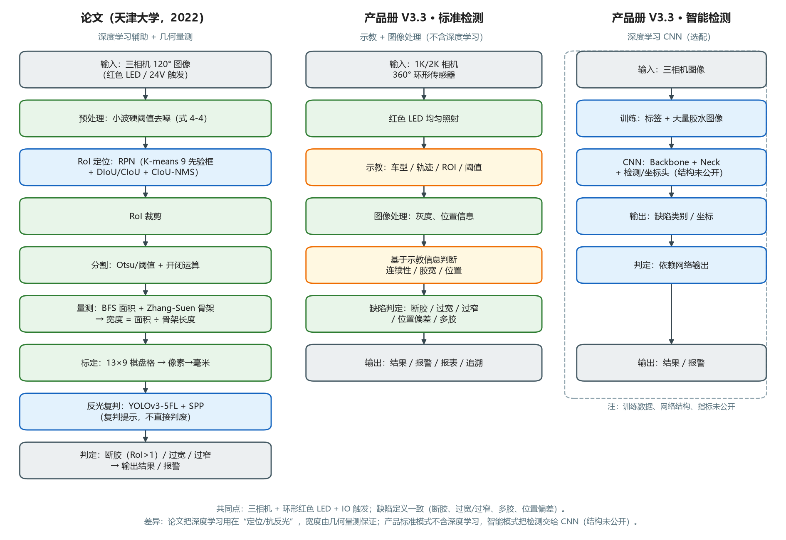

# 相机接入与 ROI 推理验证 —— 项目进度报告

> 日期：2026-11-22 ｜ 板端环境：Ubuntu 22.04 / Qualcomm QCS8550 aarch64（广翼智联 FV04） ｜ 基线：`feat/host-app` @ `e09418b`

## 一、本阶段工作

完成三件事：**相机接入软件**、**RPN 推理接入 ROI 定位**、**板端分阶段耗时统计**。

## 二、完成情况

| 工作项 | 状态 | 结果 |
| --- | --- | --- |
| 相机接入 | ✅ 完成 | 海康 MV-CB016-10UM-S（USB3 Vision，Mono8）通过 MVS SDK 接入软件 |
| 图像采集 | ✅ 完成 | 1440×1080 灰度连续采集，软件可实时消费并逐帧检测 |
| ROI 推理接入 | ✅ 完成 | RPN（ONNX）接入定位环节，20 张样例判定结果与启发式一致 |
| 耗时统计 | ✅ 完成 | 质量门控 / 定位 / 量测 / 整帧 的 p50、p95 |
| NPU 推理 | ⏳ 待做 | 需 Qualcomm SNPE/QNN 或 AidLite 工具链（x86 Linux 转换） |
| 反光复判 | ⏳ 待做 | YOLO 反光权重尚未训练 |

## 三、相机接入

| 项目 | 结果 |
| --- | --- |
| 相机 | 海康 MV-CB016-10UM-S，USB3 Vision 接口，1.6MP 黑白 |
| SDK | MVS V5.0.1（Linux aarch64） |
| 采集 | 1440×1080 Mono8，连续采集 |
| 软件侧 | `glue-agent --camera` 连续消费帧并输出 JSONL；GUI 相机页实时预览 + 逐帧判定 |

## 四、ROI 推理接入

| 项目 | 结果 |
| --- | --- |
| 接入方式 | RPN 输出 RoI → 裁剪 → 量测 → 判定（原启发式定位可切换） |
| 板端运行 | CPU（ONNX）推理，随软件统一构建 |
| 验证结果 | 20 张样例中 12 帧由 RPN 产出 RoI；判定分布与启发式完全一致 |
| 示例 | 正常样例 ROI 覆盖胶条区域，宽度 10.00 mm，判定 OK |

> 当前权重为合成数据训练的演示权重，用于验证"链路已通"；真实相机画面下的精度需用真实数据重新训练后评估。

## 五、算法耗时

| 阶段 | p50 / p95（ms） |
| --- | --- |
| 质量门控 | 3.06 / 9.05（不通过时整帧短路，约 3 ms） |
| ROI 定位（RPN） | 23.81 / 54.28 |
| 裁剪 + 预处理 + 量测 | 4.56 / 13.72 |
| 整帧 | 31.87 / 62.65 |

口径：p50 为中位数（典型情况），p95 表示 95% 的帧在该时间内完成（反映尾部抖动）。

## 六、算法完成进度

> 口径沿用上次汇报（P0–P5 + 软件端），百分比按本次实际完成情况更新；任务数来自 `docs/algo/tasks.md`。

**任务完成度：30 / 41**（未完成：A-06、B-05/06/11/12、D-05、E-01~04、E-08）

| 阶段 | 进度 | 说明 |
| --- | --- | --- |
| P0 规范与口径 | 100% | 指标定义、数据规范、接口契约、假设登记 |
| P1 量测链路 | 90% | 实现与测试完成；真实数据验证未做 |
| P2 判定与集成 | 85% | 判定/流水线完成；本次补充分段耗时统计 |
| P3 RoI 定位（RPN） | 70% | 合成数据可收敛（IoU 0.978，冒烟值，非论文指标）；真实数据与消融未做 |
| P4 反光检测（YOLO） | 55% | 结构/训练脚本完成，合成小目标未收敛 |
| P5 对标与报告 | 30% | 本次新增 ONNX 导出报告、NPU 可行性验证、演示权重与数据集 |
| S 软件端 | 85% | 相机接入、CPU 推理接入、AidLite 后端完成；PLC/IO 未接 |

**各模块状态（摘要）**

| 模块 | 状态 | 说明 |
| --- | --- | --- |
| 预处理 / 分割 / 形态学 / 标定 / 量测 / 判定 / 流水线 | ✅ 完成 | 90 项算法测试通过 |
| RPN 定位 | ✅ 合成可收敛 | 验证集平均 IoU 0.978（冒烟值） |
| ONNX 导出（RPN / YOLO） | ✅ 完成 | 与 PyTorch 最大误差 <1e-6 |
| 端侧推理接入（CPU） | ✅ 完成 | 本板实测定位 p50 23.81 ms（见第五节） |
| 相机接入（MVS） | ✅ 完成 | 1440×1080 Mono8，连续采集 + 逐帧检测 |
| AidLite 推理后端 | ✅ 完成 | 静态 ONNX，invoke 约 12.96 ms（CPU） |
| NPU 可行性 | ✅ 已验证（官方模型） | QNN248/HTP V73：2.27 ms vs CPU 172.18 ms（约 75.9×）；我们的 RPN 待 QNN `.ctx.bin` 转换 |
| 反光检测收敛 / 消融实验 / 真实数据指标 | ⏳ 未完成 | 依赖真实反光样本、真实图像与卡尺真值 |

> 说明：IoU 0.978、板端耗时等均为**合成数据/本板实测**，不是论文指标；论文指标（99% / 97% / 0.23 mm）需在真实数据上复测后才能对照。

## 七、算法对比：论文 vs 产品

- **论文**：深度学习只用于"定位（RPN）与抗反光（YOLOv3-5FL）"，宽度由几何量测保证（面积 ÷ 骨架长度 × 标定），误差可溯源；
- **产品基础检测**（P10/P13）：示教 + 图像处理 + 规则判断，不含深度学习（PDF 未用“标准检测”这一叫法）；
- **产品智能检测（选配，P11–P12）**：CNN 端到端（Backbone + Neck + 检测/坐标头），训练数据、结构与指标未公开。

本项目当前以**论文路线**为主线（几何量测 + 深度学习辅助），产品册用于需求参照（示教/配方、双报警线、报表追溯等）。

## 八、当前限制

1. 演示权重为合成数据训练，**不代表真实相机精度**；
2. NPU（Qualcomm SNPE/QNN 或 AidLite）尚未接入，需先完成模型转换与运行库部署；
3. 反光复判（YOLO）权重未训练；
4. 长时间连续运行稳定性尚未测试。
