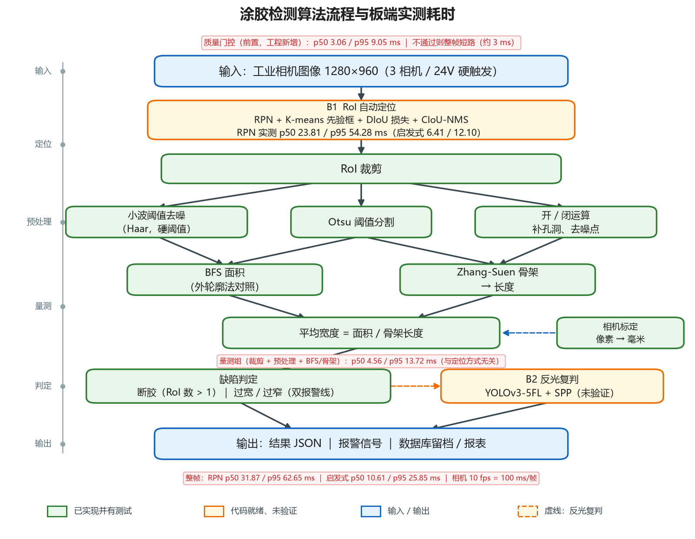

# 相机接入与 ROI 推理验证报告

> 日期：2026-11-22  
> 基线：`feat/host-app` @ `e09418b`  
> 环境：Ubuntu 22.04 / aarch64（RK3588 板端，8 核）/ rustc 1.100.0 / release 构建  
> 范围：**相机接入验证、ROI 推理接入验证、算法耗时统计**（不含模型精度评测与现场调光）

---

## 一、结论摘要

1. **相机链路已打通**：海康 MV-CB016-10UM-S（USB3 Vision）经 MVS SDK 枚举、采集 1440×1080 Mono8，
   通过 GLUE 帧协议送入 Rust 软件；`glue-agent --camera` 可连续消费帧并写 JSONL，GUI 实测 188 帧 @ 9.7 fps。
2. **ROI 推理已接入软件**：RPN（ONNX / CPU）通过 `glue-pipeline::Detectors` 注入定位环节，
   板端原生 `--features infer` 构建后生效；20 张样例中 12 帧由 RPN 产出 RoI，判定分布与启发式完全一致。
3. **耗时满足当前节拍**：RPN 使定位 p50 由 6.41 ms 增至 23.81 ms，整帧 p50 31.87 ms / p95 62.65 ms；
   相机 10 fps（100 ms/帧）有 **1.6–3 倍余量**；30 fps 需后续 NPU 方案。

---

## 二、验证范围与方法

| 项 | 说明 |
| --- | --- |
| 相机 | 海康 MV-CB016-10UM-S（USB3 Vision，Mono8），MVS V5.0.1 |
| 采集方式 | `scripts/camera_mvs.py` 调 MVS SDK，按 GLUE 协议写 stdout（`GLUE`+w/h/len+灰度），Rust `glue-camera` 读取 |
| 推理 | RPN（ONNX，tract CPU），`locate.enabled=true`，权重为仓库演示权重（合成数据训练） |
| 样例 | `outputs/rust_samples` 20 张（正常/过窄/过宽/断胶/无胶/暗/过曝/模糊） |
| 计时 | 软件内部 `Timings`（质量门控/定位/量测/总计），取 p50、p95 |
| 判定口径 | `glue-core::decide`（OK / TOO_NARROW / TOO_WIDE / BROKEN / NO_ROI / NO_QUALITY） |

---

## 三、相机接入验证

| 项 | 实测 |
| --- | --- |
| 硬件 | `2bdf:0001 Hikrobot MV-CB016-10UM-S`，SN `DB2638436` |
| SDK | MVS V5.0.1（817,467,053 B，SHA256 校验通过），Python `MvImport` 可导入 |
| 枚举 | `MV_CC_EnumDevices` rc=0，1 台设备 |
| 采集 | 1440×1080 Mono8；GLUE 协议头解析正确；10 秒采集 19 帧 |
| Rust 消费 | `glue-agent --camera` 连续消费帧并写 JSONL（帧号/判定/宽度/RoI/耗时/notes） |
| GUI | 实测 188 帧 @ 9.7 fps（相机页实时预览 + 逐帧判定） |
| 环境补充 | 补装 `libxcb-xinerama0` 后 MVS 客户端可启动（仅影响 MVS GUI 客户端，不影响 SDK 采集） |

**说明**：采集测试期间画面质量未调优，质量门控按设计判 `NO_QUALITY`（软件行为正确）；
调光/曝光属于现场调试项，本次不作为软件缺陷处理，列入后续工作。

---

## 四、ROI 推理接入验证

| 项 | 实测 |
| --- | --- |
| 架构 | `pipeline::Detectors{locate, reflect}` 注入 `dyn ObjectDetector`；`glue-infer` 提供 RPN/YOLO；RKNN 由 `rknn` feature 控制 |
| 启用方式 | agent 默认 `infer=[]` → 板端原生构建 `--features infer`（2 分 51 秒；二进制 1.5 MB → 17 MB） |
| 权重 | 从构建机拉取 `rpn.onnx` 3.78 MB，SHA256 `f85cc1e3…` |
| 证据 | 20 张样例中 **12 帧由 RPN 产出 RoI**；`0000_normal.png` → RoI `[0, 419.9, 1280, 540.1]` → 宽度 10.00 mm → `OK` |
| 一致性 | 20 张判定分布与启发式路径**完全一致** |
| 未验证 | RKNN（缺 `librknnrt.so`）、YOLO 反光复判（未启用）、相机实时帧推理（画面门控短路，`locate_ms=0`） |

**边界说明**：当前权重为**合成数据演示权重**，本次只验证"推理链路已接入并生效"，
不代表真实相机画面下的检测精度；真实数据评测需另行采集与训练。

---

## 五、算法耗时统计（板端，20 张样例）

耗时同时以红色标注在算法流程框图上（见下图）。

| 阶段 | 启发式 p50 / p95 (ms) | RPN p50 / p95 (ms) |
| --- | --- | --- |
| 质量门控 quality | 3.07 / 6.30 | 3.06 / 9.05 |
| 定位 locate | 6.41 / 12.10 | **23.81 / 54.28** |
| 量测 measure | 4.28 / 13.75 | 4.56 / 13.72 |
| **整帧 total** | **10.61 / 25.85** | **31.87 / 62.65** |



*图：算法流程框图（红色为板端实测 p50 / p95，20 张样例）。*


**关键结论**：

1. 质量门控短路最有效：6 张 NG 帧约 3.1 ms 即出结论，不进入定位/量测；
2. RPN 使定位 p50 从约 7 ms 增至约 24 ms（增量约 +17 ms）；
3. 实时余量：RPN 下 p50 ≈ 31 fps、p95 ≈ 16 fps；相机 10 fps 有 1.6–3 倍余量；
4. 量测阶段稳定在 4.3–4.6 ms，与定位方式无关；
5. 相机实时帧（门控短路）单帧 p50 5.54 ms，说明**采集/解码不是瓶颈**。

---

## 六、未验证项与已知限制

| 项 | 状态 | 说明 |
| --- | --- | --- |
| RKNN / NPU | 未验证 | 需 x86_64 Linux 转换 `.rknn` + 板端 `librknnrt.so`（MVS SDK 不含该运行库） |
| 反光复判（YOLO） | 未启用 | 反光权重尚未训练 |
| 真实相机下的 RPN 精度 | 未验证 | 演示权重为合成数据；真实画面需重新训练/微调 |
| 长时间稳定性 | 未测 | 8 小时连续采集、掉线恢复未做 |
| 画面质量调优 | 未处理 | 本次只做链路验证，曝光/光源按现场调试 |
| 三路相机 / 硬触发 | 未做 | 当前单路、软触发关闭（连续采集） |

---

## 七、复现命令（板端）

```bash
# 1) 相机采集（独立验证）
python3 scripts/camera_mvs.py --device 0 --fps 10 > /tmp/raw.bin

# 2) 相机 + 判定（无推理）
./host/target/release/glue-agent --config configs/experiments/camera-mvs.yaml \
    --camera --frames 100 --mm-per-px 0.0833 --state outputs/camera.jsonl

# 3) 相机 + RPN 推理（需先 --features infer 构建，并放置 rpn.onnx）
./host/target/release/glue-agent --config configs/experiments/camera-rpn.yaml \
    --camera --frames 100 --mm-per-px 0.0833 --state outputs/camera.jsonl

# 4) 样例推理一致性（无相机）
./host/target/release/glue-cli inspect --config configs/experiments/demo-rpn.yaml \
    --input outputs/rust_samples --mm-per-px 0.0833 --out /tmp/demo.json
```


> 本报告所有数字均来自板端实测输出（commit `e09418b`），未使用估算值；
> 合成数据演示权重相关结果已明确标注"不代表真实精度"。
