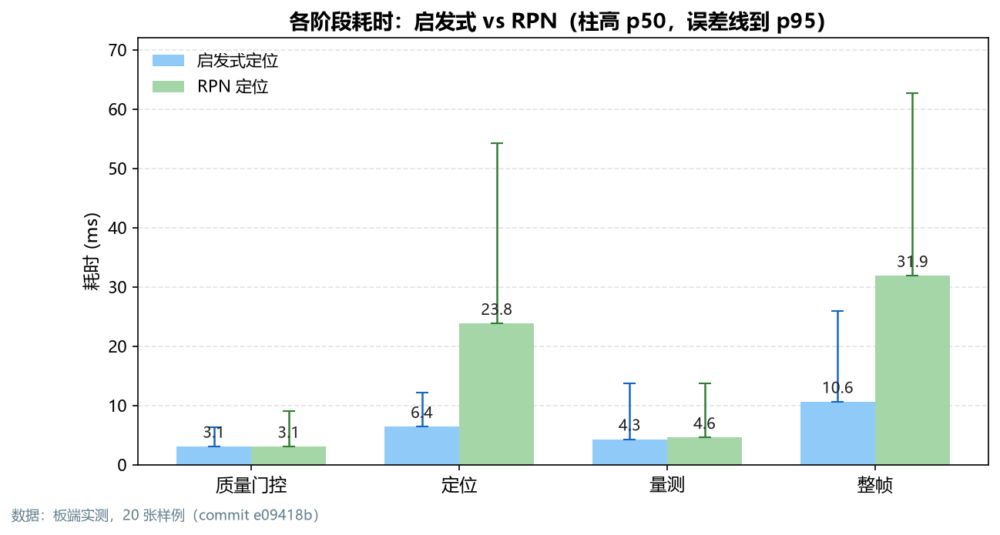

# 相机接入与 ROI 推理验证 —— 项目进度报告

> 日期：2026-11-22 ｜ 板端环境：Ubuntu 22.04 / RK3588 aarch64 ｜ 基线：`feat/host-app` @ `e09418b`

## 一、本阶段工作

完成三件事：**相机接入软件**、**RPN 推理接入 ROI 定位**、**板端分阶段耗时统计**。

## 二、完成情况

| 工作项 | 状态 | 结果 |
| --- | --- | --- |
| 相机接入 | ✅ 完成 | 海康 MV-CB016-10UM-S（USB3 Vision，Mono8）通过 MVS SDK 接入软件 |
| 图像采集 | ✅ 完成 | 1440×1080 灰度连续采集，软件可实时消费并逐帧检测 |
| ROI 推理接入 | ✅ 完成 | RPN（ONNX）接入定位环节，20 张样例判定结果与启发式一致 |
| 耗时统计 | ✅ 完成 | 质量门控 / 定位 / 量测 / 整帧 的 p50、p95 |
| NPU 推理 | ⏳ 待做 | 需 x86 Linux 环境完成 RKNN 转换 |
| 反光复判 | ⏳ 待做 | YOLO 反光权重尚未训练 |

## 三、相机接入

| 项目 | 结果 |
| --- | --- |
| 相机 | 海康 MV-CB016-10UM-S，USB3 Vision 接口，1.6MP 黑白 |
| SDK | MVS V5.0.1（Linux aarch64） |
| 采集 | 1440×1080 Mono8，连续采集 |
| 软件侧 | `glue-agent --camera` 连续消费帧并输出 JSONL；GUI 相机页实时预览 + 逐帧判定 |

## 四、ROI 推理接入

| 项目 | 结果 |
| --- | --- |
| 接入方式 | RPN 输出 RoI → 裁剪 → 量测 → 判定（原启发式定位可切换） |
| 板端运行 | CPU（ONNX）推理，随软件统一构建 |
| 验证结果 | 20 张样例中 12 帧由 RPN 产出 RoI；判定分布与启发式完全一致 |
| 示例 | 正常样例 ROI 覆盖胶条区域，宽度 10.00 mm，判定 OK |

> 当前权重为合成数据训练的演示权重，用于验证"链路已通"；真实相机画面下的精度需用真实数据重新训练后评估。

## 五、算法耗时

- RPN 接入后主要增量在**定位**（p50 6.41 → 23.81 ms，约 +17 ms）；
- 量测阶段稳定在 4.3–4.6 ms，与定位方式无关；
- 整帧 p50：启发式 10.61 ms，RPN 31.87 ms；p95 分别为 25.85 / 62.65 ms。
- 口径：p50 为中位数（典型情况），p95 表示 95% 的帧在该时间内完成（反映尾部抖动）。

## 六、当前限制

1. 演示权重为合成数据训练，**不代表真实相机精度**；
2. NPU（RKNN）尚未验证，需先完成模型转换与运行库部署；
3. 反光复判（YOLO）权重未训练；
4. 长时间连续运行稳定性尚未测试。
